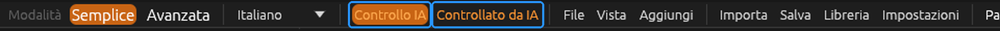
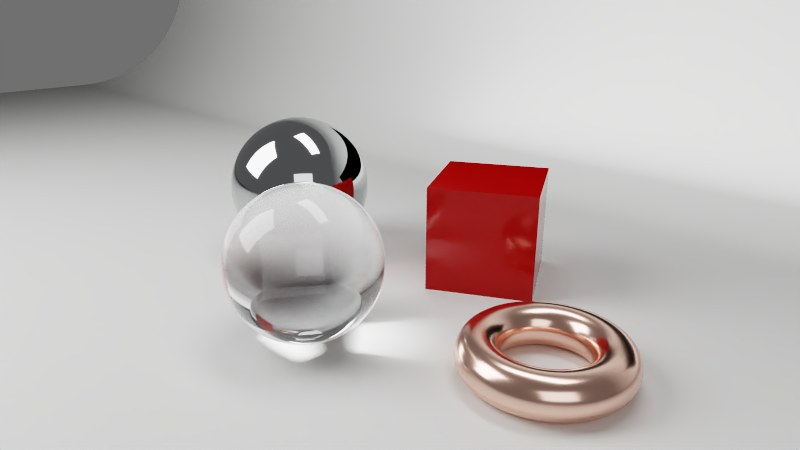

# ForgeRender

🇬🇧 [Read in English](README.md) (versione di riferimento)


**Motore di rendering fotorealistico per CAD e 3D, per Windows 11 · 64 bit.**  
Scritto in Rust, con path tracing progressivo su CPU e GPU per modelli CAD, assiemi meccanici e scene 3D.

## Scarica ForgeRender

<sub><strong>ULTIMA VERSIONE STABILE</strong> · Windows 11 · x64</sub>

[⬇️ **SCARICA L'ULTIMA VERSIONE**](https://github.com/tarabaz/ForgeRender/releases/latest)

Apri la pagina dell'ultima release per scaricare il pacchetto Windows e leggere le note di rilascio.  
Con il pacchetto ZIP portable non serve installazione: estrailo e avvia `forgerender.exe`.

[Consulta tutte le release e le versioni precedenti](https://github.com/tarabaz/ForgeRender/releases).

### Novità della versione 0.35.0

- **Stili di rendering:** fumetto (cel shading) e illustrazione tecnica (Gooch), scelti in cima alla scheda Render con un piccolo esempio al passaggio del mouse, più i contorni a inchiostro che vanno con qualsiasi stile.
- **Foschia che non vela tutto:** la modalità "solo raggi delle luci" (di serie) mostra i raggi di spot, sole e lampade senza ingrigire la scena; addensamenti, altezza massima con sbuffi, scala della densità, griglia più fitta e vortici più marcati.
- **Polvere solo nei fasci:** la illuminano solo spot e sole, il denoiser la tiene, con lo slider della brillantezza.

<details>
<summary><strong>Versioni precedenti — storico completo delle release</strong></summary>

- **0.34.0 — Foschia in cinque tipi, polvere come effetto a sé:** nebbia bassa, nuvole di gas, fumo tossico a terra, strati sospesi e riccioli di vapore con frattale e qualità; polvere visibile solo con la luce diretta; icone al posto dei simboli mancanti.
- **0.33.0 — Foschia d'ambiente, polvere, adesivi:** foschia con banchi e riccioli illuminata con diffusione multipla; granelli di polvere; adesivi sulle superfici curve; conversione STEP salvata con progetti e pacchetti; calcolo della nebbia annullabile e che riparte alle modifiche.
- **0.32.0 — Nebbia da ghiaccio secco molto più veloce:** la simulazione lavora solo dove c'è la nebbia (Ultra 182 → 37 s sulla demo del cocktail), calcolata in sottofondo con la barra di avanzamento; riflessi parziali del laser; demo del banco ottico e delle lenti; interruttore AI MCP ON/OFF.
- **0.31.0 — Pacchetto completo e libreria staccabile:** .frpack, cartella o ZIP con tutti i file; libreria dei materiali staccabile con Applica alla selezione grande; laser viola UV e blu corretto; fasci larghi tagliati sulle facce del vetro; gli aspetti tengono le tue luci; nuova schermata di benvenuto.
- **0.30.0 — Laser come luce a sé, preset che aggiungono:** laser rosso, verde, blu e bianco da laboratorio (i colorati non si scompongono); i preset delle luci aggiungono invece di sostituire; fascio visibile dentro i liquidi.
- **0.29.0 — Luce nei bicchieri con il liquido:** piega giusta vetro-liquido per il laser e le caustiche, fascio che si affievolisce nei drink colorati; nuova categoria di materiali Liquidi.
- **0.28.0–0.28.1 — Caustiche e scene demo:** caustiche con il photon mapping con tutte le luci (CPU e GPU, RGB e Spettrale); File → Scene demo divise per tipo con la scheda che le spiega; forme Prisma, Diamante e Pendente di cristallo; le scene demo salvate come progetto tengono i loro oggetti.
- **0.27.0 — Luci puntate su un oggetto, laser nel vetro:** le luci agganciate a un oggetto lo seguono e gli girano attorno; il fascio laser si vede dentro il vetro; pannello Luci scorrevole e ridimensionabile.
- **0.26.0 — Luce laser e demo "Prisma e luce":** fascio sottile seguito dalla luce attraverso vetri e specchi, macchia esatta e fascio visibile a scelta, ventaglio arcobaleno nel render Spettrale; scena demo con un prisma di vetro sul nero.
- **0.25.0 — Ray tracing hardware (RT core):** raggi tracciati dalle unità di ray tracing della scheda (Vulkan), stessa immagine, render 10–15 volte più veloci su una RTX 5070; ritorno automatico alla BVH dello shader.
- **0.24.0 — Rendering spettrale, scelta della modalità all'avvio:** modalità spettrale opzionale su CPU e GPU con dispersione nei vetri (numero di Abbe) e i predefiniti crown, flint, cristallo al piombo, policarbonato e diamante ([docs/SPECTRAL.it.md](docs/SPECTRAL.it.md)); modalità Semplice o Avanzata scelta all'avvio; materiali BlenderKit tolti dai predefiniti inclusi.
- **0.23.0 — Render più puliti di base:** il denoiser lavora al 100% e la soglia di rumore parte da 0,03.
- **0.22.0 — Viste multiple, turntable e passaggi di render:** viste frontale, posteriore, laterali, dall'alto e a tre quarti automatiche; video del prodotto in rotazione in MP4 (H.264) con rotazione e durata regolabili; passaggi albedo, normali, profondità, maschera del prodotto e ID dei componenti.
- **0.21.0 — Editor materiali ed esportazione ZIP:** modifica materiali e mappe, ruota l'anteprima in tempo reale, applica e salva le modifiche ed esporta materiali portabili in ZIP. Corretti anche i campioni di Bozza e il ridimensionamento ripetuto dei fondali.
- **0.20.0 — Scala dei materiali adattata:** le texture con proiezione Box si adattano al singolo oggetto o all'assieme; rilievo e displacement mantengono la stessa scala su CPU e GPU.
- **0.19.0 — Luci spot volumetriche:** fasci di luce visibili con densità e lunghezza regolabili, ombre coniche e risultati coerenti tra CPU e GPU.
- **0.18.0 — Integrazione IA con un clic:** configurazione e gestione del ponte MCP per Claude Desktop, Claude Code e Codex, con stato della connessione e aggiornamento sicuro delle configurazioni.
- **0.17.1 — Correzioni a viewport e camera:** riavvio automatico del render solo nella vista Render; migliorate inquadratura della camera e navigazione.
- **0.17.0 — Ancoraggio texture Box e appoggio:** scelta tra ancoraggio Pezzo, Assieme o Mondo; appoggio di più oggetti con annullamento e impilamento senza compenetrazioni.
- **0.16.0 — Correttezza di materiali e texture:** displacement Box più uniforme, coerenza CPU/GPU e importazione migliorata dei nodi Blender Displacement e Bump.
- **0.15.0 — Proiezione Box e anteprime materiali:** texture triplanari allineate agli oggetti, proiezioni più morbide sulle superfici curve, anteprime scalabili e appoggio a contatto.
- **0.14.0 — Dimensioni sugli assi dell'oggetto e GPU prioritaria:** dimensioni e scala seguono gli assi locali; anteprime GPU e miglioramenti all'interfaccia.
- **0.13.0 — Importatore materiali Blender:** analisi e importazione di materiali, mappe e valori shader supportati dai file `.blend`, senza richiedere Blender per la lettura.
- **0.12.0 — Anteprime su shader ball:** miniature e anteprime renderizzate su una scena shader-ball reale; nel pannello Materiali vengono mostrati quelli usati nella scena.
- **0.11.0 — Libreria materiali unificata:** materiali predefiniti e scaricati in un unico catalogo; aggiunti preset metallici e legno derivati da BlenderKit, soggetti alle relative restrizioni di licenza.
- **0.10.0 — Materiali predefiniti con mappe:** primi materiali con mappe per rovere, pelle nera e marmo bianco lucido.
- **0.9.0 — Ispezione componenti con IA:** strumento MCP per creare anteprime numerate dei componenti e riconoscere le parti ripetute negli assiemi CAD.
- **0.8.3 — Correzioni a render e appoggio:** risolti artefatti di auto-ombreggiatura in ortografica e migliorato l'appoggio preciso sulla base.
- **0.8.2 — Correzioni:** interventi di stabilità e rendering.
- **0.8.1 — Correzioni:** ulteriori correzioni dell'applicazione.
- **0.8.0 — Manuale e compilazione:** manuale interno, miglioramenti al processo di compilazione e correzioni.
- **0.7.0 — Revisione dell'interfaccia:** menu e barra strumenti separati, nuove funzioni, correzioni e prima fase del manuale.
- **0.6.0 — Modalità Semplice e prima configurazione:** flusso semplificato per la foto prodotto, statistiche, schermata di benvenuto, controllo IA e guide.
- **0.5.0 — Controllo IA separato:** separazione del ponte di controllo IA dal programma principale.
- **0.4.0 — Controllo tramite Claude e MCP:** prima integrazione per il controllo in linguaggio naturale e miglioramenti collegati.
- **0.3.0 — Flusso foto prodotto:** strumenti per la fotografia prodotto, viewport e camera, illuminazione e interfaccia.
- **0.2.0 — Primo flusso di lavoro e libreria:** modalità Semplice, libreria materiali, miglioramenti al render, esempi portable e strumenti di compilazione.
- **0.1.0 — Prima versione:** path tracer CPU/GPU, import CAD/3D, libreria materiali, denoiser OIDN, camera professionale, luci, nebbia volumetrica, progetti, pacchetto portable e installer.

Per le note tecniche complete consulta [CHANGELOG.md](CHANGELOG.md) (in italiano, registro ufficiale delle release).

</details>

> **Controlla ForgeRender con l'IA — MCP**
>
> Apri ForgeRender, accendi **AI MCP** e chiedi a Claude di preparare la scena, importare un modello CAD, posizionare le luci da studio, assegnare i materiali, impostare la camera e lanciare il render. 25 comandi, modifiche visibili in tempo reale e anteprime dei render restituite all'assistente. Decidi tu quando l'IA può comandare: quando si scollega, ForgeRender resta aperto con il tuo lavoro.
>
> 
>
> **[Configura Claude Code o Claude Desktop →](docs/MCP.md)** · [English guide](docs/MCP.en.md)

> Vedi [docs/ROADMAP.it.md](docs/ROADMAP.it.md) per cosa funziona davvero oggi, cosa viene dopo
> e quanto è complesso ogni passo.

## Funzionalità in evidenza

Le immagini seguenti mostrano risultati e flussi di lavoro reali di ForgeRender. Ogni sezione mette in evidenza una capacità specifica del motore.

### 1. Trasporto avanzato della luce — RGB, Spettrale e Caustiche


**Quattro configurazioni, una stessa scena.** RGB utilizza il trasporto della luce tradizionale a tre canali; la modalità Spettrale campiona le lunghezze d'onda e permette ai materiali dispersivi di separare i colori durante la rifrazione. Le Caustiche attivano il photon mapping progressivo per mostrare la luce concentrata da vetri, cristalli e gemme.

- **RGB + Caustiche OFF:** path tracing RGB senza il contributo dedicato delle caustiche.
- **RGB + Caustiche ON:** caustiche calcolate in RGB, senza separazione cromatica spettrale.
- **Spettrale + Caustiche OFF:** trasporto a lunghezze d'onda campionate; la dispersione può colorare la rifrazione.
- **Spettrale + Caustiche ON:** caustiche con frange cromatiche e separazione dello spettro, se il materiale trasparente ha dispersione non nulla.

Per ottenere una dispersione visibile serve un materiale trasparente con un numero di Abbe impostato. Un numero più basso produce una dispersione più forte. Le caustiche sono indipendenti dalla modalità RGB/Spettrale e sono supportate da luci puntiformi, spot, direzionali e ad area, su CPU e GPU. Nel backend GPU il tracciamento dei fotoni viene costruito dalla CPU e raccolto dalla GPU.

[Dettagli tecnici sul rendering spettrale](docs/SPECTRAL.it.md).

### 2. Controllo della scena tramite IA — MCP


Collega Claude Desktop, Claude Code o Codex tramite il bridge MCP di ForgeRender e controlla in linguaggio naturale le operazioni supportate sulla scena. Puoi chiedere all'assistente di modificare l'illuminazione, assegnare materiali, configurare la camera o preparare un render: ForgeRender applica le operazioni supportate direttamente alla scena aperta. Il controllo IA è esplicito e può essere disattivato dall'interfaccia.

[Guida alla configurazione MCP](docs/MCP.md).

### 3. Ottica laser — fasci, prismi e lenti


Usa ForgeRender come un banco ottico virtuale. Scegli tra sorgenti laser rosse, verdi, blu, viola UV (405 nm) e bianche da laboratorio, quindi osserva il percorso del fascio attraverso componenti ottici trasparenti.

- **Sorgenti laser:** preset dedicati rosso, verde, blu, viola UV e bianco da laboratorio.
- **Percorsi del fascio visibili:** tracciamento e visualizzazione del fascio anche all'interno di vetri e liquidi.
- **Rifrazione e riflessioni parziali:** le interfacce trasparenti possono deviare il fascio e generare rami riflessi secondari.
- **Dispersione spettrale:** con luce bianca e materiali trasparenti dispersivi, la rifrazione dipendente dalla lunghezza d'onda può separare lo spettro visibile.
- **Esperimenti con le lenti:** scena demo inclusa con lenti convergenti e divergenti.

Il percorso del laser viene tracciato in modo deterministico a partire dalla sorgente, senza affidarsi al path tracing dalla camera per intercettare casualmente un fascio sottile. Il risultato è una visualizzazione pulita e stabile.

### 4. Nebbia da ghiaccio secco — simulazione fluida e rendering volumetrico

ForgeRender genera nebbia scenografica con una simulazione fluida 3D deterministica e basata su seed. Il solver modella la discesa del gas freddo e pesante, il suo accumulo e la propagazione laterale sulle superfici, oltre agli sbuffi turbolenti che risalgono mentre la nube evolve.

- **Griglia MAC 3D:** calcolo di velocità e pressione e trasporto dei campi della nebbia.
- **Gravità e risalita:** la nube cade dall'emettitore, si raccoglie e si allarga lateralmente; il parametro *Risalita* controlla il moto verso l'alto degli sbuffi.
- **Turbolenza:** curl noise con seed, confinamento della vorticità e advezione MacCormack limitata generano vortici e filamenti preservando i dettagli.
- **Collisioni:** gli oggetti vengono voxelizzati come ostacoli solidi; la nebbia li aggira, si raccoglie nei contenitori, trabocca e si diffonde sulle superfici.
- **Rendering volumetrico:** il risultato viene trasferito in un volume di densità più dettagliato. Il path tracer usa delta tracking e scattering Henyey–Greenstein, con illuminazione e ombre volumetriche.
- **Controlli:** tempo simulato, emissione, raggio sorgente, turbolenza, risalita, dissolvenza, densità, scala dei dettagli e qualità. Il seed rende ripetibile il risultato.
- **Veloce e pronta prima del render:** ogni passo lavora solo dove c'è la nebbia (entro poche celle), non su tutta la griglia, e la pressione legge una tabella dei vicini compatta: sulla demo del cocktail la qualità Ultra è passata da circa 3 minuti a circa 37 secondi (4,9×), Molto alta da 61 s a 14,5 s (4,2×), Alta da 11,4 s a 3,7 s. La nebbia si calcola in sottofondo poco dopo l'ultima modifica, così di solito è già pronta quando premi Render, e la barra in basso ne mostra l'avanzamento (ostacoli, simulazione, dettaglio) accanto ai campioni.

È un'approssimazione fluidodinamica ispirata alla fisica, non un modello CFD termodinamico della sublimazione della CO2 o del trasferimento di calore.

[Apri la scena demo del cocktail con ghiaccio secco](samples/scene/cocktail-ghiaccio-secco/cocktail-ghiaccio-secco.frproject) · [Istruzioni e controlli](samples/scene/cocktail-ghiaccio-secco/LEGGIMI.md).

### 5. Foschia d'ambiente — cinque tipi di nebbia procedurale

Un mezzo partecipante che riempie la scena (o solo uno strato) e che ogni luce attraversa: spot, sole e lampade disegnano raggi con le ombre degli oggetti, e la luce si diffonde più volte, su CPU e GPU. Non è una texture né un blocco grigio uniforme: la densità viene da un rumore frattale a dominio distorto calcolato su una griglia 3D, quindi ha banchi, riccioli e vuoti.

- **Cinque tipi:** *Nebbia bassa* che si stende a terra e si dirada salendo; *Nuvole di gas*, aria quasi limpida con ammassi densi qua e là; *Fumo tossico a terra*, uno strato di pochi centimetri che aleggia sul pavimento raccolto in filamenti; *Strati sospesi*, veli orizzontali a quote diverse, ondulati e bucati; *Riccioli di vapore*, vortici dentro i vortici con contrasto alto.
- **Comandi del frattale:** forza dei vortici (da macchie tonde a spirali ben visibili), dettaglio frattale (1–8 ottave), ruvidità (bordi morbidi o frastagliati), grandezza e quantità dei vortici, colore e diffusione in avanti (quanto brillano i raggi in controluce).
- **Solo raggi delle luci (di serie):** la foschia aggiunge solo la luce di spot, sole e lampade diffusa nell'aria, così i raggi si vedono senza velare né scurire gli oggetti; spento, diventa un mezzo fisico che diffonde anche la luce dell'ambiente e vela la scena.
- **Comandi della forma:** addensamenti (zone grandi più dense e altre più tenui), altezza massima dal pavimento (trovato con i raggi) con qualche sbuffo che sale a caso, e la scala della densità che dice fino a che distanza ci si vede attraverso.
- **Slider di qualità:** la griglia segue sia la grandezza dei vortici sia quella della scena, da una bozza di 2 milioni di celle a 24 milioni (48 MB) per dettagli fini e bordi netti. La foschia si calcola in anticipo, un effetto alla volta, con la barra di avanzamento in basso.
- **Mai dentro gli oggetti:** i raggi che viaggiano nel vetro o nel liquido la saltano (lenti e bicchieri restano limpidi) e si toglie dall'interno pieno dei pezzi, mentre l'aria di una stanza chiusa resta velata.

### 6. Polvere in sospensione — granelli che brillano solo in un fascio

Granelli veri (qualche millimetro, fino a 150 000) sparsi nell'aria, come effetto a sé. Sono invisibili tranne dentro i fasci di spot e sole: lì brillano, come la polvere nei raggi che entrano dalla finestra di una soffitta, mentre lampadine, pannelli, ambiente e luce di rimbalzo non li illuminano. Sono segnati nelle guide del denoiser, così il denoiser li tiene invece di cancellarli come rumore. Quantità, dimensione, brillantezza e colore sono regolabili.

### 7. Adesivi (decal) — etichette e loghi su qualsiasi superficie


Applica un'immagine (un logo, un'etichetta, un PNG con trasparenza) sull'oggetto selezionato, nel punto che la camera sta guardando. L'adesivo si ricava dai triangoli dell'oggetto dentro una scatola di proiezione, quindi segue le superfici curve come bottiglie e tazze, e si sposta con l'oggetto. Le parti trasparenti del PNG lasciano vedere l'oggetto. Si regolano larghezza (l'altezza segue le proporzioni dell'immagine), rotazione, posizione sulla superficie, profondità della proiezione, ruvidità e metallicità; l'immagine viaggia con il progetto e dentro i pacchetti `.frpack`.

### 8. Materiali PBR e texture per modelli CAD


Materiali diffusi, metalli e plastiche GGX, vetro Fresnel, vetro satinato ed emissivi. Le mappe PBR includono colore base, rugosità, metallicità, normal, bump, displacement reale, occlusione ambientale e opacità. Per i modelli CAD senza UV è disponibile la proiezione Box in scala metrica, con ancoraggio a pezzo, assieme o mondo.

### 9. Studio fotografico e illuminazione


Prepara una scena prodotto con fondale e luci da studio, quindi scegli sfondo chiaro, scuro o scenografico. Le luci possono essere regolate singolarmente; la scena può essere adattata alle dimensioni del prodotto senza perdere il controllo sui componenti.

### 10. Illuminazione volumetrica e fasci visibili


Le luci spot possono generare fasci visibili con densità e lunghezza regolabili. La nebbia volumetrica è un mezzo partecipante simulato, con scattering e ombre: la luce interagisce con il volume e diventa visibile nello spazio, non soltanto sulle superfici.

Per la nebbia che riempie la scena vedi [Foschia d'ambiente](#5-foschia-dambiente--cinque-tipi-di-nebbia-procedurale), per i granelli che brillano nei fasci vedi [Polvere in sospensione](#6-polvere-in-sospensione--granelli-che-brillano-solo-in-un-fascio).

### 11. Camera, viste multiple e presentazione prodotto



Le camere di rendering offrono focale, diaframma, profondità di campo e decentramento. Le viste automatiche frontale, posteriore, laterali, superiore e a tre quarti aiutano a presentare un prodotto da più angolazioni; è possibile esportare video turntable in MP4.

### 12. Render pass e workflow di post-produzione

ForgeRender può esportare pass separati **Albedo, Normals, Depth, Product Mask e Component ID**, utili per compositing, mascherature e interventi successivi sull'immagine. Sono buffer tecnici di output, non ulteriori render beauty.

### 13. Stili di rendering — fumetto, illustrazione tecnica e contorni a inchiostro

In cima alla scheda Render scegli come si disegna l'immagine; passando sopra a ogni scelta compare un piccolo esempio.

- **Fotorealistico:** il path tracing fisico di sempre.
- **Fumetto (cel shading):** colori pieni del materiale in tre fasce nette (luce, mezz'ombra, ombra) dalle luci della scena, con le loro ombre nette e un riflesso secco sui materiali lucidi.
- **Illustrazione tecnica (Gooch):** ombreggiatura morbida da caldo in luce a freddo in ombra, senza ombre nere, così forme e volumi si leggono bene.
- **Contorni a inchiostro:** linee scure su sagome, confini tra oggetti, salti di profondità e (a scelta) spigoli vivi, tracciati con 3×3 raggi per pixel e disegnati sopra l'immagine finale, anche dopo il denoiser. Vanno con qualsiasi stile; spessore, colore e angolo degli spigoli sono regolabili.

Gli stili si applicano alla prima superficie vista dalla camera, quindi vetri e specchi riflettono e rifrangono come sempre; funzionano su CPU e GPU, anche nel render spettrale.

### 14. Modelli STEP: convertiti una volta, poi riaperti subito

Un file STEP si converte in mesh una volta sola. Il risultato resta in una cache delle conversioni e si salva accanto al progetto (`modelli-convertiti/`) e dentro i pacchetti `.frpack`, così riaprendo il progetto lo STEP non si riconverte. Sulla demo del banco ottico l'apertura è passata da 27 s a 0,2 s. Se lo STEP cambia (o cambiano i pezzi di un assieme a più file, o la qualità), si riconverte. I pacchetti ora includono anche i file dei pezzi a cui rimanda un assieme STEP a più file.


## Cosa fa oggi

- **Interfaccia Semplice / Avanzata** (selettore in alto, predefinita Semplice): "Foto prodotto in
  5 passi" con pulsanti grandi (importa, appoggia sulla base, inquadra, aspetto, materiali,
  formato 16:9 / 1:1 / 4:5 / 9:16, qualità Bozza / Bilanciata / Alta, render e salvataggio).
  La Avanzata ha tutti i controlli; le due modalità modificano gli stessi valori.
- **Studio fotografico**: scena di partenza con fondale in tela inclinato e quattro luci da
  studio; colore delle luci (calda 3200 K, neutra 5500 K, fredda 7500 K o per singola luce).
  Altri aspetti: Sfondo chiaro, Sfondo scuro, Studio scenografico. **Prepara scena prodotto** e
  **Adatta la scena al prodotto** ridimensionano fondale e luci sulle misure del prodotto;
  **Annulla preset** riporta la scena com'era. Luci e oggetti nuovi nascono vicino al prodotto.
- **Lingue**: italiano e inglese, cambio immediato di tutta l'interfaccia (in alto o in
  Impostazioni → Lingua). Le traduzioni sono file separati `lang/Lan_*.json`: se ne aggiungono
  altri copiando `Lan_eng.json`.
- **Controllo IA (MCP)**: comanda ForgeRender in linguaggio naturale tramite Claude Code o Claude Desktop, con il ponte `forgerender-mcp.exe` e l'interruttore "AI MCP" nella barra (ON/OFF, con l'ingranaggio per le impostazioni dell'integrazione AI). Consulta la [guida di configurazione MCP](docs/MCP.md) per installazione, esempi, strumenti disponibili e sicurezza.
- **Schermata di benvenuto** all'avvio con immagine (`assets/splash.png`), versione e commit;
  si chiude con "Chiudi" e si riapre da File.
- **Path tracing** su CPU (tutti i core) e su GPU (compute shader wgpu, Vulkan/DX12) con accumulo
  progressivo reale (16…1024 campioni, personalizzato o illimitato, modificabile durante il render).
  Next Event Estimation + Multiple Importance Sampling, Russian roulette, BVH SAH.
- **Denoiser**: Intel Open Image Denoise caricato a runtime, dispositivo CPU o CUDA, buffer guida
  albedo/normali, modalità solo finale o anteprima progressiva.
- **Materiali**: diffuso, metalli e plastiche GGX con compensazione multi-scattering, vetro con
  Fresnel esatto, vetro satinato, superfici emissive campionate come luci.
  Mappe PBR complete: colore base, rugosità/lucidità, metallicità, normal (OpenGL/DirectX),
  height (bump), **displacement vero**, occlusione ambientale, ritaglio con opacità; mapping UV o
  proiezione box in metri per i modelli CAD senza UV, con dimensione della ripetizione, rotazione
  e spostamento.
- **Libreria**: materiali predefiniti inclusi, più materiali e HDRI scaricati da ambientCG e
  Poly Haven o importati da cartelle/ZIP, conservati nella cartella locale `Libreria` con anteprime.
- **Luci e ambiente**: luci ad area, puntiformi, spot e direzionali, preset da studio; ambiente
  uniforme, a gradiente o HDRI (.hdr/.exr) con importance sampling. Puntiformi e spot hanno un
  **raggio d'azione** con sfumatura del bordo, indipendente dall'intensità, disegnato come una
  bolla nella viewport (CPU e GPU).
- **Nebbia volumetrica**: nebbia da ghiaccio secco procedurale (con seed, riproducibile) che
  esce da un emettitore puntiforme, cade, si deposita, si allarga e scorre attorno agli oggetti;
  resa come vero mezzo partecipante (delta tracking, fase Henyey–Greenstein, ombre nella nebbia)
  su CPU e GPU.
- **Camere**: camera orbitale della viewport più camere di rendering con obiettivo professionale:
  focale in mm, diaframma f/, profondità di campo (piano di fuoco e limiti vicino/lontano
  disegnati nella viewport), lamelle, decentramento. **Vista ortografica e isometrica** nella
  viewport (icone accanto al navigatore, tasto 5 del tastierino) e nella camera di render.
- **Import**: glTF/GLB (esportazione consigliata da SolidWorks), OBJ (con .mtl), STL, Blender
  `.blend` (tramite Blender installato); STEP con Open CASCADE e SolidWorks SLDPRT/SLDASM sono
  sperimentali. Il convertitore STEP (`forgerender-step.exe`) lo compila `Build-ForgeRender.ps1`;
  serve CMake (`winget install Kitware.CMake`).
- **Modifica**: gizmo sposta/ruota/scala con snap (anche per le luci, con le maniglie del cono
  dello spot, e per l'emettitore della nebbia), snap a contatto per oggetto, annulla/ripeti, nascondi (H), duplica, appoggio
  esatto sul pavimento, navigatore degli assi stile Blender, albero dei componenti, assegnazione
  dei materiali persistente per id stabile.
- Avvio / pausa / ripresa / stop / riavvio automatico quando la scena cambia, export PNG.
- Progetti `.frproject` (JSON versionato, salvataggio atomico, percorsi relativi).
- CLI per render senza interfaccia, benchmark e import nella libreria.

## Scaricare la versione Windows

La build su GitHub Actions **non** parte ai push: si avvia a mano da *Actions → CI → Run workflow*
(oppure si compila in locale con `Build-ForgeRender.ps1`). Nella sezione *Artifacts* del run ci
sono due pacchetti:

| Pacchetto | Contenuto |
|---|---|
| `ForgeRender-portable-x64` | zip: si estrae e si avvia `forgerender.exe`, nessuna installazione |
| `ForgeRender-setup-x64` | installer (menu Start, disinstallazione, associazione `.frproject`) |

Entrambi sono autonomi: CRT statico, solo DLL di sistema di Windows più le librerie di Open
Image Denoise incluse.

## Compilare in locale

Requisiti: Rust stable (`rustup`); su Windows i *Visual Studio Build Tools* (C++).

```
cargo test --workspace --release
cargo run --release -p forge_app            # interfaccia grafica
cargo run --release -p forge_cli -- bench   # benchmark
```

Pacchetti Windows in locale: `powershell -ExecutionPolicy Bypass -File packaging\windows\package.ps1`
(per l'installer serve [Inno Setup 6](https://jrsoftware.org/isdl.php)).

## Benchmark: comandi da lanciare

Elenco di tutte le misure che si possono fare, con a cosa serve ciascuna. I risultati veri (e i
dati grezzi) vanno in [`reports/`](reports/README.md), una cartella per esperimento; quelli già
fatti sono in [docs/BENCHMARK.md](docs/BENCHMARK.md). Regola: si riportano solo numeri misurati.

### Preparazione (una volta)

I comandi sono per PowerShell. Basta lo zip `ForgeRender-portable-x64`:
- estrailo e apri PowerShell **nella cartella estratta**;
- i progetti di benchmark sono già dentro, in `samples\scene\cocktail-ghiaccio-secco\`;
- non serve né Python né il repository.

In alternativa usa la cartella del repository con `forgerender-cli.exe` compilato da
`Build-ForgeRender.ps1`.

```powershell
cd C:\percorso\ForgeRender-portable-x64          # cartella dello zip estratto
$cli = ".\forgerender-cli.exe"                    # nel repository: ".\target\release\forgerender-cli.exe"
```

I progetti di benchmark sono derivati dalla demo del cocktail, tutti senza profondità di campo
e con la camera fissa. Se cambia la demo si rigenerano con
`reports/strumenti/crea_progetti_bench.py`, e la CI controlla che siano allineati.

Python (`py -m pip install numpy pillow`) serve solo per gli script di confronto delle immagini
in `reports/strumenti/`. Se non puoi usarlo, metti le immagini in `reports/AAAA-MM-GG_.../` e
l'analisi la fa l'agente.

| Progetto | Cosa inquadra | Seed |
|---|---|---|
| `bench_intera` | l'intera demo | 12345 |
| `bench_vicina` | ravvicinata sulla nebbia | 12345 |
| `bench_ad` | l'intera demo | dato da `--seed` |

Le righe da leggere nell'output del render sono:
- `rendering N s | M ms/passata | X Mcampioni/s`
- `geometria compilata … in N ms`
- `nebbia «…»: simulazione … in N ms`

### 1. Hardware rilevato

```powershell
& $cli info
```
**A cosa serve**: verificare CPU, thread e RAM viste dal programma. Il nome va scritto in ogni
report.

### 2. Benchmark standard (CPU, GPU, denoiser)

```powershell
& $cli bench --json bench.json
& $cli bench --spp 64 --width 1920 --height 1080 --threads 1,4,8,12,24 --json bench-1080p.json
```
**A cosa serve**:
- **CPU**: scalabilità al variare dei thread.
- **GPU**: la riga `GPU` riporta Mcampioni/s e quante volte va più veloce di 1 thread.
- **Denoiser**: OIDN su CPU e CUDA, in ms per immagine.

La scena di test è piccola (11 022 triangoli): misura la velocità pura del path tracer.
**Confronto**: la tabella del 9900X in `docs/BENCHMARK.md`. Se cambia di molto senza modifiche
al codice, cambiano driver o impostazioni di energia.

### 3. Scena reale pesante, CPU contro GPU (nebbia, vetro, texture)

```powershell
$p = "samples\scene\cocktail-ghiaccio-secco"
& $cli render --project $p\bench_intera.frproject --backend cpu --width 320 --height 400 --spp 32 --quiet --out intera_cpu.png
& $cli render --project $p\bench_intera.frproject --backend gpu --width 320 --height 400 --spp 32 --quiet --out intera_gpu.png
& $cli render --project $p\bench_vicina.frproject --backend cpu --width 320 --height 400 --spp 32 --quiet --out vicina_cpu.png
& $cli render --project $p\bench_vicina.frproject --backend gpu --width 320 --height 400 --spp 32 --quiet --out vicina_gpu.png
```
**A cosa serve**:
- Quanto rende la GPU su una scena vera, non sulla scena di test.
- Misura il **majorant 3D della nebbia** sulla RTX 5070, che nel container non si è potuto
  misurare.

**Cosa guardare**: la riga `ms/passata`. Prima del render c'è la simulazione della nebbia, che
dura qualche decina di secondi e non conta nel tempo di rendering.

**Confronto**: [report majorant](reports/2026-10-29_majorant-3d-nebbia/REPORT.md). Per
confrontarti con i numeri del container aggiungi `--threads 3` alla riga CPU. Per tempi più
stabili alza la risoluzione (es. `--width 960 --height 1200 --spp 64`).

### 4. Campionamento adattivo (conviene sulla mia scena?)

```powershell
$b = "samples\scene\cocktail-ghiaccio-secco\bench_ad.frproject"
& $cli render --project $b --backend gpu --width 320 --height 400 --spp 1024 --seed 99  --quiet --out ref.png
& $cli render --project $b --backend gpu --width 320 --height 400 --spp 1024 --seed 100 --quiet --out ref2.png
& $cli render --project $b --backend gpu --width 320 --height 400 --spp 32  --quiet --out uni32.png
& $cli render --project $b --backend gpu --width 320 --height 400 --spp 128 --quiet --out uni128.png
& $cli render --project $b --backend gpu --width 320 --height 400 --spp 1024 --noise-threshold 0.08 --quiet --out ad08.png
& $cli render --project $b --backend gpu --width 320 --height 400 --spp 1024 --noise-threshold 0.04 --quiet --out ad04.png
py reports\strumenti\confronta_immagini.py ref.png ref2.png -- uni32.png uni128.png ad08.png ad04.png
```
**A cosa serve**: capire se fermare i pixel già puliti fa risparmiare tempo a parità di
qualità.

**Cosa guardare**:
- Annota il tempo di ogni render.
- Calcola **tempo × MSE**: più è basso, meglio è. Si confronta adattivo contro uniforme.
- Con il threshold attivo il CLI stampa anche i campioni medi per pixel.

Ripeti con `--backend cpu` per confrontare i due backend.

**Diagnostica (dove vanno i campioni)**: aggiungi `--adaptive-map mappa04.png` a un render
adattivo. Scrive un PNG a 16 bit con i campioni esatti di ogni pixel e stampa la quota dei
campioni nella metà "B" usata per stimare l'errore (dovrebbe essere circa 0,5). Poi:

```powershell
py reports\strumenti\analisi_adattivo.py --rif ref.png ref2.png --mappa mappa04.png --img ad04.png --img uni128.png --csv riquadri.csv
```

Per le zone scure, medie e chiare del riferimento stampa: quota di pixel, quota di campioni,
errore di ogni immagine e differenza media con il suo errore standard.

**Confronto**: [report campionamento adattivo](reports/2026-10-29_campionamento-adattivo/REPORT.md).
Nel container, su questa scena, l'adattivo era meno efficiente.

### 5. Import e BVH di una mesh grande

```powershell
& $cli render --mesh C:\percorso\modello_grande.stl --unit mm --spp 16 --width 640 --height 360 --quiet --out mesh.png
```
**A cosa serve**: il tempo di caricamento delle scene CAD pesanti. Funziona anche con
`.step`, `.glb` e `.obj`.

**Cosa guardare**: la riga `geometria compilata: N triangoli, BVH M nodi, in T ms` e il tempo
totale prima che parta il render.

**Confronto**: toro da 1 milione di triangoli in `docs/BENCHMARK.md`.

### 6. Profilo della simulazione della nebbia

```powershell
$env:FORGE_FOG_PROFILE = "1"
& $cli render --project samples\scene\cocktail-ghiaccio-secco\bench_intera.frproject --spp 1 --width 160 --height 200 --quiet --out nebbia.png
Remove-Item Env:FORGE_FOG_PROFILE
```
**A cosa serve**: capire quanto costa ogni fase della simulazione fluida (forze, trasporto,
pressione…), per decidere dove ottimizzare.

**Cosa guardare**: le righe `nebbia «…»: simulazione … passi in N ms` e `profilo nebbia: …`.

Per cronometrare solo la nebbia a tutte le qualità (ostacoli, simulazione, dettaglio; 3
ripetizioni, mediana) e confrontare il risultato con una misura precedente (`FOG_BENCH_REF`,
differenza e massa), dal repository:

```powershell
cargo run --release -p forge_project --example fog_bench -- fog_bench 3
```

### 7. Risoluzione e campioni della scena finale

```powershell
& $cli render --project samples\scene\cocktail-ghiaccio-secco\cocktail-ghiaccio-secco.frproject --backend gpu --quiet --out finale_gpu.png
& $cli render --project samples\scene\cocktail-ghiaccio-secco\cocktail-ghiaccio-secco.frproject --backend gpu --denoise finale --cuda --quiet --out finale_gpu_dn.png
```
**A cosa serve**: il tempo reale di un'immagine finita, con le impostazioni del progetto
(risoluzione, campioni, profondità di campo), con e senza denoiser.

### 8. Test di correttezza (prima di fidarsi dei tempi)

```powershell
cargo test --release --workspace --exclude forge_step
cargo test --release -p forge_render_gpu -- --nocapture
cargo test --release -p forge_render_cpu --test portal -- --nocapture
cargo test --release -p forge_render_cpu --test adaptive -- --nocapture
```
**A cosa serve**:
- **Tutti i test**: confermano che le immagini sono giuste. Tra questi ci sono white furnace,
  luci contro il risultato analitico, nebbia, vetro, portali e adattivo.
- **Test della GPU**: sulla RTX 5070 controllano che CPU e GPU diano la stessa immagine.
- `--nocapture` stampa gli errori misurati (portali, adattivo) da confrontare con i report.

### Dove scrivere i risultati

Crea `reports/AAAA-MM-GG_argomento/` con un `REPORT.md` (macchina, commit, comandi, tabella) e i
file di output e le immagini. Poi aggiungi una riga all'indice in `reports/README.md`.

## Documentazione

- [Indice della documentazione](docs/README.it.md) — scegli la lingua e consulta le guide.

- [CHANGELOG.md](CHANGELOG.md) — novità di ogni versione e regola per i numeri di versione
- [reports/](reports/README.md) — report delle misure con dati grezzi, immagini e comandi per rifarle
- [docs/MCP.md](docs/MCP.md) — comandare ForgeRender con Claude Code (MCP): installazione,
  comandi, sicurezza
- [docs/ROADMAP.it.md](docs/ROADMAP.it.md) — stato, prossimi passi con la complessità, piani tecnici
  ([English](docs/ROADMAP.md))
- [docs/ARCHITECTURE.it.md](docs/ARCHITECTURE.it.md) — architettura, scelte tecniche e limiti noti ([English](docs/ARCHITECTURE.md))
- [docs/BENCHMARK.it.md](docs/BENCHMARK.it.md) — misure eseguite (solo dati reali; traduzione inglese da completare)
- [docs/STATO_LAVORI.md](docs/STATO_LAVORI.md) — diario dello sviluppo

## Licenza e contributi

ForgeRender è distribuito con **Apache License 2.0**. La licenza consente di
utilizzare, modificare, ridistribuire e distribuire commercialmente il progetto,
nel rispetto delle sue condizioni. I file modificati devono essere identificati
come tali e gli avvisi applicabili di copyright, licenza e attribuzione devono
essere conservati. La licenza **non** concede diritti sul nome o sul logo
ForgeRender oltre al limitato uso descrittivo previsto dalla licenza.

- [Apache License 2.0](LICENSE)
- [Avvisi di attribuzione del progetto](NOTICE)
- [Come contribuire](CONTRIBUTING.md)

Librerie, materiali, asset di esempio e altri contenuti di terze parti possono
essere soggetti a licenze separate: consulta gli avvisi allegati e
`packaging/licenses/`.
