# ForgeRender

🇬🇧 [Read in English](README.md) (versione di riferimento)

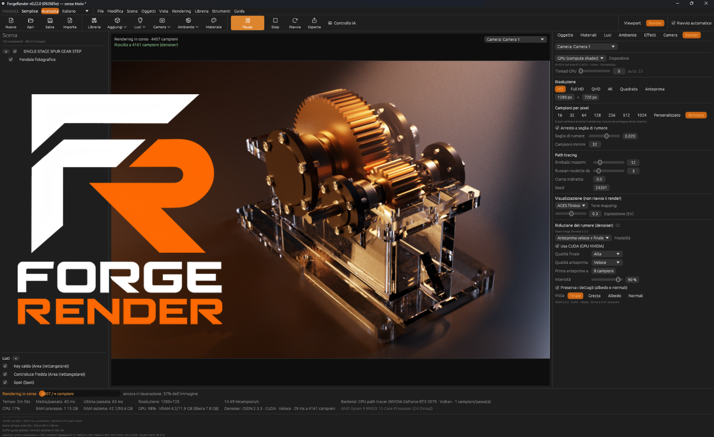

**Motore di rendering fotorealistico per CAD e 3D, per Windows 11 · 64 bit.**  
Scritto in Rust, con path tracing progressivo su CPU e GPU per modelli CAD, assiemi meccanici e scene 3D.

## Scarica ForgeRender

<sub><strong>ULTIMA VERSIONE STABILE</strong> · Windows 11 · x64</sub>

[⬇️ **SCARICA L'ULTIMA VERSIONE**](https://github.com/tarabaz/ForgeRender/releases/latest)

Apri la pagina dell'ultima release per scaricare il pacchetto Windows e leggere le note di rilascio.  
Con il pacchetto ZIP portable non serve installazione: estrailo e avvia `forgerender.exe`.

[Consulta tutte le release e le versioni precedenti](https://github.com/tarabaz/ForgeRender/releases).

### Novità della versione 0.50.0

- **Una finestra più ordinata:** in alto due righe invece di quattro. Menu a sinistra, selettore Semplice / Avanzata e Impostazioni a destra; Avvia render, Stop, Riavvia ed Esporta sempre nello stesso punto; linguette Viewport | Render subito sopra la vista.
- **Il pannello segue quello che clicchi:** il pannello di destra ha tre schede. **Selezione** mostra ciò che hai scelto (un oggetto con il suo materiale, una luce, una camera o un effetto), **Scena** raccoglie luci, ambiente, effetti, camera e materiali, **Render** le impostazioni del calcolo, con i valori da tecnico in una sezione **Avanzate** chiusa.
- **Un solo albero della scena e più spazio per l'immagine:** oggetti, luci, camere ed effetti in un unico elenco a sinistra; la timeline resta ridotta a una riga finché non c'è un'animazione; testi piccoli più grandi e leggibili e arancione tenuto per Avvia render e per ciò che è selezionato.

### Novità della versione 0.49.0

- **Un vero manuale dentro il programma:** Guida → Manuale (F1) ora spiega ogni pannello e impostazione, in inglese e in italiano, in 33 pagine e 12 capitoli, con ricerca e F1 sui controlli.
- **Vedi cosa fa davvero un cursore:** le impostazioni principali di render, materiali, luci, ambiente, camera ed effetti mostrano la stessa scena calcolata con il valore basso, medio e alto, una accanto all'altra.
- **Render fatti da ForgeRender stesso:** 56 immagini di confronto calcolate con il renderer del programma, conservate anche in `docs/manual/renders/`.

### Novità della versione 0.48.0

- **Esportazioni che proseguono in background:** riduci ForgeRender a icona e fotogrammi, codifica e file finale vanno avanti, e il PC intanto non va in sospensione.
- **Lascia il PC usabile:** scegli tra massima velocità e un carico più leggero mentre lavori ad altro.
- **Ripresa dopo un'interruzione:** un'esportazione che si è fermata continua dai fotogrammi fatti, e chiudere durante un'esportazione chiede prima.

### Novità della versione 0.47.0

- **Lucciole che illuminano davvero la scena:** uno stormo con il suo ciclo di accensione, palette e alone, con il preset Bosco incantato. Le lucciole accese sono luci vere, fermate dagli oggetti.
- **Polvere che fluttua:** i granelli si muovono lungo la timeline, reagiscono agli oggetti in movimento e alle correnti del fumo e restano coerenti tra Play, salti e render.
- **Anteprima del fumo che sente gli oggetti animati,** e griglia finale del fumo salvata su file: rifacendo il render di un'animazione viene riusata.
- **Una finestra dedicata allo STEP:** impostazioni di tassellazione, anteprima 3D del risultato e importazione solo quando confermi.

### Novità della versione 0.46.0

- **Scegli come nasce il video:** MP4, MOV, MKV o AVI, H.264, H.265, ProRes, FFV1 o non compresso, con preset dal file piccolo al senza perdita e i parametri effettivi riportati alla fine.
- **La tua barra di stato:** fino a 9 contatori su 15, tra cui gli FPS veri della viewport, i fotogrammi fatti e il tempo rimanente per fotogrammi e codifica.
- **Punta le luci nel viewport:** trascini il bersaglio di Spot e Direzionali e la sorgente resta ferma.
- **Barra superiore uniforme:** tutti i controlli con la stessa altezza e lo stesso allineamento.

### Novità della versione 0.45.0

- **Annulla per la timeline:** chiavi, modificatori, area di lavoro e tempi degli effetti si annullano un gesto alla volta, insieme all'oggetto spostato.
- **Luci e ghiaccio secco tengono l'animazione** se li rinomini o se due hanno lo stesso nome: la timeline segue un numero stabile. I progetti vecchi si convertono all'apertura.
- **Fumo che esce sempre:** una sorgente dentro un oggetto si trova subito, un fumo nuovo alza la sorgente sopra l'oggetto e con un clic lo fai su quello già sistemato.
- **Avvisi al posto delle finestre dopo i salvataggi,** con **Apri cartella**; barra della timeline su due righe nelle finestre strette, misure del render in una riga.

### Novità della versione 0.44.1

- **Correzioni da un beta test completo:** Annulla non passa più a un altro progetto, copia e incolla delle chiavi della timeline funzionano, un avviso spiega quando la sorgente del fumo è chiusa dentro un oggetto, il Play nella vista Render mostra solo fotogrammi finiti, e pannelli e barra si adattano alle finestre piccole.

### Novità della versione 0.44.0

- **Fumo calcolato una volta su tutta la timeline:** ogni fotogramma resta in file temporanei, così spostare il cursore li legge subito. Se cambia qualcosa dal secondo 5 in poi, la simulazione riparte dall'ultimo stato salvato prima di lì: quello che viene prima resta identico al bit, quindi una forma che ti piace non si perde.
- **Spostamento d'aria vero:** gli oggetti animati sono bordi in movimento nelle equazioni del fluido: spingono l'aria e il fumo, lasciando scia e vortici.
- **Inizio e fine dell'emissione:** per fumo e ghiaccio secco; dopo lo stop la sorgente è spenta, ma quello che è uscito continua a muoversi e a dissolversi.
- **Timeline in stile After Effects:** sempre attiva, una riga per posizione e rotazione, chiavi selezionate col mouse (rettangolo, Ctrl, trascinamento di gruppo, Canc, copia e incolla), barra dell'area di lavoro, salvataggio del render o di un'anteprima della viewport da viewport o da una camera, Play nella vista Render a pochi campioni.
- **Viewport fluida:** muovere gli oggetti non ricarica più la geometria: sulla GPU vanno solo le loro matrici (circa 185 fps sulla scena di prova da 100.000 triangoli).
- **Cartella Rendering:** quello che salvi o esporti finisce lì di serie.

<details>
<summary><strong>Versioni precedenti — cronologia completa</strong></summary>

- **0.43.0 — Timeline, fumo a particelle, lucciole:** chiavi con sei interpolazioni e modificatori su oggetti, luci, camera ed effetti; fumo a particelle con i preset *Vapore da tazza* e *Incenso o sigaretta*; polvere luminosa con l'alone delle lucciole; opacità degli oggetti su CPU e GPU; selettore colore sistemato e usato da ogni pulsante colore; barra rapida senza sovrapposizioni e pulsante AI MCP doppio; finestre staccate che tornano davanti.
- **0.42.0–0.42.1 — Sostituisci materiale, polvere a due colori, polvere di fata:** tutti gli oggetti con un materiale passano a un altro senza selezionarli; polvere a due colori con opacità, variazione della dimensione e scaglie che luccicano; fumo simulato solo come anteprima nella viewport; Esc deseleziona tutto.
- **0.41.0 — Fumo e nebbia calcolati una volta:** fumo e nebbia già calcolati si riusano al render se non cambia niente; la simulazione del fumo lavora solo dove c'è il fumo (fino a quattro volte più veloce nei riquadri grandi); contrasto del fumo per un fumo leggero e trasparente che tiene il rilievo.
- **0.40.0 — Fumo che non finisce sul riquadro:** bordi sfumati frattali sul fumo simulato; un riquadro che gira e si scala con la sua sorgente, crescendo solo verso l'alto; vapore da tazza simulato; anteprime dei materiali a 512 px; bianco e nero anche attraverso i vetri colorati.
- **0.39.0 — Fumo da posizionare, selettore colore:** la sorgente del fumo simulato è una sfera nella viewport, spostata con il gizmo; un'anteprima veloce a particelle mostra dove va il fumo e come si muove nel tempo, senza fare il render; le celle della simulazione seguono la sorgente, così nei riquadri grandi il fumo non si perde più; un selettore colore per ogni colore dei materiali con RGB, CMYK e palette (RAL Classic con valori indicativi compresa); il render parte subito con contorni a inchiostro e tilt-shift; sfocatura del tilt-shift continua; riflessi del fumetto solo dove una luce si riflette davvero; il manuale segue la lingua dell'interfaccia.

- **0.38.0 — Nuova libreria dei materiali di serie:** 125 materiali in 13 categorie con nomi italiani, la dispersione giusta sui trasparenti e cinque materiali con texture per categoria; materiali BlenderKit sostituiti da materiali CC0; un pacchetto aggiuntivo di 109 materiali con texture.
- **0.37.0 — Simulazione del fumo, camere come componenti, tilt-shift:** fumo simulato (calore, galleggiamento, vortici, vento, oggetti che lo deviano); camere di rendering con bersaglio, spostate e fatte orbitare con il gizmo; fascia di tilt-shift separata dalla profondità di campo; stili in bianco e nero, sfondo a tinta unita, contorni senza puntini; polvere nel suo riquadro, granelli più grandi che fanno ombra.
- **0.36.0 — Fumo volumetrico, altezza di partenza della foschia:** nubi di fumo procedurali in un riquadro spostabile con il gizmo, sei preset; foschia da un'altezza di partenza a una massima; slider più ampi.
- **0.35.0 — Stili di rendering, foschia che non vela tutto:** fumetto e illustrazione tecnica con i contorni a inchiostro; foschia in modalità "solo raggi delle luci" con addensamenti, altezza massima e sbuffi; polvere illuminata solo nei fasci e tenuta dal denoiser.
- **0.34.0 — Foschia in cinque tipi, polvere come effetto a sé:** nebbia bassa, nuvole di gas, fumo tossico a terra, strati sospesi e riccioli di vapore con frattale e qualità; polvere visibile solo con la luce diretta; icone al posto dei simboli mancanti.
- **0.33.0 — Foschia d'ambiente, polvere, adesivi:** foschia con banchi e riccioli illuminata con diffusione multipla; granelli di polvere; adesivi sulle superfici curve; conversione STEP salvata con progetti e pacchetti; calcolo della nebbia annullabile e che riparte alle modifiche.
- **0.32.0 — Nebbia da ghiaccio secco molto più veloce:** la simulazione lavora solo dove c'è la nebbia (Ultra 182 → 37 s sulla demo del cocktail), calcolata in sottofondo con la barra di avanzamento; riflessi parziali del laser; demo del banco ottico e delle lenti; interruttore AI MCP ON/OFF.
- **0.31.0 — Pacchetto completo e libreria staccabile:** .frpack, cartella o ZIP con tutti i file; libreria dei materiali staccabile con Applica alla selezione grande; laser viola UV e blu corretto; fasci larghi tagliati sulle facce del vetro; gli aspetti tengono le tue luci; nuova schermata di benvenuto.
- **0.30.0 — Laser come luce a sé, preset che aggiungono:** laser rosso, verde, blu e bianco da laboratorio (i colorati non si scompongono); i preset delle luci aggiungono invece di sostituire; fascio visibile dentro i liquidi.
- **0.29.0 — Luce nei bicchieri con il liquido:** piega giusta vetro-liquido per il laser e le caustiche, fascio che si affievolisce nei drink colorati; nuova categoria di materiali Liquidi.
- **0.28.0–0.28.1 — Caustiche e scene demo:** caustiche con il photon mapping con tutte le luci (CPU e GPU, RGB e Spettrale); File → Scene demo divise per tipo con la scheda che le spiega; forme Prisma, Diamante e Pendente di cristallo; le scene demo salvate come progetto tengono i loro oggetti.
- **0.27.0 — Luci puntate su un oggetto, laser nel vetro:** le luci agganciate a un oggetto lo seguono e gli girano attorno; il fascio laser si vede dentro il vetro; pannello Luci scorrevole e ridimensionabile.
- **0.26.0 — Luce laser e demo "Prisma e luce":** fascio sottile seguito dalla luce attraverso vetri e specchi, macchia esatta e fascio visibile a scelta, ventaglio arcobaleno nel render Spettrale; scena demo con un prisma di vetro sul nero.
- **0.25.0 — Ray tracing hardware (RT core):** raggi tracciati dalle unità di ray tracing della scheda (Vulkan), stessa immagine, render 10–15 volte più veloci su una RTX 5070; ritorno automatico alla BVH dello shader.
- **0.24.0 — Rendering spettrale, scelta della modalità all'avvio:** modalità spettrale opzionale su CPU e GPU con dispersione nei vetri (numero di Abbe) e i predefiniti crown, flint, cristallo al piombo, policarbonato e diamante ([docs/SPECTRAL.it.md](docs/SPECTRAL.it.md)); modalità Semplice o Avanzata scelta all'avvio; materiali BlenderKit tolti dai predefiniti inclusi.
- **0.23.0 — Render più puliti di base:** il denoiser lavora al 100% e la soglia di rumore parte da 0,03.
- **0.22.0 — Viste multiple, turntable e passaggi di render:** viste frontale, posteriore, laterali, dall'alto e a tre quarti automatiche; video del prodotto in rotazione in MP4 (H.264) con rotazione e durata regolabili; passaggi albedo, normali, profondità, maschera del prodotto e ID dei componenti.
- **0.21.0 — Editor materiali ed esportazione ZIP:** modifica materiali e mappe, ruota l'anteprima in tempo reale, applica e salva le modifiche ed esporta materiali portabili in ZIP. Corretti anche i campioni di Bozza e il ridimensionamento ripetuto dei fondali.
- **0.20.0 — Scala dei materiali adattata:** le texture con proiezione Box si adattano al singolo oggetto o all'assieme; rilievo e displacement mantengono la stessa scala su CPU e GPU.
- **0.19.0 — Luci spot volumetriche:** fasci di luce visibili con densità e lunghezza regolabili, ombre coniche e risultati coerenti tra CPU e GPU.
- **0.18.0 — Integrazione IA con un clic:** configurazione e gestione del ponte MCP per Claude Desktop, Claude Code e Codex, con stato della connessione e aggiornamento sicuro delle configurazioni.
- **0.17.1 — Correzioni a viewport e camera:** riavvio automatico del render solo nella vista Render; migliorate inquadratura della camera e navigazione.
- **0.17.0 — Ancoraggio texture Box e appoggio:** scelta tra ancoraggio Pezzo, Assieme o Mondo; appoggio di più oggetti con annullamento e impilamento senza compenetrazioni.
- **0.16.0 — Correttezza di materiali e texture:** displacement Box più uniforme, coerenza CPU/GPU e importazione migliorata dei nodi Blender Displacement e Bump.
- **0.15.0 — Proiezione Box e anteprime materiali:** texture triplanari allineate agli oggetti, proiezioni più morbide sulle superfici curve, anteprime scalabili e appoggio a contatto.
- **0.14.0 — Dimensioni sugli assi dell'oggetto e GPU prioritaria:** dimensioni e scala seguono gli assi locali; anteprime GPU e miglioramenti all'interfaccia.
- **0.13.0 — Importatore materiali Blender:** analisi e importazione di materiali, mappe e valori shader supportati dai file `.blend`, senza richiedere Blender per la lettura.
- **0.12.0 — Anteprime su shader ball:** miniature e anteprime renderizzate su una scena shader-ball reale; nel pannello Materiali vengono mostrati quelli usati nella scena.
- **0.11.0 — Libreria materiali unificata:** materiali predefiniti e scaricati in un unico catalogo; aggiunti preset metallici e legno derivati da BlenderKit, soggetti alle relative restrizioni di licenza.
- **0.10.0 — Materiali predefiniti con mappe:** primi materiali con mappe per rovere, pelle nera e marmo bianco lucido.
- **0.9.0 — Ispezione componenti con IA:** strumento MCP per creare anteprime numerate dei componenti e riconoscere le parti ripetute negli assiemi CAD.
- **0.8.3 — Correzioni a render e appoggio:** risolti artefatti di auto-ombreggiatura in ortografica e migliorato l'appoggio preciso sulla base.
- **0.8.2 — Correzioni:** interventi di stabilità e rendering.
- **0.8.1 — Correzioni:** ulteriori correzioni dell'applicazione.
- **0.8.0 — Manuale e compilazione:** manuale interno, miglioramenti al processo di compilazione e correzioni.
- **0.7.0 — Revisione dell'interfaccia:** menu e barra strumenti separati, nuove funzioni, correzioni e prima fase del manuale.
- **0.6.0 — Modalità Semplice e prima configurazione:** flusso semplificato per la foto prodotto, statistiche, schermata di benvenuto, controllo IA e guide.
- **0.5.0 — Controllo IA separato:** separazione del ponte di controllo IA dal programma principale.
- **0.4.0 — Controllo tramite Claude e MCP:** prima integrazione per il controllo in linguaggio naturale e miglioramenti collegati.
- **0.3.0 — Flusso foto prodotto:** strumenti per la fotografia prodotto, viewport e camera, illuminazione e interfaccia.
- **0.2.0 — Primo flusso di lavoro e libreria:** modalità Semplice, libreria materiali, miglioramenti al render, esempi portable e strumenti di compilazione.
- **0.1.0 — Prima versione:** path tracer CPU/GPU, import CAD/3D, libreria materiali, denoiser OIDN, camera professionale, luci, nebbia volumetrica, progetti, pacchetto portable e installer.

Per le note tecniche complete consulta [CHANGELOG.md](CHANGELOG.md) (in italiano, registro ufficiale delle release).

</details>

> **Controlla ForgeRender con l'IA — MCP**
>
> Apri ForgeRender, accendi **AI MCP** e chiedi a Claude di preparare la scena, importare un modello CAD, posizionare le luci da studio, assegnare i materiali, impostare la camera e lanciare il render. 25 comandi, modifiche visibili in tempo reale e anteprime dei render restituite all'assistente. Decidi tu quando l'IA può comandare: quando si scollega, ForgeRender resta aperto con il tuo lavoro.
>
> 
>
> **[Configura Claude Code o Claude Desktop →](docs/MCP.md)** · [English guide](docs/MCP.en.md)

> Vedi [docs/ROADMAP.it.md](docs/ROADMAP.it.md) per cosa funziona davvero oggi, cosa viene dopo
> e quanto è complesso ogni passo.

## Funzionalità in evidenza

Le immagini seguenti mostrano risultati e flussi di lavoro reali di ForgeRender. Ogni sezione mette in evidenza una capacità specifica del motore.

### 1. Trasporto avanzato della luce — RGB, Spettrale e Caustiche

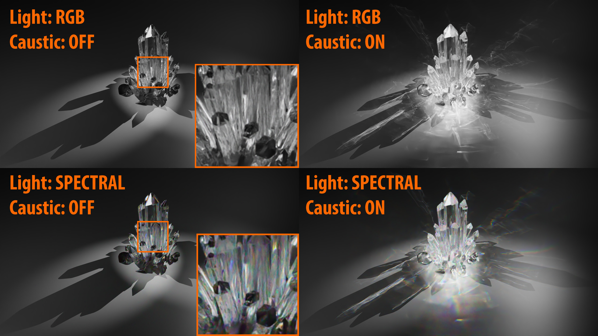

**Quattro configurazioni, una stessa scena.** RGB utilizza il trasporto della luce tradizionale a tre canali; la modalità Spettrale campiona le lunghezze d'onda e permette ai materiali dispersivi di separare i colori durante la rifrazione. Le Caustiche attivano il photon mapping progressivo per mostrare la luce concentrata da vetri, cristalli e gemme.

- **RGB + Caustiche OFF:** path tracing RGB senza il contributo dedicato delle caustiche.
- **RGB + Caustiche ON:** caustiche calcolate in RGB, senza separazione cromatica spettrale.
- **Spettrale + Caustiche OFF:** trasporto a lunghezze d'onda campionate; la dispersione può colorare la rifrazione.
- **Spettrale + Caustiche ON:** caustiche con frange cromatiche e separazione dello spettro, se il materiale trasparente ha dispersione non nulla.

Per ottenere una dispersione visibile serve un materiale trasparente con un numero di Abbe impostato. Un numero più basso produce una dispersione più forte. Le caustiche sono indipendenti dalla modalità RGB/Spettrale e sono supportate da luci puntiformi, spot, direzionali e ad area, su CPU e GPU. Nel backend GPU il tracciamento dei fotoni viene costruito dalla CPU e raccolto dalla GPU.

[Dettagli tecnici sul rendering spettrale](docs/SPECTRAL.it.md).

### 2. Controllo della scena tramite IA — MCP

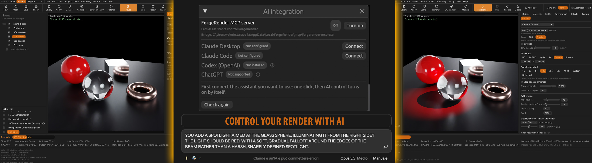

Collega Claude Desktop, Claude Code o Codex tramite il bridge MCP di ForgeRender e controlla in linguaggio naturale le operazioni supportate sulla scena. Puoi chiedere all'assistente di modificare l'illuminazione, assegnare materiali, configurare la camera o preparare un render: ForgeRender applica le operazioni supportate direttamente alla scena aperta. Il controllo IA è esplicito e può essere disattivato dall'interfaccia.

[Guida alla configurazione MCP](docs/MCP.md).

### 3. Ottica laser — fasci, prismi e lenti

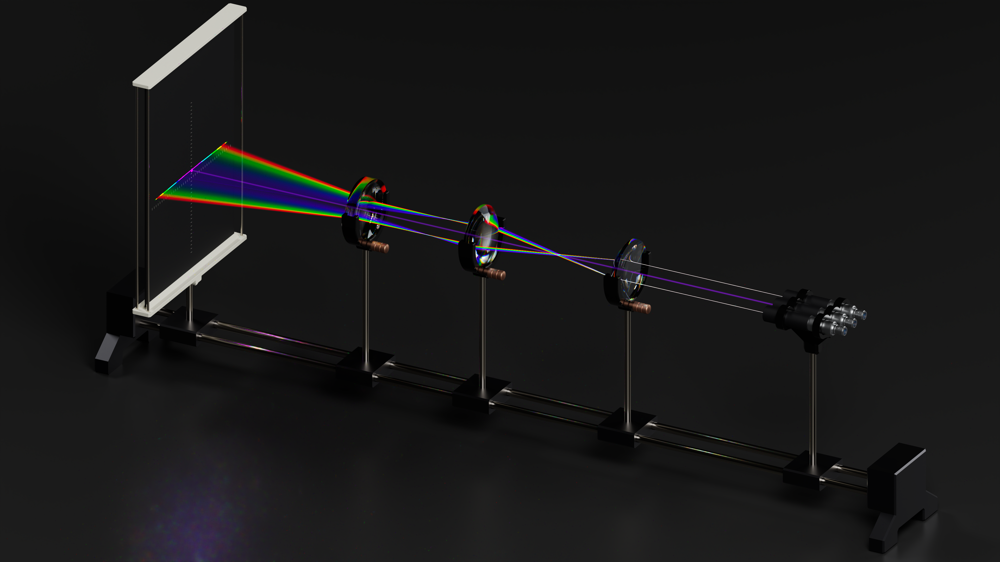

Usa ForgeRender come un banco ottico virtuale. Scegli tra sorgenti laser rosse, verdi, blu, viola UV (405 nm) e bianche da laboratorio, quindi osserva il percorso del fascio attraverso componenti ottici trasparenti.

- **Sorgenti laser:** preset dedicati rosso, verde, blu, viola UV e bianco da laboratorio.
- **Percorsi del fascio visibili:** tracciamento e visualizzazione del fascio anche all'interno di vetri e liquidi.
- **Rifrazione e riflessioni parziali:** le interfacce trasparenti possono deviare il fascio e generare rami riflessi secondari.
- **Dispersione spettrale:** con luce bianca e materiali trasparenti dispersivi, la rifrazione dipendente dalla lunghezza d'onda può separare lo spettro visibile.
- **Esperimenti con le lenti:** scena demo inclusa con lenti convergenti e divergenti.

Il percorso del laser viene tracciato in modo deterministico a partire dalla sorgente, senza affidarsi al path tracing dalla camera per intercettare casualmente un fascio sottile. Il risultato è una visualizzazione pulita e stabile.

### 4. Nebbia da ghiaccio secco — simulazione fluida e rendering volumetrico

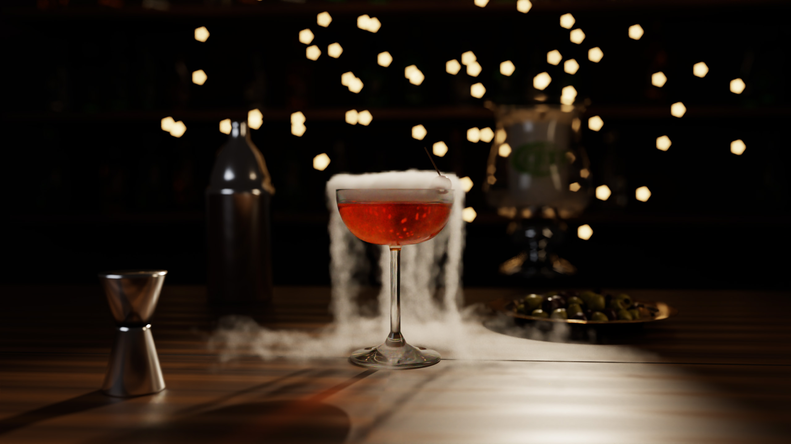

ForgeRender genera nebbia scenografica con una simulazione fluida 3D deterministica e basata su seed. Il solver modella la discesa del gas freddo e pesante, il suo accumulo e la propagazione laterale sulle superfici, oltre agli sbuffi turbolenti che risalgono mentre la nube evolve.

- **Griglia MAC 3D:** calcolo di velocità e pressione e trasporto dei campi della nebbia.
- **Gravità e risalita:** la nube cade dall'emettitore, si raccoglie e si allarga lateralmente; il parametro *Risalita* controlla il moto verso l'alto degli sbuffi.
- **Turbolenza:** curl noise con seed, confinamento della vorticità e advezione MacCormack limitata generano vortici e filamenti preservando i dettagli.
- **Collisioni:** gli oggetti vengono voxelizzati come ostacoli solidi; la nebbia li aggira, si raccoglie nei contenitori, trabocca e si diffonde sulle superfici.
- **Rendering volumetrico:** il risultato viene trasferito in un volume di densità più dettagliato. Il path tracer usa delta tracking e scattering Henyey–Greenstein, con illuminazione e ombre volumetriche.
- **Controlli:** tempo simulato, emissione, raggio sorgente, turbolenza, risalita, dissolvenza, densità, scala dei dettagli e qualità. Il seed rende ripetibile il risultato.
- **Veloce e pronta prima del render:** ogni passo lavora solo dove c'è la nebbia (entro poche celle), non su tutta la griglia, e la pressione legge una tabella dei vicini compatta: sulla demo del cocktail la qualità Ultra è passata da circa 3 minuti a circa 37 secondi (4,9×), Molto alta da 61 s a 14,5 s (4,2×), Alta da 11,4 s a 3,7 s. La nebbia si calcola in sottofondo poco dopo l'ultima modifica, così di solito è già pronta quando premi Render, e la barra in basso ne mostra l'avanzamento (ostacoli, simulazione, dettaglio) accanto ai campioni.

È un'approssimazione fluidodinamica ispirata alla fisica, non un modello CFD termodinamico della sublimazione della CO2 o del trasferimento di calore.

[Apri la scena demo del cocktail con ghiaccio secco](samples/scene/cocktail-ghiaccio-secco/cocktail-ghiaccio-secco.frproject) · [Istruzioni e controlli](samples/scene/cocktail-ghiaccio-secco/LEGGIMI.md).

### 5. Foschia d'ambiente — cinque tipi di nebbia procedurale

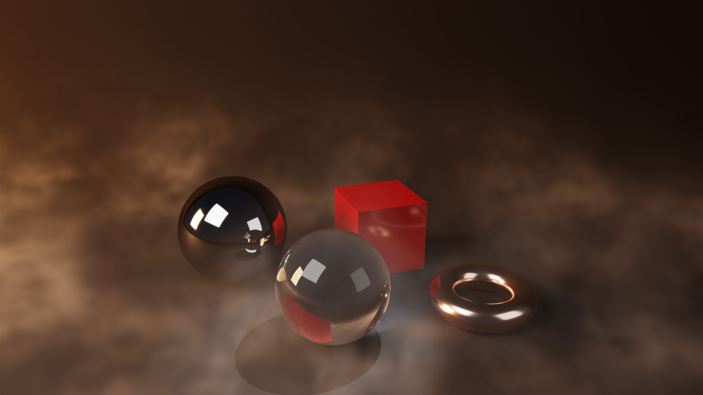

Un mezzo partecipante che riempie la scena (o solo uno strato) e che ogni luce attraversa: spot, sole e lampade disegnano raggi con le ombre degli oggetti, e la luce si diffonde più volte, su CPU e GPU. Non è una texture né un blocco grigio uniforme: la densità viene da un rumore frattale a dominio distorto calcolato su una griglia 3D, quindi ha banchi, riccioli e vuoti.

- **Cinque tipi:** *Nebbia bassa* che si stende a terra e si dirada salendo; *Nuvole di gas*, aria quasi limpida con ammassi densi qua e là; *Fumo tossico a terra*, uno strato di pochi centimetri che aleggia sul pavimento raccolto in filamenti; *Strati sospesi*, veli orizzontali a quote diverse, ondulati e bucati; *Riccioli di vapore*, vortici dentro i vortici con contrasto alto.
- **Comandi del frattale:** forza dei vortici (da macchie tonde a spirali ben visibili), dettaglio frattale (1–10 ottave), ruvidità (bordi morbidi o frastagliati), grandezza e quantità dei vortici, colore e diffusione in avanti (quanto brillano i raggi in controluce).
- **Solo raggi delle luci (di serie):** la foschia aggiunge solo la luce di spot, sole e lampade diffusa nell'aria, così i raggi si vedono senza velare né scurire gli oggetti; spento, diventa un mezzo fisico che diffonde anche la luce dell'ambiente e vela la scena.
- **Comandi della forma:** addensamenti (zone grandi più dense e altre più tenui), altezza di partenza e altezza massima dal pavimento (insieme fanno una fascia sospesa, per esempio sotto il soffitto) (trovato con i raggi) con qualche sbuffo che sale a caso, e la scala della densità che dice fino a che distanza ci si vede attraverso.
- **Slider di qualità:** la griglia segue sia la grandezza dei vortici sia quella della scena, da una bozza di 2 milioni di celle a 24 milioni (48 MB) per dettagli fini e bordi netti. La foschia si calcola in anticipo, un effetto alla volta, con la barra di avanzamento in basso.
- **Mai dentro gli oggetti:** i raggi che viaggiano nel vetro o nel liquido la saltano (lenti e bicchieri restano limpidi) e si toglie dall'interno pieno dei pezzi, mentre l'aria di una stanza chiusa resta velata.

### 6. Fumo volumetrico — nubi, pennacchi e incenso in un riquadro

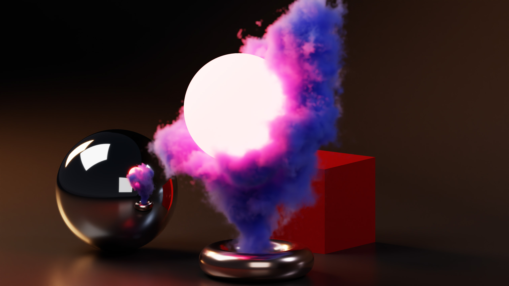

[Guarda la demo: fumo e illuminazione volumetrica](docs/video-demo-volumetrico.md)

Nubi di fumo volumetrico vere per le foto di prodotto: il fumo d'incenso accanto al flacone di profumo, il vapore che sale dalla tazza, il pennacchio da un tubo o da un camino, il fumo denso e scuro industriale. Ogni nube vive in un riquadro che selezioni nella viewport e sposti o ridimensioni con il gizmo: il fumo renderizzato segue esattamente il riquadro, senza lasciare niente dove era prima.

- **Quattro forme e sei preset:** *Nube* (un ammasso tondeggiante a mezz'aria), *Pennacchio* (stretto in fondo al riquadro, si allarga e si dissolve salendo), *Filo d'incenso* (liscio in basso, poi si rompe in riccioli) e *Banco* (riempie tutto il riquadro con i bordi sfilacciati). Preset: nube sospesa, incenso, vapore da tazza, pennacchio da tubo, fumo denso industriale e banco di fumo. Ogni preset aggiunge una nube nuova sopra la selezione, non ne sostituisce nessuna.
- **Struttura a più scale:** il contorno della forma è attorcigliato da un rumore a dominio distorto, il bordo ha sbuffi a cavolfiore (frattale di |rumore|) e filamenti sottili (creste del rumore), e l'interno ha variazioni lente della densità. Pennacchi e incenso nascono lisci e diventano turbolenti salendo.
- **Comandi:** densità con la scala "opaco oltre ~X", colore (vapore bianco, fumo grigio, fuliggine scura), controluce, grandezza dei riccioli, forza dei vortici (fino a 8), dettaglio frattale (fino a 10 ottave), ruvidità, sbuffi, filamenti, morbidezza dei bordi, variazione interna; per pennacchi e incenso anche quanto si allarga, serpeggia e si dissolve; altezza di partenza e altezza massima dentro il riquadro; qualità da 3 a 24 milioni di celle; variante (seme).
- **Fisico:** il fumo diffonde e assorbe la luce con la diffusione multipla, fa ombre volumetriche e le riceve, su CPU e GPU (lo stesso delta tracking della nebbia da ghiaccio secco). Non riempie mai l'interno pieno degli oggetti che attraversano il riquadro. Stessi parametri e stesso seme danno sempre la stessa nube.
- **Calcolato in anticipo** con gli altri effetti, uno alla volta sulla barra di avanzamento, e salvato con il progetto.

- **Modo simulato:** invece di una forma scelta, il fumo può nascere da una simulazione fisica dentro il riquadro (un fluido euleriano con temperatura e galleggiamento, come in Fedkiw, Stam e Jensen 2001): una sorgente emette fumo e calore, il fumo caldo sale, il gas pesante scende e si stende, il confinamento della vorticità tiene i riccioli, la turbolenza (curl noise) rompe la colonna in sbuffi, il vento la spinge e gli oggetti nel riquadro la deviano. La simulazione si congela all'istante scelto e sul bordo si aggiunge il dettaglio procedurale (sbuffi, filamenti). Comandi: posizione e raggio della sorgente, quantità, calore, spinta, peso, velocità di uscita, raffreddamento, dissolvenza, vortici, turbolenza e la sua grandezza, vento, istante e qualità della simulazione (da 48 a 136 celle per lato). Preset: fumo caldo simulato, gas pesante simulato e vapore da tazza (filamenti sottili che si arricciano e svaniscono, da una sorgente larga come la tazza).
- **Posizionare il fumo simulato:** la sorgente è una sfera azzurra nella viewport, grande come la sorgente vera: con un clic (o "Seleziona la sorgente") il gizmo la sposta, e Scala ne cambia il raggio. L'**anteprima in viewport** fa la stessa simulazione su una griglia grossolana in circa un secondo e la mostra come una nuvola di punti che si muove da 0 all'istante scelto, in loop o ferma su un istante qualsiasi: trovi posto, sorgente e comportamento senza fare il render, poi rifinisci con il render. Le celle della simulazione seguono la sorgente: in un riquadro grande diventano più fini (entro il limite di calcolo della qualità), così il fumo non nasce più in pochi grumi né sparisce nel pavimento, e il pannello avvisa se la sorgente resta più piccola di una cella.
- **Bordi sfumati:** il fumo simulato non riempie il riquadro per poi finire tagliato: in una fascia vicino alle pareti e al soffitto (non al fondo) si dissolve come se uscisse dal riquadro, e il bordo si sfilaccia in modo frattale, con lingue, buchi e filamenti, come il fumo vero che si dirada nell'aria. La larghezza della fascia si regola (0 = pieno fino al bordo).
- **Contrasto:** aumenta la differenza tra i grumi e le parti diradate: con densità bassa e contrasto alto il fumo è trasparente ma tiene il rilievo, i grumi restano densi e fanno ombra su sé stessi.
- **Calcolato una volta:** la simulazione lavora solo nella zona dove ci sono fumo e calore (come la nebbia da ghiaccio secco), e il render riusa il risultato finché fumo, riquadro e oggetti restano gli stessi.
- **Solo anteprima:** spegni "Calcolo vero per il render" e il fumo simulato resta come anteprima veloce a punti nella viewport (anche quando non è selezionato), con le collisioni con gli oggetti, mentre il render salta la simulazione completa. Lo sistemi, guardi come gira attorno agli oggetti, poi riaccendi il calcolo per il render vero.
- **Riquadro con la sua sorgente:** il gizmo segue il riquadro: Sposta muove riquadro e sorgente, Ruota li gira attorno alla verticale (anche con il campo "Rotazione"), Scala ingrandisce insieme riquadro, posizione e raggio della sorgente. Altezza e scala crescono solo verso l'alto, dal fondo del riquadro, così il fumo non va mai sotto il piano. L'anteprima in viewport mostra l'istante riprodotto e resta pronta quando clicchi altrove, quindi non si ricalcola mentre giri la camera.

- **Fumo a particelle (veli e filamenti):** con "Fumo a particelle" la griglia calcola solo il moto dell'aria e il fumo viaggia su circa 2,4 milioni di particelle che non si sfumano mai, depositate alla fine su una griglia due o tre volte più fitta. Il fumo tiene veli sottili che si ripiegano su sé stessi, luminosi dove li vedi di taglio, e fili lunghi e compatti, invece della nuvola gonfia del fumo sulla griglia. Con la **sorgente a chiazze** sale da pochi punti che si spostano piano, in nastri separati. Lo usano due preset: **Vapore da tazza** (nastri leggeri e trasparenti che salgono da tutta la superficie del caffè, si torcono e svaniscono in pochi centimetri) e **Incenso o sigaretta** (un filo di un paio di millimetri che sale dritto e poi si rompe in lunghi filamenti e veli che si arricciano).

- **Calcolato una volta sulla timeline:** la simulazione gira una volta su tutta la durata e lascia nella cartella temporanea un file per fotogramma e, una volta al secondo, lo stato completo. Spostare il cursore legge il file di quel fotogramma. Ogni fotogramma ha un'impronta cumulativa di quello che lo influenza fino a lì (oggetti dentro il riquadro, emissione accesa o spenta): quando cambia qualcosa, la simulazione riparte dall'ultimo stato prima del primo fotogramma diverso, e quello che viene prima resta identico al bit. In una prova 60 fotogrammi hanno richiesto 6,3 s, un altro fotogramma 1 s, e un'animazione cambiata dal secondo 1 è ripartita dal fotogramma 25.
- **Spostamento d'aria degli oggetti animati:** con l'opzione accesa (di serie) gli oggetti animati sono bordi in movimento del fluido: la velocità normale dell'aria sulla loro superficie è la loro, quindi la pressione spinge l'aria davanti e la richiama dietro, e scia e vortici nascono dal fluido stesso. Spenta, il fumo si adatta soltanto attorno all'oggetto. Vale solo per il fumo simulato: fumo procedurale e foschia non sono simulati, e i vortici più piccoli di una cella della griglia non possono comparire.
- **Inizio e fine:** sulla riga dell'effetto nella timeline scegli quando parte e quando la sorgente smette di emettere; quello che è uscito non sparisce, continua a muoversi e a dissolversi. I comandi del tempo nel pannello del fumo sono nascosti: il tempo lo decide la timeline.
- **Sorgente dentro un oggetto:** il pannello avvisa appena la sorgente finisce dentro un oggetto, anche tagliato dal riquadro, perché il fumo resterebbe chiuso lì e il render non ne mostrerebbe. Un fumo nuovo alza da solo la sorgente sopra l'oggetto; su un fumo già sistemato lo fa con un clic **Sposta la sorgente sopra l'oggetto**.

Il fuoco (combustione, emissione, fiamme che illuminano la scena) è un passo a parte, successivo: vedi lo [studio su fumo e fuoco](docs/studio-fumo-fuoco.md).

### 7. Polvere in sospensione — granelli che brillano solo in un fascio

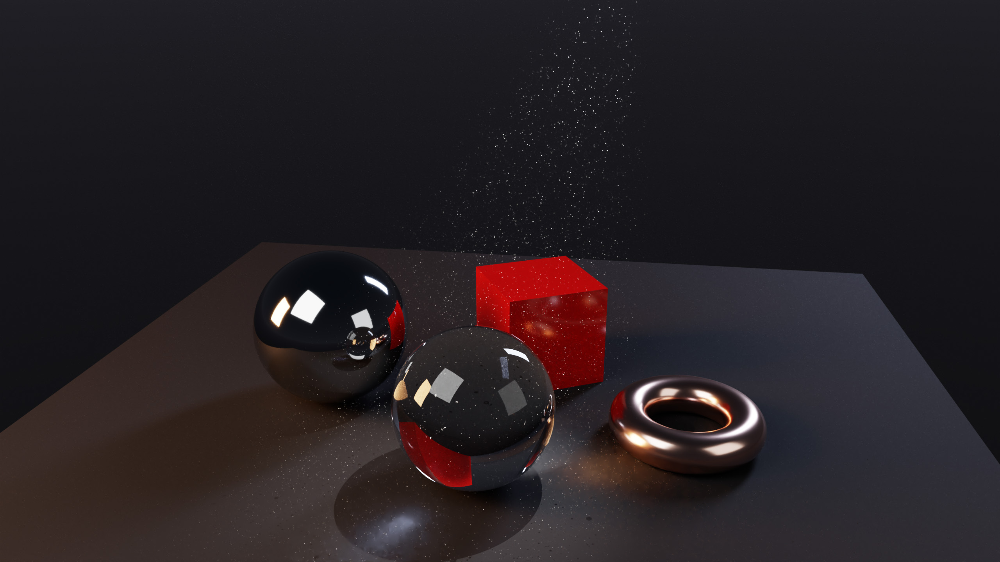

Granelli veri (qualche millimetro, fino a 150 000) sparsi nell'aria, come effetto a sé. Sono invisibili tranne dentro i fasci di spot e sole: lì brillano, come la polvere nei raggi che entrano dalla finestra di una soffitta, mentre lampadine, pannelli, ambiente e luce di rimbalzo non li illuminano. Sono segnati nelle guide del denoiser, così il denoiser li tiene invece di cancellarli come rumore. I granelli stanno in un riquadro che selezioni nella viewport e sposti o ridimensioni con il gizmo; di partenza copre gli oggetti fino alle spot, così i granelli riempiono tutto il fascio fino al piano illuminato. Si regolano quantità (fino a pochi granelli isolati), dimensione (fino a 18 mm), brillantezza e colore, e i granelli possono fare ombra: piccole sagome scure nei fasci e sul piano illuminato.

- **Moto nel tempo:** i granelli fluttuano piano lungo la timeline anche senza niente di animato, sempre con la stessa formula, quindi Play, salto a un fotogramma e render mostrano gli stessi granelli. *Influenza dell'aria* regola quanto li spostano gli oggetti in movimento (che spingono i granelli vicini e li tengono fuori) e le correnti del fumo. È un modello semplificato a senso unico: gli oggetti contano come sfere, il fumo come una corrente che sale stimata dai suoi parametri e non dalla sua velocità simulata, e la polvere non agisce mai sul fumo.
- **Variazione della dimensione:** quanto la dimensione di ogni granello si scosta a caso da quella impostata, da tutti uguali a da piccolissimi al triplo.
- **Due colori e opacità:** un secondo colore con la parte di granelli che lo prende (per esempio oro e bianco), e un'opacità che li rende semitrasparenti: diffondono meno luce e, se fanno ombra, ne fermano solo una parte.
- **Granelli luminosi:** con **+** scegli un colore: una parte dei granelli si accende di quel colore, come lucciole o scintille, e si vede anche fuori dai fasci delle spot (è geometria normale che emette luce e illumina quello che ha intorno). Ogni colore ha la sua intensità e la sua percentuale di granelli; con intensità basse il colore resta, con intensità alte diventa bianco come una lampadina vista dritta. **Alone** e **forza dell'alone** aggiungono un bagliore morbido attorno a ogni granello luminoso che la camera vede, come le lucciole: un nucleo luminoso largo quanto il granello e una coda tenue tre volte più larga che sfuma a zero, del colore del granello. Si aggiunge all'immagine finita (prima del tilt-shift), uguale su CPU e GPU; un granello coperto da un oggetto non fa alone, e la viewport non lo mostra.
- **Granelli o scaglie (polvere di fata):** i *granelli* sono tondi e diffondono la luce uguale da ogni lato. Le *scaglie* sono piatte e girate a caso: riflettono come piccoli specchi, quindi brillano solo quelle girate giuste tra luce e camera mentre le altre restano spente, come brillantini o polvere di fata. **Luccichio** regola quanta luce le scaglie riflettono a specchio, **ruvidità del riflesso** se le scintille sono piccole e intense (bassa) o larghe e tenui (alta). Uguale su CPU e GPU.

### Lucciole / Bosco incantato

Uno stormo che vola in un volume, soprattutto in orizzontale, e si accende a intervalli, ogni lucciola per conto suo: spenta, accensione, accesa, spegnimento. Da accese sono **luci vere della scena**: le superfici prendono il loro colore e gli oggetti fermano la loro luce, su CPU e GPU. Oltre *Luci al massimo* le lucciole vicine si uniscono in una luce con la stessa potenza totale, che tiene sotto controllo il rumore al prezzo di ombre meno precise.

- **Volo e ciclo:** quantità, volume con rotazione, velocità, parte verticale, fluidità, dispersione, durate minime e massime di ogni fase.
- **Colori:** una palette con le percentuali, ogni lucciola tiene il suo colore, e una variazione tonale che resta nella stessa famiglia.
- **Luce e aspetto separati:** *Luce sulla scena* per quello che ricevono gli oggetti, corpo e alone per i punti visibili. Con la luce a 0 restano solo i punti.
- Tutto nasce da tempo e seme: Play, salti, viewport e render coincidono. Il preset *Bosco incantato* riempie l'inquadratura di lucciole lente e calde.

### 8. Adesivi (decal) — etichette e loghi su qualsiasi superficie

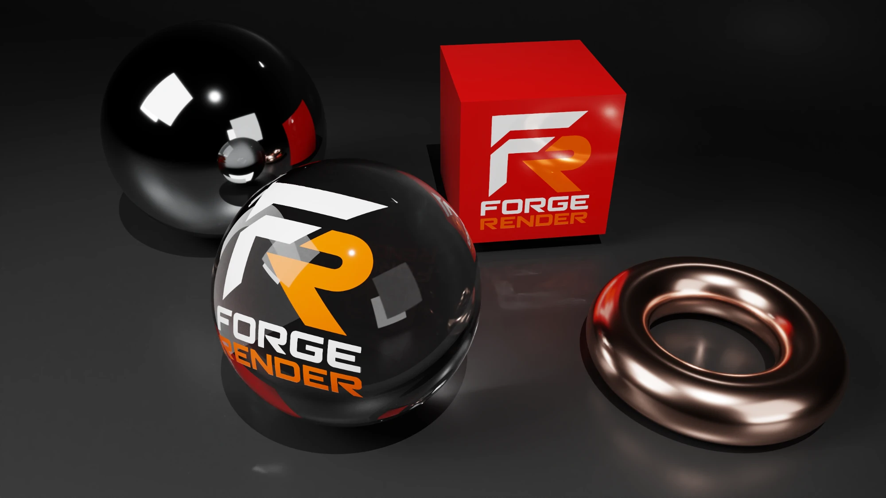

Applica un'immagine (un logo, un'etichetta, un PNG con trasparenza) sull'oggetto selezionato, nel punto che la camera sta guardando. L'adesivo si ricava dai triangoli dell'oggetto dentro una scatola di proiezione, quindi segue le superfici curve come bottiglie e tazze, e si sposta con l'oggetto. Le parti trasparenti del PNG lasciano vedere l'oggetto. Si regolano larghezza (l'altezza segue le proporzioni dell'immagine), rotazione, posizione sulla superficie, profondità della proiezione, ruvidità e metallicità; l'immagine viaggia con il progetto e dentro i pacchetti `.frpack`.

### 9. Materiali PBR e texture per modelli CAD

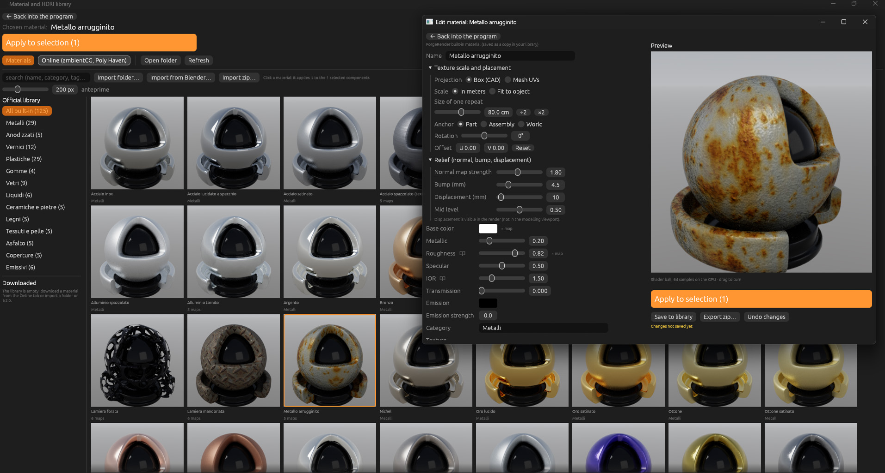

Materiali diffusi, metalli e plastiche GGX, vetro Fresnel, vetro satinato ed emissivi. Le mappe PBR includono colore base, rugosità, metallicità, normal, bump, displacement reale, occlusione ambientale e opacità. Per i modelli CAD senza UV è disponibile la proiezione Box in scala metrica, con ancoraggio a pezzo, assieme o mondo.

- **Libreria di serie:** 125 materiali pronti in 13 categorie: metalli, alluminio anodizzato, vernici, plastiche, gomme, vetri, liquidi, ceramiche e pietre, legni, tessuti e pelle, asfalto, coperture ed emissivi. Ci sono tutti i materiali senza texture (metalli, vernici, plastiche, vetri, liquidi, LED) e cinque materiali con texture per categoria, scelti diversi tra loro: acciaio spazzolato, alluminio tornito, lamiera mandorlata, lamiera forata e metallo arrugginito; rovere, noce, parquet a spina di pesce, compensato e corteccia; denim, pelle, lana bouclé, juta e raso. I trasparenti hanno la dispersione giusta (numero di Abbe: vetro 58, cristallo al piombo 32, vetro ottico 64, diamante 55, policarbonato 30, acqua 56…), che si vede nel render spettrale, e acqua e bevande si comportano da liquidi dentro il loro bicchiere. Le mappe sono da 1024 px perché il programma resti leggero.
- **Pacchetto aggiuntivo:** altri 109 materiali con mappe a 2K (legni e cortecce, pietre e intonaci, tessuti, metalli arrugginiti e consumati, asfalti, tetti), circa 1,6 GB, da scaricare a parte e copiare come `materiali-aggiuntivi` accanto a `forgerender.exe`: al riavvio compaiono nella stessa libreria.
- **Liberi da ridistribuire:** i materiali con texture vengono da Poly Haven e ambientCG (CC0); la fonte di ogni materiale è in `assets/materiali/LEGGIMI.md`.
- **Anteprime nitide:** ogni anteprima dei materiali si renderizza una volta con il path tracer a 512 px e si rimpicciolisce per ogni grandezza delle schede, così resta nitida sia grande sia piccola.
- **Sostituisci materiale:** in **Gestione materiali** (sotto il materiale della selezione, oppure Scena → Materiali) scegli "Sostituisci [materiale] con «selezionato»" (oppure clic destro su un materiale della scena): tutti i componenti con quel materiale, anche quelli che lo ereditano e il predefinito della scena, passano a quello selezionato, senza dover selezionare cento oggetti. "Annulla sostituzione" rimette le assegnazioni di prima.
- **Selettore colore:** cliccando il campione di un colore del materiale (colore base, colore in volume, emissione) si apre un solo pannello con tre schede: **RGB** (ruota dei colori, R, G, B e codice esadecimale), **CMYK** (ciano, magenta, giallo e nero in percentuale, con una conversione matematica semplice, non un profilo di stampa) e **Palette** (colori con codice e nome). Il colore cambia subito; **Applica** lo tiene, **Annulla** (o Esc) rimette quello di prima. La scheda palette comprende i codici RAL Classic con nome italiano e inglese e valori RGB **indicativi** (media di fonti pubbliche, non i valori ufficiali RAL, che RAL vende come libreria digitale); in più puoi importare la libreria ufficiale RAL CLASSIC `.ase` o una tua palette `.json`/`.csv` nella cartella Colori della libreria. Un colore preso da una palette mostra il suo codice (per esempio **RAL 7016**) accanto al campione, salvato con il progetto; cambiando il colore a mano torna un normale colore RGB.

### 10. Studio fotografico e illuminazione

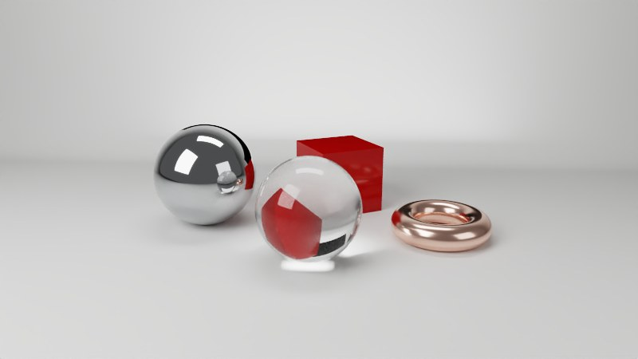

Prepara una scena prodotto con fondale e luci da studio, quindi scegli sfondo chiaro, scuro o scenografico. Le luci possono essere regolate singolarmente; la scena può essere adattata alle dimensioni del prodotto senza perdere il controllo sui componenti.

Le luci Spot e Direzionali si puntano dal viewport: selezioni la luce, clicchi il rombo del suo bersaglio e lo trascini. La sorgente resta ferma, il cono gira dal vivo, i campi numerici restano allineati e lo spostamento si annulla; se la luce è animata, la timeline lo registra come chiave.

### 11. Illuminazione volumetrica e fasci visibili

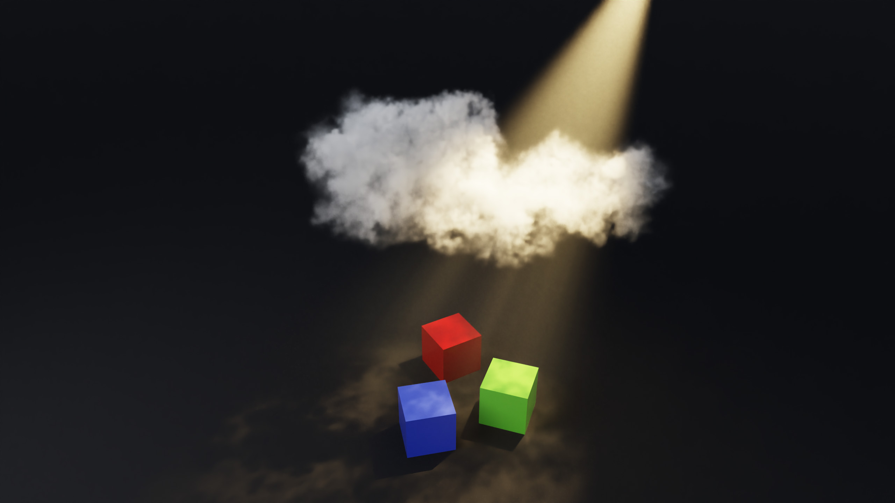

[Guarda la demo: fumo e illuminazione volumetrica](docs/video-demo-volumetrico.md)

Le luci spot possono generare fasci visibili con densità e lunghezza regolabili. La nebbia volumetrica è un mezzo partecipante simulato, con scattering e ombre: la luce interagisce con il volume e diventa visibile nello spazio, non soltanto sulle superfici.

Per la nebbia che riempie la scena vedi [Foschia d'ambiente](#5-foschia-dambiente--cinque-tipi-di-nebbia-procedurale), per i granelli che brillano nei fasci vedi [Polvere in sospensione](#7-polvere-in-sospensione--granelli-che-brillano-solo-in-un-fascio).

### 12. Camera, viste multiple e presentazione prodotto

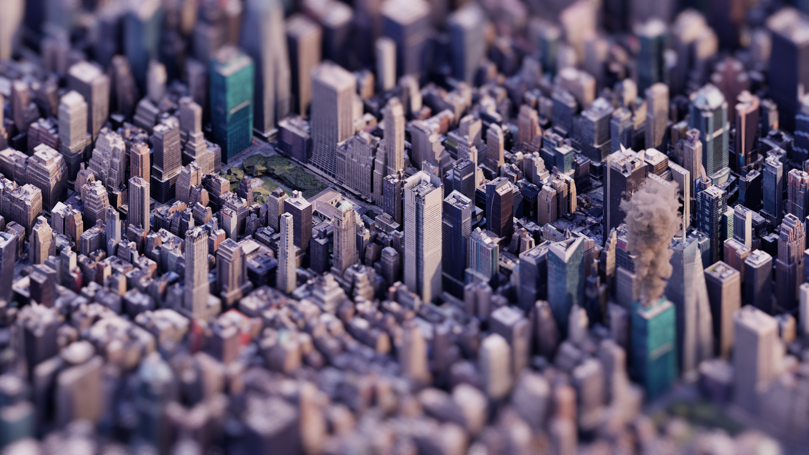

Le camere di rendering offrono focale, diaframma, profondità di campo e decentramento. Le viste automatiche frontale, posteriore, laterali, superiore e a tre quarti aiutano a presentare un prodotto da più angolazioni; è possibile esportare video turntable in MP4.

- **Camere come componenti:** le camere di rendering sono elencate nel gruppo **Camere** del pannello di sinistra. Selezionandone una compare nella viewport una linea fino al suo bersaglio (un rombo): il gizmo sposta insieme camera e bersaglio, fa girare la camera attorno al bersaglio (Ruota) oppure, dopo un clic sul rombo, sposta solo il bersaglio. Il bersaglio può seguire un oggetto, come per le spot, così l'oggetto resta al centro anche quando lo sposti.
- **Tilt-shift:** una fascia nitida sull'immagine finale (posizione, larghezza e angolo: orizzontale, verticale o inclinata) con la sfocatura che cresce ai lati, ogni lato con la sua transizione, da un passaggio netto a una sfumatura molto ampia. È separato dalla profondità di campo: diaframma, focale e messa a fuoco non cambiano, e con tutte e due accese la fascia si aggiunge alla sfocatura della lente. La sfocatura rispetta la profondità (un oggetto vicino e nitido non sbava sullo sfondo sfocato) ed è continua anche molto forte (si raccoglie da copie dell'immagine via via ridotte, così i riflessi luminosi diventano una sfumatura morbida invece di copie ripetute), è uguale su CPU e GPU, e spostare la fascia si vede subito, senza rifare il render.

### 13. Render pass e workflow di post-produzione

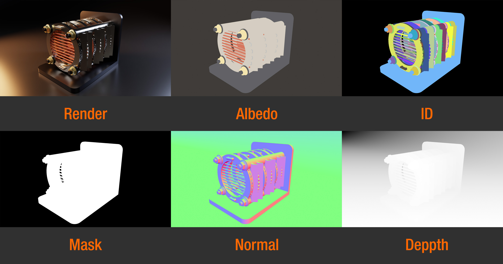

ForgeRender può esportare pass separati **Albedo, Normals, Depth, Product Mask e Component ID**, utili per compositing, mascherature e interventi successivi sull'immagine. Sono buffer tecnici di output, non ulteriori render beauty.

### 14. Stili di rendering — fumetto, illustrazione tecnica e contorni a inchiostro

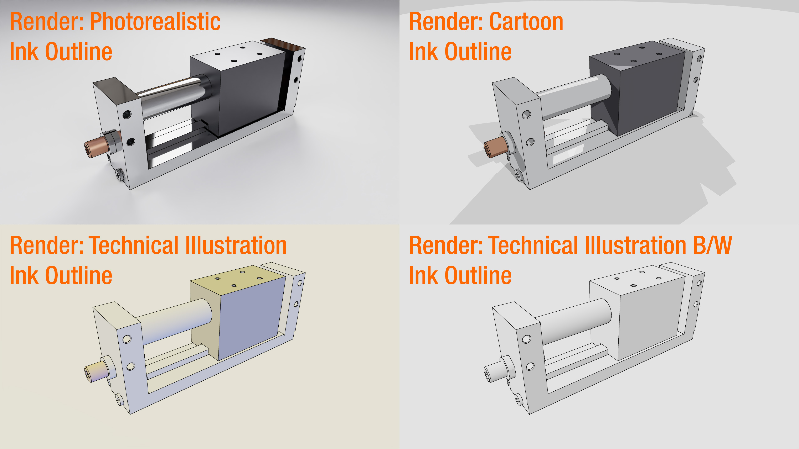

In cima alla scheda Render scegli come si disegna l'immagine; passando sopra a ogni scelta compare un piccolo esempio.

- **Fotorealistico:** il path tracing fisico di sempre.
- **Fumetto (cel shading):** colori pieni del materiale in tre fasce nette (luce, mezz'ombra, ombra) dalle luci della scena, con le loro ombre nette e un riflesso secco sui materiali lucidi, solo dove una luce si riflette davvero (la forma della softbox per le luci ad area) e forte quanto riflette il materiale (tenue sulle plastiche scure, pieno sui metalli).
- **Illustrazione tecnica (Gooch):** ombreggiatura morbida da caldo in luce a freddo in ombra, senza ombre nere, così forme e volumi si leggono bene.
- **Bianco e nero:** il fumetto con le stesse fasce in grigi, l'illustrazione tecnica come un disegno a matita; tutta l'immagine è in grigi, anche quello che si vede attraverso vetri e liquidi colorati o negli specchi. Spento, restano a colori.
- **Sfondo a tinta unita:** dove la camera non vede niente, un colore (bianco, grigio chiaro, nero o un altro) al posto dell'ambiente, che continua a illuminare la scena.
- **Contorni a inchiostro:** linee scure su sagome, confini tra oggetti, salti di profondità e (a scelta) spigoli vivi, tracciati con 3×3 raggi per pixel e disegnati sopra l'immagine finale, anche dopo il denoiser. Vanno con qualsiasi stile; si regolano spessore, colore, angolo degli spigoli e sensibilità ai salti di profondità. I raggi che passano nella fessura tra due triangoli non lasciano più puntini sparsi, lo slider Pulizia toglie i pezzi di linea troppo corti e il bordo del pavimento contro lo sfondo può restare senza linea.

Gli stili si applicano alla prima superficie vista dalla camera, quindi vetri e specchi riflettono e rifrangono come sempre; funzionano su CPU e GPU, anche nel render spettrale.

### 15. Modelli STEP: convertiti una volta, poi riaperti subito

Uno STEP da solo apre la sua finestra: il file a sinistra, la tassellazione al centro e a destra un'anteprima 3D del risultato, ombreggiata o in fil di ferro, da ruotare e ingrandire, con triangoli, vertici, dimensioni e pezzi. Bozza, Bilanciata, Alta qualità o Personalizzata impostano le deviazioni lineare e angolare vere del convertitore; si può riconvertire quante volte si vuole e il modello entra nella scena solo con Importa. La geometria CAD originale non si vede perché resta nel processo separato del convertitore.

Un file STEP si converte in mesh una volta sola. Il risultato resta in una cache delle conversioni e si salva accanto al progetto (`modelli-convertiti/`) e dentro i pacchetti `.frpack`, così riaprendo il progetto lo STEP non si riconverte. Sulla demo del banco ottico l'apertura è passata da 27 s a 0,2 s. Se lo STEP cambia (o cambiano i pezzi di un assieme a più file, o la qualità), si riconverte. I pacchetti ora includono anche i file dei pezzi a cui rimanda un assieme STEP a più file.


### 16. Timeline — animazione di oggetti, luci, camera ed effetti

Una timeline professionale, sempre disponibile: sta in basso con le schede **Timeline | Console** (ridotte a una riga finché non c'è un'animazione), oppure in una finestra a parte con "Stacca dal programma", da spostare su un altro schermo.

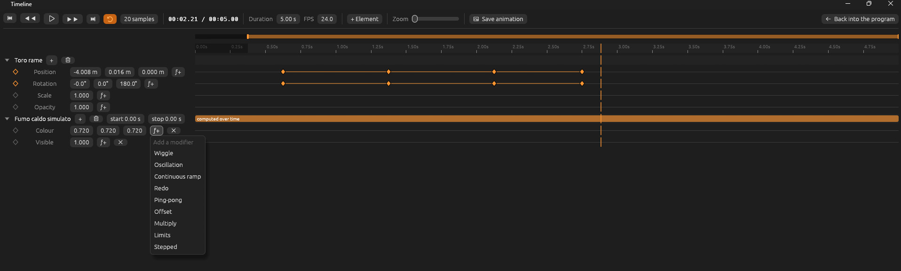

- **Elementi e proprietà:** "+ Elemento" aggiunge gli oggetti selezionati, la camera, una luce, un fumo, una nebbia di ghiaccio secco, la foschia, la polvere o l'ambiente. Ogni elemento mostra le sue proprietà di base (per gli oggetti posizione, rotazione, scala e opacità; per la camera posizione e bersaglio; per le luci posizione e intensità) e con "+" si aggiungono una alla volta le altre compatibili (scala per asse, visibilità, colore, bersaglio, apertura del cono, campo visivo, diaframma, distanza di fuoco, densità, rotazione dell'HDRI, brillantezza). Posizione, rotazione, bersaglio e colore sono una riga sola con i tre valori: una chiave vale per tutti.
- **Chiavi:** il rombo mette o toglie una chiave nell'istante del cursore con il valore attuale; spostare un oggetto con il gizmo, o cambiare un valore nei pannelli, quando la sua proprietà ha già delle chiavi registra lì una chiave. Come in After Effects, un clic seleziona una chiave, Ctrl o Maiusc aggiunge o toglie, trascinando sul vuoto si disegna un rettangolo di selezione e trascinando una chiave si spostano tutte le selezionate (a scatti di fotogramma); Canc le toglie, Ctrl+C e Ctrl+V le copiano nell'istante del cursore, F9 mette la morbida in entrata e uscita e il clic destro sceglie l'interpolazione verso la chiave dopo: a scatto, lineare, morbida in entrata, in uscita, in entrata e uscita, curva continua.
- **Modificatori:** "ƒ+" aggiunge a ogni proprietà, uno alla volta e in ordine, tremolio (ampiezza, frequenza, seme), oscillazione, rampa continua (per esempio 90°/s per una piattaforma girevole), ripeti, avanti e indietro, spostamento, moltiplica, limiti e a scatti (stop motion); su una riga a tre assi le lettere X Y Z scelgono su quali agisce.
- **Riproduzione:** inizio, chiave prima, play/pausa, chiave dopo, fine, ripeti; durata e fotogrammi al secondo; zoom e scorrimento del tempo. La barra dell'**area di lavoro** sopra il righello (si trascinano le due estremità e il centro) sceglie la parte che si riproduce e si salva. Nella viewport la riproduzione è in tempo reale; nella **vista Render** il Play calcola ogni fotogramma con pochi campioni (20 di serie, regolabili) e passa al successivo: più lento del tempo reale, ma si vede l'animazione renderizzata.
- **Effetti nel tempo:** fumo simulato e ghiaccio secco hanno la loro riga appena creati e seguono il cursore: l'istante simulato è il tempo del cursore meno l'inizio dell'effetto, che si sceglie sulla sua riga insieme alla fine dell'emissione; la durata scelta nella timeline decide fino a quando si calcolano.
- **Annulla e Ripeti:** chiavi, modificatori, area di lavoro, durata e tempi degli effetti si annullano con Ctrl+Z, un gesto alla volta, insieme all'oggetto spostato in quel gesto.
- **Riferimenti stabili:** luci e ghiaccio secco si seguono per numero, non per nome: puoi rinominarli, o tenerne due con lo stesso nome, senza perdere l'animazione. I progetti delle versioni precedenti si convertono all'apertura.
- **Salva animazione:** l'area di lavoro, come render di ogni fotogramma o come **anteprima della viewport** (pochi secondi, per controllare il movimento; fumo e nebbie non ci sono), dalla viewport o da una camera di rendering, in fotogrammi PNG in una cartella nuova dentro **Rendering** e, se vuoi, in un video MP4.
- **Impostazioni video:** l'ingranaggio in Salva animazione apre contenitore, codec, CRF o bitrate, formato dei pixel, frequenza, risoluzione e file di destinazione, con i preset Standard, Alta qualità, Molto alta, Per il montaggio (ProRes), Senza perdita (FFV1) e Non compresso (AVI). MP4 H.264 e AVI non compresso funzionano subito; gli altri formati richiedono ffmpeg accanto al programma o nel PATH e senza restano disattivati. Il file compare solo a lavoro finito, la codifica si può interrompere e l'avviso riporta i parametri veri.
- **Tempo rimanente:** la barra di stato conta i fotogrammi e stima quanto manca per il render e poi per la codifica, solo quando ci sono dati veri.
- **Opacità degli oggetti:** una proprietà a sé, resa lasciando passare ogni raggio con probabilità 1 − opacità, così l'oggetto sfuma con la sua ombra, uguale su CPU e GPU.

### 17. Manuale interno con immagini di confronto

**Guida → Manuale** (o **F1** sopra un controllo) apre un manuale che sta dentro il programma e funziona senza internet: capitoli a sinistra, pagina al centro, ricerca in alto, Indietro / Avanti e scelta della lingua. Segue la lingua dell'interfaccia.

- **Ogni pannello e impostazione:** introduzione e primo render, modalità Semplice, finestra e viewport, impostazioni, importazione, oggetti e progetti, luci, materiali, ambiente, effetti, camera, rendering, salvataggio delle immagini, timeline e video, controllo con l'IA e scorciatoie da tastiera: 33 pagine in inglese e in italiano, con intervalli e valori predefiniti presi dal programma.
- **Immagini di confronto:** per le impostazioni che contano di più, la stessa scena è calcolata con il cursore basso, medio e alto e mostrata in fila: campioni e soglia di rumore, denoiser, rimbalzi, esposizione e tone mapping, caustiche, stili del render, roughness, metallic, specular, IOR e transmission, dimensione e temperatura colore delle luci, intensità dell'ambiente, focale, diaframma e densità della foschia. Passando col mouse sopra un'immagine la si vede grande.
- **Fatte con ForgeRender:** le 56 immagini (640 × 480, almeno 256 campioni, tranne i confronti sul numero di campioni e sulla soglia di rumore) le calcola il path tracer del programma sulla scena di prova e sulla sfera delle anteprime dei materiali. `tools/manuale/render_confronti.js` le rifà; una copia è in [docs/manual/renders/](docs/manual/renders), con il nome che dice impostazione, cursore e valore (per esempio `render_samples_064.png`).
- **Controllato dai test:** ogni pagina esiste nelle due lingue, collegamenti e immagini sono validi, ogni immagine è usata e la ricerca trova la pagina giusta anche con le parole di tutti i giorni.

### 18. Un'interfaccia chiara e ordinata

La finestra è disposta in modo che si sappia sempre dove guardare e cosa fare dopo.

- **Due righe in alto:** i menu, con a destra il selettore **Semplice / Avanzata** e l'ingranaggio delle **Impostazioni**; sotto, file e aggiunte a sinistra e **Avvia render**, Stop, Riavvia, Esporta e AI MCP a destra. La lingua si sceglie in Impostazioni → Lingua.
- **Un solo albero della scena:** a sinistra gli oggetti del modello e, sotto, i gruppi **Luci**, **Camere** ed **Effetti**, che si aprono e si chiudono e hanno un **+** per aggiungerne uno. Ciò che è selezionato è evidenziato in arancione.
- **Un pannello che segue la selezione:** in modalità Avanzata il pannello di destra ha tre schede. **Selezione** mostra ciò che hai cliccato nella viewport o nell'albero: un oggetto con posizione, misure e materiale, oppure una luce, una camera o un effetto con le sue proprietà. **Scena** raccoglie ciò che vale per tutta la scena in sotto-schede (Luci, Ambiente, Effetti, Camera, Materiali). **Render** contiene le impostazioni del calcolo; roulette russa, limite della luce indiretta, seme casuale e thread della CPU sono in una sezione **Avanzate** chiusa.
- **Più spazio per la vista:** **Viewport | Render** e **Riavvio automatico** stanno subito sopra l'area centrale; timeline e console restano ridotte a una riga finché non c'è un'animazione (**Riduci** le richiude).
- **Più facile da leggere:** i testi piccoli sono più grandi e più chiari, le impostazioni dei materiali hanno nomi italiani con il termine tecnico tra parentesi, e l'arancione resta per Avvia render, l'avanzamento del render e ciò che è selezionato.

## Cosa fa oggi

- **Interfaccia Semplice / Avanzata** (selettore in alto a destra, predefinita Semplice): "Foto prodotto in
  5 passi" con pulsanti grandi (importa, appoggia sulla base, inquadra, aspetto, materiali,
  formato 16:9 / 1:1 / 4:5 / 9:16, qualità Bozza / Bilanciata / Alta, render e salvataggio).
  La Avanzata ha tutti i controlli in tre schede, Selezione, Scena e Render, accanto a un solo
  albero della scena; le due modalità modificano gli stessi valori.
- **Studio fotografico**: scena di partenza con fondale in tela inclinato e quattro luci da
  studio; colore delle luci (calda 3200 K, neutra 5500 K, fredda 7500 K o per singola luce).
  Altri aspetti: Sfondo chiaro, Sfondo scuro, Studio scenografico. **Prepara scena prodotto** e
  **Adatta la scena al prodotto** ridimensionano fondale e luci sulle misure del prodotto;
  **Annulla preset** riporta la scena com'era. Luci e oggetti nuovi nascono vicino al prodotto.
- **Lingue**: italiano e inglese, cambio immediato di tutta l'interfaccia (in
  Impostazioni → Lingua, l'ingranaggio in alto a destra). Le traduzioni sono file separati `lang/Lan_*.json`: se ne aggiungono
  altri copiando `Lan_eng.json`.
- **Controllo IA (MCP)**: comanda ForgeRender in linguaggio naturale tramite Claude Code o Claude Desktop, con il ponte `forgerender-mcp.exe` e l'interruttore "AI MCP" nella barra (ON/OFF, con l'ingranaggio per le impostazioni dell'integrazione AI). Consulta la [guida di configurazione MCP](docs/MCP.md) per installazione, esempi, strumenti disponibili e sicurezza.
- **Schermata di benvenuto** all'avvio con immagine (`assets/splash.png`), versione e commit;
  si chiude con "Chiudi" e si riapre da File.
- **Path tracing** su CPU (tutti i core) e su GPU (compute shader wgpu, Vulkan/DX12) con accumulo
  progressivo reale (16…1024 campioni, personalizzato o illimitato, modificabile durante il render).
  Next Event Estimation + Multiple Importance Sampling, Russian roulette, BVH SAH.
- **Denoiser**: Intel Open Image Denoise caricato a runtime, dispositivo CPU o CUDA, buffer guida
  albedo/normali, modalità solo finale o anteprima progressiva.
- **Materiali**: diffuso, metalli e plastiche GGX con compensazione multi-scattering, vetro con
  Fresnel esatto, vetro satinato, superfici emissive campionate come luci.
  Mappe PBR complete: colore base, rugosità/lucidità, metallicità, normal (OpenGL/DirectX),
  height (bump), **displacement vero**, occlusione ambientale, ritaglio con opacità e opacità
  generale (animabile); mapping UV o
  proiezione box in metri per i modelli CAD senza UV, con dimensione della ripetizione, rotazione
  e spostamento.
- **Libreria**: 125 materiali di serie in 13 categorie (un pacchetto aggiuntivo ne aggiunge 109 con texture), più materiali e HDRI scaricati da ambientCG e
  Poly Haven o importati da cartelle/ZIP, conservati nella cartella locale `Libreria` con anteprime a 512 px.
- **Selettore colore**: RGB, CMYK e palette (RAL Classic con valori indicativi, o palette
  `.ase`/`.json`/`.csv` importate) per ogni colore dei materiali, con il codice della palette
  accanto al campione; lo stesso selettore si apre da ogni pulsante colore (luci, ambiente,
  foschia, fumo, polvere, stili). **Sostituisci materiale** fa passare tutti gli oggetti con un
  materiale a un altro.
- **Render spettrale, caustiche e laser**: trasporto della luce RGB o spettrale con dispersione,
  caustiche con il photon mapping con tutte le luci, laser da laboratorio rosso, verde, blu, viola
  e bianco con fasci visibili, prismi e lenti.
- **Luci e ambiente**: luci ad area, puntiformi, spot e direzionali, preset da studio; ambiente
  uniforme, a gradiente o HDRI (.hdr/.exr) con importance sampling. Puntiformi e spot hanno un
  **raggio d'azione** con sfumatura del bordo, indipendente dall'intensità, disegnato come una
  bolla nella viewport (CPU e GPU).
- **Nebbia volumetrica**: nebbia da ghiaccio secco procedurale (con seed, riproducibile) che
  esce da un emettitore puntiforme, cade, si deposita, si allarga e scorre attorno agli oggetti;
  resa come vero mezzo partecipante (delta tracking, fase Henyey–Greenstein, ombre nella nebbia)
  su CPU e GPU.
- **Foschia e polvere**: cinque tipi di foschia procedurale (nebbia bassa, nuvole di gas, fumo
  tossico a terra, strati sospesi, riccioli di vapore) da un'altezza di partenza a una massima;
  granelli di polvere nel loro riquadro che brillano solo nei fasci di spot e sole, a due colori,
  con opacità e variazione della dimensione, tondi o a scaglie piatte che luccicano come polvere
  di fata; granelli luminosi nei colori scelti con + (intensità e percentuale per ognuno) con un
  alone da lucciola regolabile.
- **Fumo volumetrico**: nubi, pennacchi, fili d'incenso e banchi procedurali, oppure una
  simulazione fisica (calore, galleggiamento, vortici, vento, oggetti che lo deviano) con la
  sorgente spostabile, l'anteprima a particelle nella viewport (anche solo anteprima, senza la
  simulazione completa al render), i bordi sfumati frattali e un
  riquadro che si sposta, gira e si scala insieme alla sua sorgente. Il **fumo a particelle**
  tiene veli sottili che si ripiegano e filamenti lunghi invece della nuvola gonfia: preset
  *Vapore da tazza* (nastri trasparenti che salgono dal caffè) e *Incenso o sigaretta*. La
  simulazione si **calcola una volta sulla timeline** e resta in file temporanei, ripartendo dal
  primo fotogramma cambiato; gli oggetti animati **spostano davvero l'aria** con scia e vortici;
  emissione con inizio e fine; una sorgente dentro un oggetto si trova subito e si sposta fuori.
- **Timeline (animazione)**: una timeline in stile After Effects, sempre disponibile, con le schede
  Timeline | Console in basso o in una finestra a parte su un altro schermo. Chiavi con sei
  interpolazioni (a scatto, lineare, morbida in entrata, in uscita, in entrata e uscita, curva
  continua), selezionate col mouse (rettangolo, Ctrl, trascinamento di gruppo, Canc, copia e
  incolla); modificatori aggiunti uno alla volta (tremolio, oscillazione, rampa continua, ripeti,
  avanti e indietro, spostamento, moltiplica, limiti, a scatti); una riga per posizione e rotazione;
  scala e opacità di oggetti, luci, camera, fumo, nebbia, foschia, polvere e ambiente; chiavi
  registrate dal gizmo, con Annulla per ogni modifica; luci e ghiaccio secco seguiti da un numero
  stabile, così rinominarli non perde niente; fumo e ghiaccio secco che seguono il cursore, con
  inizio e fine dell'emissione; barra dell'area di lavoro; riproduzione in tempo reale nella viewport, Play a
  pochi campioni nella vista Render; salvataggio del render di ogni fotogramma o di un'anteprima
  della viewport, dalla viewport o da una camera, in fotogrammi PNG e MP4.
- **Cartella Rendering**: quello che salvi o esporti finisce di serie in `Rendering` accanto al
  programma (o in Documenti\ForgeRender se la cartella del programma non è scrivibile).
- **Stili di rendering**: fotorealistico, fumetto (cel shading) e illustrazione tecnica, a colori
  o in bianco e nero, sfondo a tinta unita, contorni a inchiostro su sagome e spigoli.
- **Adesivi**: immagini e loghi (PNG con trasparenza) proiettati sulle superfici curve, che si
  muovono con l'oggetto.
- **Camere**: camera orbitale della viewport più camere di rendering con obiettivo professionale:
  focale in mm, diaframma f/, profondità di campo (piano di fuoco e limiti vicino/lontano
  disegnati nella viewport), lamelle, decentramento. **Vista ortografica e isometrica** nella
  viewport (icone accanto al navigatore, tasto 5 del tastierino) e nella camera di render. Le
  camere di rendering sono componenti con un bersaglio, spostate e fatte orbitare con il gizmo.
  **Tilt-shift**: una fascia nitida (posizione, larghezza, angolo) con la sfocatura che tiene
  conto della profondità ai due lati, separata dalla profondità di campo, visibile subito senza
  rifare il render.
- **Import**: glTF/GLB (esportazione consigliata da SolidWorks), OBJ (con .mtl), STL, Blender
  `.blend` (tramite Blender installato); STEP con Open CASCADE e SolidWorks SLDPRT/SLDASM sono
  sperimentali. Il convertitore STEP (`forgerender-step.exe`) lo compila `Build-ForgeRender.ps1`;
  serve CMake (`winget install Kitware.CMake`).
- **Viewport**: rasterizzazione su GPU con le matrici degli oggetti sulla GPU: muovere gli oggetti
  non ricarica la geometria, così l'animazione resta fluida.
- **Modifica**: gizmo sposta/ruota/scala con snap (anche per le luci, con le maniglie del cono
  dello spot, e per l'emettitore della nebbia), snap a contatto per oggetto, annulla/ripeti, nascondi (H), duplica, appoggio
  esatto sul pavimento, navigatore degli assi stile Blender, albero dei componenti, assegnazione
  dei materiali persistente per id stabile.
- Avvio / pausa / ripresa / stop / riavvio automatico quando la scena cambia, export PNG.
- Progetti `.frproject` (JSON versionato, salvataggio atomico, percorsi relativi).
- CLI per render senza interfaccia, benchmark e import nella libreria.
- **Lucciole / Bosco incantato**: uno stormo con il suo ciclo e la sua palette, le cui lucciole accese sono luci vere della scena, con occlusione, su CPU e GPU.
- **Polvere in sospensione in movimento**: moto nel tempo, reazione a oggetti in movimento e correnti del fumo, deterministica.
- **Finestra di importazione STEP**: impostazioni di tassellazione, anteprima 3D, conversione ripetibile, arresto.
- **Esportazione video**: MP4, MOV, MKV e AVI con H.264, H.265, ProRes, FFV1 o non compresso, preset, stima della dimensione e parametri veri alla fine.
- **Esportazioni lunghe affidabili**: proseguono da ridotte a icona o coperte, bloccano la sospensione automatica, possono lasciare il PC usabile e riprendere dai fotogrammi fatti.
- **Manuale interno**: Guida → Manuale o F1 su un controllo, 33 pagine in inglese e in italiano su ogni pannello, con immagini di confronto calcolate da ForgeRender per i cursori principali (basso, medio, alto).
- **Barra di stato configurabile**: fino a 9 contatori su 15 (FPS viewport, fotogrammi, tempo rimanente, GPU, VRAM, RAM e altri), Backend e processore fissi a destra.
- **Bersaglio delle luci nel viewport**: Spot e Direzionali si puntano trascinando il bersaglio, con Annulla.

## Scaricare la versione Windows

La build su GitHub Actions **non** parte ai push: si avvia a mano da *Actions → CI → Run workflow*
(oppure si compila in locale con `Build-ForgeRender.ps1`). Nella sezione *Artifacts* del run ci
sono due pacchetti:

| Pacchetto | Contenuto |
|---|---|
| `ForgeRender-portable-x64` | zip: si estrae e si avvia `forgerender.exe`, nessuna installazione |
| `ForgeRender-setup-x64` | installer (menu Start, disinstallazione, associazione `.frproject`) |

Entrambi sono autonomi: CRT statico, solo DLL di sistema di Windows più le librerie di Open
Image Denoise incluse.

## Compilare in locale

Requisiti: Rust stable (`rustup`); su Windows i *Visual Studio Build Tools* (C++).

```
cargo test --workspace --release
cargo run --release -p forge_app            # interfaccia grafica
cargo run --release -p forge_cli -- bench   # benchmark
```

Pacchetti Windows in locale: `powershell -ExecutionPolicy Bypass -File packaging\windows\package.ps1`
(per l'installer serve [Inno Setup 6](https://jrsoftware.org/isdl.php)).

## Benchmark: comandi da lanciare

Elenco di tutte le misure che si possono fare, con a cosa serve ciascuna. I risultati veri (e i
dati grezzi) vanno in [`reports/`](reports/README.md), una cartella per esperimento; quelli già
fatti sono in [docs/BENCHMARK.it.md](docs/BENCHMARK.it.md). Regola: si riportano solo numeri misurati.

### Preparazione (una volta)

I comandi sono per PowerShell. Basta lo zip `ForgeRender-portable-x64`:
- estrailo e apri PowerShell **nella cartella estratta**;
- i progetti di benchmark sono già dentro, in `samples\scene\cocktail-ghiaccio-secco\`;
- non serve né Python né il repository.

In alternativa usa la cartella del repository con `forgerender-cli.exe` compilato da
`Build-ForgeRender.ps1`.

```powershell
cd C:\percorso\ForgeRender-portable-x64          # cartella dello zip estratto
$cli = ".\forgerender-cli.exe"                    # nel repository: ".\target\release\forgerender-cli.exe"
```

I progetti di benchmark sono derivati dalla demo del cocktail, tutti senza profondità di campo
e con la camera fissa. Se cambia la demo si rigenerano con
`reports/strumenti/crea_progetti_bench.py`, e la CI controlla che siano allineati.

Python (`py -m pip install numpy pillow`) serve solo per gli script di confronto delle immagini
in `reports/strumenti/`. Se non puoi usarlo, metti le immagini in `reports/AAAA-MM-GG_.../` e
l'analisi la fa l'agente.

| Progetto | Cosa inquadra | Seed |
|---|---|---|
| `bench_intera` | l'intera demo | 12345 |
| `bench_vicina` | ravvicinata sulla nebbia | 12345 |
| `bench_ad` | l'intera demo | dato da `--seed` |

Le righe da leggere nell'output del render sono:
- `rendering N s | M ms/passata | X Mcampioni/s`
- `geometria compilata … in N ms`
- `nebbia «…»: simulazione … in N ms`

### 1. Hardware rilevato

```powershell
& $cli info
```
**A cosa serve**: verificare CPU, thread e RAM viste dal programma. Il nome va scritto in ogni
report.

### 2. Benchmark standard (CPU, GPU, denoiser)

```powershell
& $cli bench --json bench.json
& $cli bench --spp 64 --width 1920 --height 1080 --threads 1,4,8,12,24 --json bench-1080p.json
```
**A cosa serve**:
- **CPU**: scalabilità al variare dei thread.
- **GPU**: la riga `GPU` riporta Mcampioni/s e quante volte va più veloce di 1 thread.
- **Denoiser**: OIDN su CPU e CUDA, in ms per immagine.

La scena di test è piccola (11 022 triangoli): misura la velocità pura del path tracer.
**Confronto**: la tabella del 9900X in `docs/BENCHMARK.md`. Se cambia di molto senza modifiche
al codice, cambiano driver o impostazioni di energia.

### 3. Scena reale pesante, CPU contro GPU (nebbia, vetro, texture)

```powershell
$p = "samples\scene\cocktail-ghiaccio-secco"
& $cli render --project $p\bench_intera.frproject --backend cpu --width 320 --height 400 --spp 32 --quiet --out intera_cpu.png
& $cli render --project $p\bench_intera.frproject --backend gpu --width 320 --height 400 --spp 32 --quiet --out intera_gpu.png
& $cli render --project $p\bench_vicina.frproject --backend cpu --width 320 --height 400 --spp 32 --quiet --out vicina_cpu.png
& $cli render --project $p\bench_vicina.frproject --backend gpu --width 320 --height 400 --spp 32 --quiet --out vicina_gpu.png
```
**A cosa serve**:
- Quanto rende la GPU su una scena vera, non sulla scena di test.
- Misura il **majorant 3D della nebbia** sulla RTX 5070, che nel container non si è potuto
  misurare.

**Cosa guardare**: la riga `ms/passata`. Prima del render c'è la simulazione della nebbia, che
dura qualche decina di secondi e non conta nel tempo di rendering.

**Confronto**: [report majorant](reports/2026-10-29_majorant-3d-nebbia/REPORT.md). Per
confrontarti con i numeri del container aggiungi `--threads 3` alla riga CPU. Per tempi più
stabili alza la risoluzione (es. `--width 960 --height 1200 --spp 64`).

### 4. Campionamento adattivo (conviene sulla mia scena?)

```powershell
$b = "samples\scene\cocktail-ghiaccio-secco\bench_ad.frproject"
& $cli render --project $b --backend gpu --width 320 --height 400 --spp 1024 --seed 99  --quiet --out ref.png
& $cli render --project $b --backend gpu --width 320 --height 400 --spp 1024 --seed 100 --quiet --out ref2.png
& $cli render --project $b --backend gpu --width 320 --height 400 --spp 32  --quiet --out uni32.png
& $cli render --project $b --backend gpu --width 320 --height 400 --spp 128 --quiet --out uni128.png
& $cli render --project $b --backend gpu --width 320 --height 400 --spp 1024 --noise-threshold 0.08 --quiet --out ad08.png
& $cli render --project $b --backend gpu --width 320 --height 400 --spp 1024 --noise-threshold 0.04 --quiet --out ad04.png
py reports\strumenti\confronta_immagini.py ref.png ref2.png -- uni32.png uni128.png ad08.png ad04.png
```
**A cosa serve**: capire se fermare i pixel già puliti fa risparmiare tempo a parità di
qualità.

**Cosa guardare**:
- Annota il tempo di ogni render.
- Calcola **tempo × MSE**: più è basso, meglio è. Si confronta adattivo contro uniforme.
- Con il threshold attivo il CLI stampa anche i campioni medi per pixel.

Ripeti con `--backend cpu` per confrontare i due backend.

**Diagnostica (dove vanno i campioni)**: aggiungi `--adaptive-map mappa04.png` a un render
adattivo. Scrive un PNG a 16 bit con i campioni esatti di ogni pixel e stampa la quota dei
campioni nella metà "B" usata per stimare l'errore (dovrebbe essere circa 0,5). Poi:

```powershell
py reports\strumenti\analisi_adattivo.py --rif ref.png ref2.png --mappa mappa04.png --img ad04.png --img uni128.png --csv riquadri.csv
```

Per le zone scure, medie e chiare del riferimento stampa: quota di pixel, quota di campioni,
errore di ogni immagine e differenza media con il suo errore standard.

**Confronto**: [report campionamento adattivo](reports/2026-10-29_campionamento-adattivo/REPORT.md).
Nel container, su questa scena, l'adattivo era meno efficiente.

### 5. Import e BVH di una mesh grande

```powershell
& $cli render --mesh C:\percorso\modello_grande.stl --unit mm --spp 16 --width 640 --height 360 --quiet --out mesh.png
```
**A cosa serve**: il tempo di caricamento delle scene CAD pesanti. Funziona anche con
`.step`, `.glb` e `.obj`.

**Cosa guardare**: la riga `geometria compilata: N triangoli, BVH M nodi, in T ms` e il tempo
totale prima che parta il render.

**Confronto**: toro da 1 milione di triangoli in `docs/BENCHMARK.md`.

### 6. Profilo della simulazione della nebbia

```powershell
$env:FORGE_FOG_PROFILE = "1"
& $cli render --project samples\scene\cocktail-ghiaccio-secco\bench_intera.frproject --spp 1 --width 160 --height 200 --quiet --out nebbia.png
Remove-Item Env:FORGE_FOG_PROFILE
```
**A cosa serve**: capire quanto costa ogni fase della simulazione fluida (forze, trasporto,
pressione…), per decidere dove ottimizzare.

**Cosa guardare**: le righe `nebbia «…»: simulazione … passi in N ms` e `profilo nebbia: …`.

Per cronometrare solo la nebbia a tutte le qualità (ostacoli, simulazione, dettaglio; 3
ripetizioni, mediana) e confrontare il risultato con una misura precedente (`FOG_BENCH_REF`,
differenza e massa), dal repository:

```powershell
cargo run --release -p forge_project --example fog_bench -- fog_bench 3
```

### 7. Risoluzione e campioni della scena finale

```powershell
& $cli render --project samples\scene\cocktail-ghiaccio-secco\cocktail-ghiaccio-secco.frproject --backend gpu --quiet --out finale_gpu.png
& $cli render --project samples\scene\cocktail-ghiaccio-secco\cocktail-ghiaccio-secco.frproject --backend gpu --denoise finale --cuda --quiet --out finale_gpu_dn.png
```
**A cosa serve**: il tempo reale di un'immagine finita, con le impostazioni del progetto
(risoluzione, campioni, profondità di campo), con e senza denoiser.

### 8. Test di correttezza (prima di fidarsi dei tempi)

```powershell
cargo test --release --workspace --exclude forge_step
cargo test --release -p forge_render_gpu -- --nocapture
cargo test --release -p forge_render_cpu --test portal -- --nocapture
cargo test --release -p forge_render_cpu --test adaptive -- --nocapture
```
**A cosa serve**:
- **Tutti i test**: confermano che le immagini sono giuste. Tra questi ci sono white furnace,
  luci contro il risultato analitico, nebbia, vetro, portali e adattivo.
- **Test della GPU**: sulla RTX 5070 controllano che CPU e GPU diano la stessa immagine.
- `--nocapture` stampa gli errori misurati (portali, adattivo) da confrontare con i report.

### Dove scrivere i risultati

Crea `reports/AAAA-MM-GG_argomento/` con un `REPORT.md` (macchina, commit, comandi, tabella) e i
file di output e le immagini. Poi aggiungi una riga all'indice in `reports/README.md`.

## Documentazione

- [Indice della documentazione](docs/README.it.md) — scegli la lingua e consulta le guide.

- [CHANGELOG.md](CHANGELOG.md) — novità di ogni versione e regola per i numeri di versione
- [reports/](reports/README.md) — report delle misure con dati grezzi, immagini e comandi per rifarle
- [docs/MCP.md](docs/MCP.md) — comandare ForgeRender con Claude Code (MCP): installazione,
  comandi, sicurezza
- [docs/ROADMAP.it.md](docs/ROADMAP.it.md) — stato, prossimi passi con la complessità, piani tecnici
  ([English](docs/ROADMAP.md))
- [docs/ARCHITECTURE.it.md](docs/ARCHITECTURE.it.md) — architettura, scelte tecniche e limiti noti ([English](docs/ARCHITECTURE.md))
- [docs/BENCHMARK.it.md](docs/BENCHMARK.it.md) — misure eseguite (solo dati reali; traduzione inglese da completare)
- [docs/STATO_LAVORI.md](docs/STATO_LAVORI.md) — diario dello sviluppo
- [docs/manual/renders/](docs/manual/renders) — i render di confronto del manuale interno (impostazione_cursore_valore.png)

## Licenza e contributi

ForgeRender è distribuito con **Apache License 2.0**. La licenza consente di
utilizzare, modificare, ridistribuire e distribuire commercialmente il progetto,
nel rispetto delle sue condizioni. I file modificati devono essere identificati
come tali e gli avvisi applicabili di copyright, licenza e attribuzione devono
essere conservati. La licenza **non** concede diritti sul nome o sul logo
ForgeRender oltre al limitato uso descrittivo previsto dalla licenza.

- [Apache License 2.0](LICENSE)
- [Avvisi di attribuzione del progetto](NOTICE)
- [Come contribuire](CONTRIBUTING.md)

Librerie, materiali, asset di esempio e altri contenuti di terze parti possono
essere soggetti a licenze separate: consulta gli avvisi allegati e
`packaging/licenses/`.
