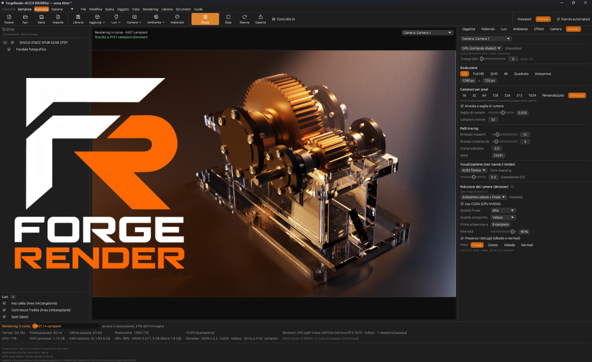
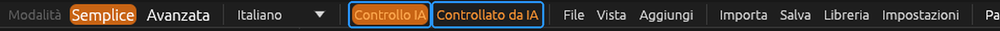

# ForgeRender

🇬🇧 [Read in English](README.md) (versione di riferimento)



**Motore di rendering fotorealistico per CAD e 3D, per Windows 11 · 64 bit.**  
Scritto in Rust, con path tracing progressivo su CPU e GPU per modelli CAD, assiemi meccanici e scene 3D.

## Scarica ForgeRender 0.23.0

<sub><strong>VERSIONE STABILE</strong> · Windows 11 · x64 · ZIP portable</sub>

[⬇️ **SCARICA FORGERENDER 0.23.0 — ZIP PORTABLE**](https://github.com/tarabaz/ForgeRender/releases/download/v0.23.0/ForgeRender-0.23.0-portable-x64.zip)

Nessuna installazione richiesta: estrai lo ZIP e avvia `forgerender.exe`.  
Il pacchetto viene distribuito tramite GitHub Releases.

### Novità della versione 0.23.0

- **Render più puliti di base:** il denoiser lavora al 100% e la soglia di rumore parte da 0,03.

<details>
<summary><strong>Versioni precedenti — storico completo delle release</strong></summary>

- **0.22.0 — Viste multiple, turntable e passaggi di render:** viste frontale, posteriore, laterali, dall'alto e a tre quarti automatiche; video del prodotto in rotazione in MP4 (H.264) con rotazione e durata regolabili; passaggi albedo, normali, profondità, maschera del prodotto e ID dei componenti.
- **0.21.0 — Editor materiali ed esportazione ZIP:** modifica materiali e mappe, ruota l'anteprima in tempo reale, applica e salva le modifiche ed esporta materiali portabili in ZIP. Corretti anche i campioni di Bozza e il ridimensionamento ripetuto dei fondali.
- **0.20.0 — Scala dei materiali adattata:** le texture con proiezione Box si adattano al singolo oggetto o all'assieme; rilievo e displacement mantengono la stessa scala su CPU e GPU.
- **0.19.0 — Luci spot volumetriche:** fasci di luce visibili con densità e lunghezza regolabili, ombre coniche e risultati coerenti tra CPU e GPU.
- **0.18.0 — Integrazione IA con un clic:** configurazione e gestione del ponte MCP per Claude Desktop, Claude Code e Codex, con stato della connessione e aggiornamento sicuro delle configurazioni.
- **0.17.1 — Correzioni a viewport e camera:** riavvio automatico del render solo nella vista Render; migliorate inquadratura della camera e navigazione.
- **0.17.0 — Ancoraggio texture Box e appoggio:** scelta tra ancoraggio Pezzo, Assieme o Mondo; appoggio di più oggetti con annullamento e impilamento senza compenetrazioni.
- **0.16.0 — Correttezza di materiali e texture:** displacement Box più uniforme, coerenza CPU/GPU e importazione migliorata dei nodi Blender Displacement e Bump.
- **0.15.0 — Proiezione Box e anteprime materiali:** texture triplanari allineate agli oggetti, proiezioni più morbide sulle superfici curve, anteprime scalabili e appoggio a contatto.
- **0.14.0 — Dimensioni sugli assi dell'oggetto e GPU prioritaria:** dimensioni e scala seguono gli assi locali; anteprime GPU e miglioramenti all'interfaccia.
- **0.13.0 — Importatore materiali Blender:** analisi e importazione di materiali, mappe e valori shader supportati dai file `.blend`, senza richiedere Blender per la lettura.
- **0.12.0 — Anteprime su shader ball:** miniature e anteprime renderizzate su una scena shader-ball reale; nel pannello Materiali vengono mostrati quelli usati nella scena.
- **0.11.0 — Libreria materiali unificata:** materiali predefiniti e scaricati in un unico catalogo; aggiunti preset metallici e legno derivati da BlenderKit, soggetti alle relative restrizioni di licenza.
- **0.10.0 — Materiali predefiniti con mappe:** primi materiali con mappe per rovere, pelle nera e marmo bianco lucido.
- **0.9.0 — Ispezione componenti con IA:** strumento MCP per creare anteprime numerate dei componenti e riconoscere le parti ripetute negli assiemi CAD.
- **0.8.3 — Correzioni a render e appoggio:** risolti artefatti di auto-ombreggiatura in ortografica e migliorato l'appoggio preciso sulla base.
- **0.8.2 — Correzioni:** interventi di stabilità e rendering.
- **0.8.1 — Correzioni:** ulteriori correzioni dell'applicazione.
- **0.8.0 — Manuale e compilazione:** manuale interno, miglioramenti al processo di compilazione e correzioni.
- **0.7.0 — Revisione dell'interfaccia:** menu e barra strumenti separati, nuove funzioni, correzioni e prima fase del manuale.
- **0.6.0 — Modalità Semplice e prima configurazione:** flusso semplificato per la foto prodotto, statistiche, schermata di benvenuto, controllo IA e guide.
- **0.5.0 — Controllo IA separato:** separazione del ponte di controllo IA dal programma principale.
- **0.4.0 — Controllo tramite Claude e MCP:** prima integrazione per il controllo in linguaggio naturale e miglioramenti collegati.
- **0.3.0 — Flusso foto prodotto:** strumenti per la fotografia prodotto, viewport e camera, illuminazione e interfaccia.
- **0.2.0 — Primo flusso di lavoro e libreria:** modalità Semplice, libreria materiali, miglioramenti al render, esempi portable e strumenti di compilazione.
- **0.1.0 — Prima versione:** path tracer CPU/GPU, import CAD/3D, libreria materiali, denoiser OIDN, camera professionale, luci, nebbia volumetrica, progetti, pacchetto portable e installer.

Per le note tecniche complete consulta [CHANGELOG.md](CHANGELOG.md) (in italiano, registro ufficiale delle release).

</details>

> **Controlla ForgeRender con l'IA — MCP**
>
> Apri ForgeRender, accendi **Controllo IA** e chiedi a Claude di preparare la scena, importare un modello CAD, posizionare le luci da studio, assegnare i materiali, impostare la camera e lanciare il render. 25 comandi, modifiche visibili in tempo reale e anteprime dei render restituite all'assistente. Decidi tu quando l'IA può comandare: quando si scollega, ForgeRender resta aperto con il tuo lavoro.
>
> 
>
> **[Configura Claude Code o Claude Desktop →](docs/MCP.md)** · [English guide](docs/MCP.en.md)

> Vedi [docs/ROADMAP.it.md](docs/ROADMAP.it.md) per cosa funziona davvero oggi, cosa viene dopo
> e quanto è complesso ogni passo.

## Cosa fa oggi

- **Interfaccia Semplice / Avanzata** (selettore in alto, predefinita Semplice): "Foto prodotto in
  5 passi" con pulsanti grandi (importa, appoggia sulla base, inquadra, aspetto, materiali,
  formato 16:9 / 1:1 / 4:5 / 9:16, qualità Bozza / Bilanciata / Alta, render e salvataggio).
  La Avanzata ha tutti i controlli; le due modalità modificano gli stessi valori.
- **Studio fotografico**: scena di partenza con fondale in tela inclinato e quattro luci da
  studio; colore delle luci (calda 3200 K, neutra 5500 K, fredda 7500 K o per singola luce).
  Altri aspetti: Sfondo chiaro, Sfondo scuro, Studio scenografico. **Prepara scena prodotto** e
  **Adatta la scena al prodotto** ridimensionano fondale e luci sulle misure del prodotto;
  **Annulla preset** riporta la scena com'era. Luci e oggetti nuovi nascono vicino al prodotto.
- **Lingue**: italiano e inglese, cambio immediato di tutta l'interfaccia (in alto o in
  Impostazioni → Lingua). Le traduzioni sono file separati `lang/Lan_*.json`: se ne aggiungono
  altri copiando `Lan_eng.json`.
- **Controllo IA (MCP)**: comanda ForgeRender in linguaggio naturale tramite Claude Code o Claude Desktop, con il ponte `forgerender-mcp.exe` e l'interruttore "Controllo IA" nella barra. Consulta la [guida di configurazione MCP](docs/MCP.md) per installazione, esempi, strumenti disponibili e sicurezza.
- **Schermata di benvenuto** all'avvio con immagine (`assets/splash.png`), versione e commit;
  si chiude con "Chiudi" e si riapre da File.
- **Path tracing** su CPU (tutti i core) e su GPU (compute shader wgpu, Vulkan/DX12) con accumulo
  progressivo reale (16…1024 campioni, personalizzato o illimitato, modificabile durante il render).
  Next Event Estimation + Multiple Importance Sampling, Russian roulette, BVH SAH.
- **Denoiser**: Intel Open Image Denoise caricato a runtime, dispositivo CPU o CUDA, buffer guida
  albedo/normali, modalità solo finale o anteprima progressiva.
- **Materiali**: diffuso, metalli e plastiche GGX con compensazione multi-scattering, vetro con
  Fresnel esatto, vetro satinato, superfici emissive campionate come luci.
  Mappe PBR complete: colore base, rugosità/lucidità, metallicità, normal (OpenGL/DirectX),
  height (bump), **displacement vero**, occlusione ambientale, ritaglio con opacità; mapping UV o
  proiezione box in metri per i modelli CAD senza UV, con dimensione della ripetizione, rotazione
  e spostamento.
- **Libreria**: materiali predefiniti inclusi, più materiali e HDRI scaricati da ambientCG e
  Poly Haven o importati da cartelle/ZIP, conservati nella cartella locale `Libreria` con anteprime.
- **Luci e ambiente**: luci ad area, puntiformi, spot e direzionali, preset da studio; ambiente
  uniforme, a gradiente o HDRI (.hdr/.exr) con importance sampling. Puntiformi e spot hanno un
  **raggio d'azione** con sfumatura del bordo, indipendente dall'intensità, disegnato come una
  bolla nella viewport (CPU e GPU).
- **Nebbia volumetrica**: nebbia da ghiaccio secco procedurale (con seed, riproducibile) che
  esce da un emettitore puntiforme, cade, si deposita, si allarga e scorre attorno agli oggetti;
  resa come vero mezzo partecipante (delta tracking, fase Henyey–Greenstein, ombre nella nebbia)
  su CPU e GPU.
- **Camere**: camera orbitale della viewport più camere di rendering con obiettivo professionale:
  focale in mm, diaframma f/, profondità di campo (piano di fuoco e limiti vicino/lontano
  disegnati nella viewport), lamelle, decentramento. **Vista ortografica e isometrica** nella
  viewport (icone accanto al navigatore, tasto 5 del tastierino) e nella camera di render.
- **Import**: glTF/GLB (esportazione consigliata da SolidWorks), OBJ (con .mtl), STL, Blender
  `.blend` (tramite Blender installato); STEP con Open CASCADE e SolidWorks SLDPRT/SLDASM sono
  sperimentali. Il convertitore STEP (`forgerender-step.exe`) lo compila `Build-ForgeRender.ps1`;
  serve CMake (`winget install Kitware.CMake`).
- **Modifica**: gizmo sposta/ruota/scala con snap (anche per le luci, con le maniglie del cono
  dello spot, e per l'emettitore della nebbia), snap a contatto per oggetto, annulla/ripeti, nascondi (H), duplica, appoggio
  esatto sul pavimento, navigatore degli assi stile Blender, albero dei componenti, assegnazione
  dei materiali persistente per id stabile.
- Avvio / pausa / ripresa / stop / riavvio automatico quando la scena cambia, export PNG.
- Progetti `.frproject` (JSON versionato, salvataggio atomico, percorsi relativi).
- CLI per render senza interfaccia, benchmark e import nella libreria.

## Scaricare la versione Windows

La build su GitHub Actions **non** parte ai push: si avvia a mano da *Actions → CI → Run workflow*
(oppure si compila in locale con `Build-ForgeRender.ps1`). Nella sezione *Artifacts* del run ci
sono due pacchetti:

| Pacchetto | Contenuto |
|---|---|
| `ForgeRender-portable-x64` | zip: si estrae e si avvia `forgerender.exe`, nessuna installazione |
| `ForgeRender-setup-x64` | installer (menu Start, disinstallazione, associazione `.frproject`) |

Entrambi sono autonomi: CRT statico, solo DLL di sistema di Windows più le librerie di Open
Image Denoise incluse.

## Compilare in locale

Requisiti: Rust stable (`rustup`); su Windows i *Visual Studio Build Tools* (C++).

```
cargo test --workspace --release
cargo run --release -p forge_app            # interfaccia grafica
cargo run --release -p forge_cli -- bench   # benchmark
```

Pacchetti Windows in locale: `powershell -ExecutionPolicy Bypass -File packaging\windows\package.ps1`
(per l'installer serve [Inno Setup 6](https://jrsoftware.org/isdl.php)).

## Benchmark: comandi da lanciare

Elenco di tutte le misure che si possono fare, con a cosa serve ciascuna. I risultati veri (e i
dati grezzi) vanno in [`reports/`](reports/README.md), una cartella per esperimento; quelli già
fatti sono in [docs/BENCHMARK.md](docs/BENCHMARK.md). Regola: si riportano solo numeri misurati.

### Preparazione (una volta)

I comandi sono per PowerShell. Basta lo zip `ForgeRender-portable-x64`:
- estrailo e apri PowerShell **nella cartella estratta**;
- i progetti di benchmark sono già dentro, in `samples\scene\cocktail-ghiaccio-secco\`;
- non serve né Python né il repository.

In alternativa usa la cartella del repository con `forgerender-cli.exe` compilato da
`Build-ForgeRender.ps1`.

```powershell
cd C:\percorso\ForgeRender-portable-x64          # cartella dello zip estratto
$cli = ".\forgerender-cli.exe"                    # nel repository: ".\target\release\forgerender-cli.exe"
```

I progetti di benchmark sono derivati dalla demo del cocktail, tutti senza profondità di campo
e con la camera fissa. Se cambia la demo si rigenerano con
`reports/strumenti/crea_progetti_bench.py`, e la CI controlla che siano allineati.

Python (`py -m pip install numpy pillow`) serve solo per gli script di confronto delle immagini
in `reports/strumenti/`. Se non puoi usarlo, metti le immagini in `reports/AAAA-MM-GG_.../` e
l'analisi la fa l'agente.

| Progetto | Cosa inquadra | Seed |
|---|---|---|
| `bench_intera` | l'intera demo | 12345 |
| `bench_vicina` | ravvicinata sulla nebbia | 12345 |
| `bench_ad` | l'intera demo | dato da `--seed` |

Le righe da leggere nell'output del render sono:
- `rendering N s | M ms/passata | X Mcampioni/s`
- `geometria compilata … in N ms`
- `nebbia «…»: simulazione … in N ms`

### 1. Hardware rilevato

```powershell
& $cli info
```
**A cosa serve**: verificare CPU, thread e RAM viste dal programma. Il nome va scritto in ogni
report.

### 2. Benchmark standard (CPU, GPU, denoiser)

```powershell
& $cli bench --json bench.json
& $cli bench --spp 64 --width 1920 --height 1080 --threads 1,4,8,12,24 --json bench-1080p.json
```
**A cosa serve**:
- **CPU**: scalabilità al variare dei thread.
- **GPU**: la riga `GPU` riporta Mcampioni/s e quante volte va più veloce di 1 thread.
- **Denoiser**: OIDN su CPU e CUDA, in ms per immagine.

La scena di test è piccola (11 022 triangoli): misura la velocità pura del path tracer.
**Confronto**: la tabella del 9900X in `docs/BENCHMARK.md`. Se cambia di molto senza modifiche
al codice, cambiano driver o impostazioni di energia.

### 3. Scena reale pesante, CPU contro GPU (nebbia, vetro, texture)

```powershell
$p = "samples\scene\cocktail-ghiaccio-secco"
& $cli render --project $p\bench_intera.frproject --backend cpu --width 320 --height 400 --spp 32 --quiet --out intera_cpu.png
& $cli render --project $p\bench_intera.frproject --backend gpu --width 320 --height 400 --spp 32 --quiet --out intera_gpu.png
& $cli render --project $p\bench_vicina.frproject --backend cpu --width 320 --height 400 --spp 32 --quiet --out vicina_cpu.png
& $cli render --project $p\bench_vicina.frproject --backend gpu --width 320 --height 400 --spp 32 --quiet --out vicina_gpu.png
```
**A cosa serve**:
- Quanto rende la GPU su una scena vera, non sulla scena di test.
- Misura il **majorant 3D della nebbia** sulla RTX 5070, che nel container non si è potuto
  misurare.

**Cosa guardare**: la riga `ms/passata`. Prima del render c'è la simulazione della nebbia, che
dura qualche decina di secondi e non conta nel tempo di rendering.

**Confronto**: [report majorant](reports/2026-10-29_majorant-3d-nebbia/REPORT.md). Per
confrontarti con i numeri del container aggiungi `--threads 3` alla riga CPU. Per tempi più
stabili alza la risoluzione (es. `--width 960 --height 1200 --spp 64`).

### 4. Campionamento adattivo (conviene sulla mia scena?)

```powershell
$b = "samples\scene\cocktail-ghiaccio-secco\bench_ad.frproject"
& $cli render --project $b --backend gpu --width 320 --height 400 --spp 1024 --seed 99  --quiet --out ref.png
& $cli render --project $b --backend gpu --width 320 --height 400 --spp 1024 --seed 100 --quiet --out ref2.png
& $cli render --project $b --backend gpu --width 320 --height 400 --spp 32  --quiet --out uni32.png
& $cli render --project $b --backend gpu --width 320 --height 400 --spp 128 --quiet --out uni128.png
& $cli render --project $b --backend gpu --width 320 --height 400 --spp 1024 --noise-threshold 0.08 --quiet --out ad08.png
& $cli render --project $b --backend gpu --width 320 --height 400 --spp 1024 --noise-threshold 0.04 --quiet --out ad04.png
py reports\strumenti\confronta_immagini.py ref.png ref2.png -- uni32.png uni128.png ad08.png ad04.png
```
**A cosa serve**: capire se fermare i pixel già puliti fa risparmiare tempo a parità di
qualità.

**Cosa guardare**:
- Annota il tempo di ogni render.
- Calcola **tempo × MSE**: più è basso, meglio è. Si confronta adattivo contro uniforme.
- Con il threshold attivo il CLI stampa anche i campioni medi per pixel.

Ripeti con `--backend cpu` per confrontare i due backend.

**Diagnostica (dove vanno i campioni)**: aggiungi `--adaptive-map mappa04.png` a un render
adattivo. Scrive un PNG a 16 bit con i campioni esatti di ogni pixel e stampa la quota dei
campioni nella metà "B" usata per stimare l'errore (dovrebbe essere circa 0,5). Poi:

```powershell
py reports\strumenti\analisi_adattivo.py --rif ref.png ref2.png --mappa mappa04.png --img ad04.png --img uni128.png --csv riquadri.csv
```

Per le zone scure, medie e chiare del riferimento stampa: quota di pixel, quota di campioni,
errore di ogni immagine e differenza media con il suo errore standard.

**Confronto**: [report campionamento adattivo](reports/2026-10-29_campionamento-adattivo/REPORT.md).
Nel container, su questa scena, l'adattivo era meno efficiente.

### 5. Import e BVH di una mesh grande

```powershell
& $cli render --mesh C:\percorso\modello_grande.stl --unit mm --spp 16 --width 640 --height 360 --quiet --out mesh.png
```
**A cosa serve**: il tempo di caricamento delle scene CAD pesanti. Funziona anche con
`.step`, `.glb` e `.obj`.

**Cosa guardare**: la riga `geometria compilata: N triangoli, BVH M nodi, in T ms` e il tempo
totale prima che parta il render.

**Confronto**: toro da 1 milione di triangoli in `docs/BENCHMARK.md`.

### 6. Profilo della simulazione della nebbia

```powershell
$env:FORGE_FOG_PROFILE = "1"
& $cli render --project samples\scene\cocktail-ghiaccio-secco\bench_intera.frproject --spp 1 --width 160 --height 200 --quiet --out nebbia.png
Remove-Item Env:FORGE_FOG_PROFILE
```
**A cosa serve**: capire quanto costa ogni fase della simulazione fluida (forze, trasporto,
pressione…), per decidere dove ottimizzare.

**Cosa guardare**: le righe `nebbia «…»: simulazione … passi in N ms` e `profilo nebbia: …`.

### 7. Risoluzione e campioni della scena finale

```powershell
& $cli render --project samples\scene\cocktail-ghiaccio-secco\cocktail-ghiaccio-secco.frproject --backend gpu --quiet --out finale_gpu.png
& $cli render --project samples\scene\cocktail-ghiaccio-secco\cocktail-ghiaccio-secco.frproject --backend gpu --denoise finale --cuda --quiet --out finale_gpu_dn.png
```
**A cosa serve**: il tempo reale di un'immagine finita, con le impostazioni del progetto
(risoluzione, campioni, profondità di campo), con e senza denoiser.

### 8. Test di correttezza (prima di fidarsi dei tempi)

```powershell
cargo test --release --workspace --exclude forge_step
cargo test --release -p forge_render_gpu -- --nocapture
cargo test --release -p forge_render_cpu --test portal -- --nocapture
cargo test --release -p forge_render_cpu --test adaptive -- --nocapture
```
**A cosa serve**:
- **Tutti i test**: confermano che le immagini sono giuste. Tra questi ci sono white furnace,
  luci contro il risultato analitico, nebbia, vetro, portali e adattivo.
- **Test della GPU**: sulla RTX 5070 controllano che CPU e GPU diano la stessa immagine.
- `--nocapture` stampa gli errori misurati (portali, adattivo) da confrontare con i report.

### Dove scrivere i risultati

Crea `reports/AAAA-MM-GG_argomento/` con un `REPORT.md` (macchina, commit, comandi, tabella) e i
file di output e le immagini. Poi aggiungi una riga all'indice in `reports/README.md`.

## Documentazione

- [Indice della documentazione](docs/README.it.md) — scegli la lingua e consulta le guide.

- [CHANGELOG.md](CHANGELOG.md) — novità di ogni versione e regola per i numeri di versione
- [reports/](reports/README.md) — report delle misure con dati grezzi, immagini e comandi per rifarle
- [docs/MCP.md](docs/MCP.md) — comandare ForgeRender con Claude Code (MCP): installazione,
  comandi, sicurezza
- [docs/ROADMAP.it.md](docs/ROADMAP.it.md) — stato, prossimi passi con la complessità, piani tecnici
  ([English](docs/ROADMAP.md))
- [docs/ARCHITECTURE.it.md](docs/ARCHITECTURE.it.md) — architettura, scelte tecniche e limiti noti ([English](docs/ARCHITECTURE.md))
- [docs/BENCHMARK.it.md](docs/BENCHMARK.it.md) — misure eseguite (solo dati reali; traduzione inglese da completare)
- [docs/STATO_LAVORI.md](docs/STATO_LAVORI.md) — diario dello sviluppo

## Licenza e contributi

ForgeRender è distribuito con **Apache License 2.0**. La licenza consente di
utilizzare, modificare, ridistribuire e distribuire commercialmente il progetto,
nel rispetto delle sue condizioni. I file modificati devono essere identificati
come tali e gli avvisi applicabili di copyright, licenza e attribuzione devono
essere conservati. La licenza **non** concede diritti sul nome o sul logo
ForgeRender oltre al limitato uso descrittivo previsto dalla licenza.

- [Apache License 2.0](LICENSE)
- [Avvisi di attribuzione del progetto](NOTICE)
- [Come contribuire](CONTRIBUTING.md)

Librerie, materiali, asset di esempio e altri contenuti di terze parti possono
essere soggetti a licenze separate: consulta gli avvisi allegati e
`packaging/licenses/`.
