# ForgeRender

🇮🇹 [Leggi in italiano](README.it.md)

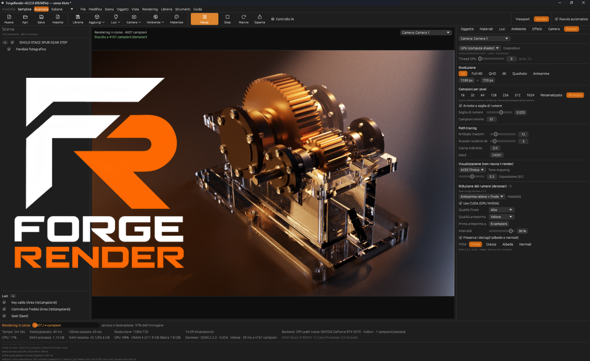

**A photorealistic CAD & 3D rendering engine for Windows 11 · 64-bit.**  
Written in Rust, with progressive CPU/GPU path tracing for CAD models, mechanical assemblies and general 3D scenes.

## Download ForgeRender

<sub><strong>LATEST STABLE RELEASE</strong> · Windows 11 · x64</sub>

[⬇️ **DOWNLOAD THE LATEST VERSION**](https://github.com/tarabaz/ForgeRender/releases/latest)

Open the latest release page to download the Windows package and read the release notes.  
No installation is required when using the portable ZIP: extract it and run `forgerender.exe`.

[Browse all releases and previous versions](https://github.com/tarabaz/ForgeRender/releases).

### What's new in 0.42.0

- **Replace material:** every object with one material switches to another in one click, without selecting them.
- **Dust in two colours:** a second colour with its share, opacity and a random size variation.
- **Fairy dust:** flat flakes that reflect like tiny mirrors, so only some of them sparkle, depending on how the light hits them.
- **Smoke preview only:** a simulated smoke can stay as a quick point preview in the viewport while you place it; the render runs the full simulation only when you turn it back on.

<details>
<summary><strong>Previous versions — complete release history</strong></summary>

- **0.41.0 — Smoke and fog computed once:** smoke and fog already computed are reused at the render when nothing has changed; the smoke simulation works only where the smoke is (up to four times faster on large boxes); smoke contrast for a light, transparent smoke that keeps its relief.
- **0.40.0 — Smoke that does not end at the box:** soft fractal edges on the simulated smoke; a box that turns and scales with its source, growing upwards only; simulated steam from a cup; material previews at 512 px; black and white also through coloured glass.
- **0.39.0 — Smoke you can place, colour picker:** the source of the simulated smoke is a sphere in the viewport, moved with the gizmo; a quick particle preview shows where the smoke goes and how it moves over time, without rendering; the simulation cells follow the source, so large boxes no longer lose the smoke; a colour picker for every material colour with RGB, CMYK and palettes (RAL Classic with indicative values included); the render starts at once with ink outlines and tilt-shift; smooth tilt-shift blur; cartoon highlights only where a light is really reflected; the manual follows the interface language.

- **0.38.0 — New built-in material library:** 125 materials in 13 categories with Italian names, the right dispersion on transparent materials and five textured materials per category; BlenderKit materials replaced by CC0 ones; an additional pack of 109 textured materials.
- **0.37.0 — Smoke simulation, cameras as components, tilt-shift:** simulated smoke (heat, buoyancy, swirls, wind, objects that deflect it); render cameras with a target, moved and orbited with the gizmo; tilt-shift band separate from the depth of field; black and white styles, solid background, outlines without stray dots; dust in its own box, larger specks with shadows.
- **0.36.0 — Volumetric smoke, haze start height:** procedural smoke clouds in a box moved with the gizmo, six presets; haze from a start height to a maximum height; wider sliders.
- **0.35.0 — Render styles, haze that does not veil everything:** cartoon and technical illustration with ink outlines; haze in "light rays only" mode with clumping, maximum height and puffs; dust lit only in the beams and kept by the denoiser.
- **0.34.0 — Haze in five kinds, dust as its own effect:** low fog, gas clouds, toxic floor smoke, floating layers and vapour curls with fractal and quality controls; dust visible only in direct light; icons instead of missing symbols.
- **0.33.0 — Ambient haze, floating dust, decals:** haze with banks and curls lit with multiple scattering; dust specks; decals on curved surfaces; STEP conversion saved with projects and packages; fog computation can be cancelled and restarts on changes.
- **0.32.0 — Much faster dry-ice fog:** the simulation works only where the fog is (Ultra 182 → 37 s on the cocktail demo), computed in the background with a progress bar; laser partial reflections; optical bench and lens demos; AI MCP ON/OFF switch.
- **0.31.0 — Complete package and detachable library:** .frpack, folder or ZIP with all files; detachable materials library with a big Apply to selection; UV violet laser and true blue; wide beams cut on glass faces; aspects keep your lights; new welcome screen.
- **0.30.0 — Laser as its own light, presets that add:** red, green, blue and white lab lasers (coloured ones never split); light presets add instead of replacing; visible beam inside liquids.
- **0.29.0 — Light through glasses with liquid:** correct glass-liquid bending for the laser and caustics, beam fading in coloured drinks; new Liquids material category.
- **0.28.0–0.28.1 — Caustics and demo scenes:** photon-mapped caustics with every light (CPU and GPU, RGB and Spectral); File → Demo scenes grouped by type with an explanation card; Prism, Diamond and Crystal pendant shapes; demo scenes saved as projects keep their objects.
- **0.27.0 — Lights aimed at an object, laser in glass:** lights hooked to an object follow it and orbit around it; the laser beam is visible inside glass; scrollable, resizable Lights panel.
- **0.26.0 — Laser light and "Prism and light" demo:** thin beam traced from the light through glass and mirrors, exact spot and optional visible beam, rainbow fan in the Spectral render; demo scene with a glass prism on black.
- **0.25.0 — Hardware ray tracing (RT cores):** rays traced by the GPU's ray tracing units (Vulkan), same image, renders 10–15× faster on an RTX 5070; automatic fallback to the shader BVH.
- **0.24.0 — Spectral rendering, startup mode choice:** optional spectral mode on CPU and GPU with glass dispersion (Abbe number) and presets for crown, flint, lead crystal, polycarbonate and diamond ([docs/SPECTRAL.md](docs/SPECTRAL.md)); Simple or Advanced mode chosen at startup; BlenderKit materials removed from the bundled presets.
- **0.23.0 — Cleaner default renders:** the denoiser runs at 100% and the noise threshold starts at 0.03.
- **0.22.0 — Multiple views, turntable and render passes:** automatic front, rear, side, top and three-quarter views; rotating product video exported as MP4 (H.264) with adjustable rotation and duration; albedo, normals, depth, product mask and component ID passes.
- **0.21.0 — Material editor and ZIP export:** edit library materials, adjust maps and values, rotate the live preview, apply changes, save materials and export portable material ZIPs. Also fixes draft sample defaults and repeated backdrop scaling.
- **0.20.0 — Adaptive material scale:** scale Box-projected textures to each object or assembly; keep bump and displacement at the same scale, consistently on CPU and GPU.
- **0.19.0 — Volumetric spotlights:** visible light beams with adjustable density and length, cone-shaped shadows, and matching CPU/GPU results.
- **0.18.0 — One-click AI integration:** configure and manage the ForgeRender MCP bridge for Claude Desktop, Claude Code and Codex, with connection status and safer configuration updates.
- **0.17.1 — Viewport and camera fixes:** automatic render restart only in Render view; improved camera framing and viewport navigation.
- **0.17.0 — Box texture anchoring and placement:** choose Piece, Assembly or World anchoring; improved multi-object placement with undo and collision-aware stacking.
- **0.16.0 — Material and texture correctness:** smoother Box displacement, consistent CPU/GPU results, improved Blender displacement and bump-node import.
- **0.15.0 — Box projection and material previews:** object-aligned triplanar textures, smoother projections on curved surfaces, scalable previews and contact placement.
- **0.14.0 — Object-axis dimensions and GPU-first rendering:** dimensions and scaling follow local object axes; GPU previews and improved interface.
- **0.13.0 — Blender material importer:** inspect and import materials, maps and supported shader values from `.blend` files without requiring Blender for the reading step.
- **0.12.0 — Shader-ball previews:** render material thumbnails and previews on a real shader-ball scene; show only materials used by the current scene in the Material panel.
- **0.11.0 — Unified material library:** combine built-in and downloaded materials; add BlenderKit-derived metal and wood presets (subject to their stated license restrictions).
- **0.10.0 — Mapped material presets:** first mapped presets for oak, black leather and polished white marble.
- **0.9.0 — AI component inspection:** MCP tool to generate numbered component previews and identify repeated parts in CAD assemblies.
- **0.8.3 — Rendering and placement fixes:** fix orthographic self-shadow artefacts and improve accurate placement on the base.
- **0.8.2 — Corrections:** stability and rendering fixes.
- **0.8.1 — Corrections:** additional fixes to the application.
- **0.8.0 — Documentation and build improvements:** internal manual, compilation workflow and corrections.
- **0.7.0 — Interface redesign:** separate menu bar and toolbar, new functions, corrections and first manual phase.
- **0.6.0 — Simple mode and onboarding:** simplified product-photo workflow, statistics, welcome screen, AI control and guides.
- **0.5.0 — Standalone AI control:** separate the AI control bridge from the main application.
- **0.4.0 — Claude control via MCP:** initial natural-language control integration and related improvements.
- **0.3.0 — Product photography workflow:** product-photo tools, viewport/camera, lighting and interface improvements.
- **0.2.0 — First workflow and library improvements:** Simple mode, material library, rendering improvements, portable samples and build tools.
- **0.1.0 — First release:** CPU/GPU path tracer, CAD/3D import, material library, OIDN denoiser, professional camera, lights, volumetric fog, projects, portable package and installer.

For the full technical notes, see [CHANGELOG.en.md](CHANGELOG.en.md) (Italian, authoritative release log).

</details>

## Explore ForgeRender

The images below show real ForgeRender results and workflows. Each section highlights a specific capability of the renderer.

### 1. Advanced light transport — RGB, Spectral & Caustics

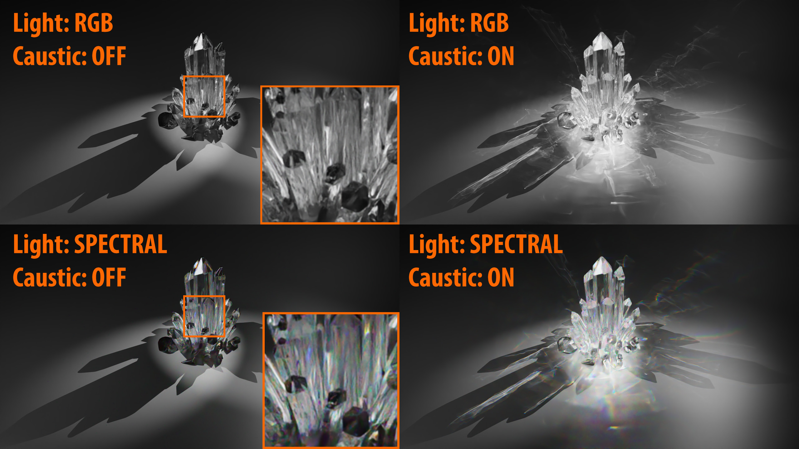

**Four configurations, one scene.** RGB uses conventional three-channel light transport. Spectral mode samples wavelengths, allowing dispersive materials to separate colours during refraction. Caustics enables progressive photon mapping to reveal focused light patterns created by glass, crystals and gemstones.

- **RGB + Caustics OFF:** RGB path tracing without the dedicated caustic contribution.
- **RGB + Caustics ON:** caustics rendered in RGB, without wavelength-dependent colour separation.
- **Spectral + Caustics OFF:** wavelength-sampled transport; dispersion can colour refraction.
- **Spectral + Caustics ON:** caustics can show coloured fringes and spectral separation when the transparent material has non-zero dispersion.

Visible dispersion requires a transparent material with an Abbe number. Lower Abbe values produce stronger dispersion. Caustics is independent of RGB/Spectral mode and supports point, spot, directional and area lights on both CPU and GPU. In the GPU backend, photon paths are currently built on the CPU and gathered by the GPU.

[Technical details: Spectral rendering](docs/SPECTRAL.md).

### 2. AI-assisted scene control — MCP

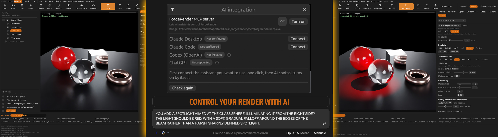

Connect Claude Desktop, Claude Code or Codex through the ForgeRender MCP bridge and control supported scene operations using natural language. Ask the assistant to adjust lighting, assign materials, configure the camera or prepare a render; ForgeRender applies the supported operations directly to the open scene. AI control is explicit and can be switched off from the interface.

[MCP setup guide](docs/MCP.en.md).

### 3. Laser optics — beams, prisms and lenses

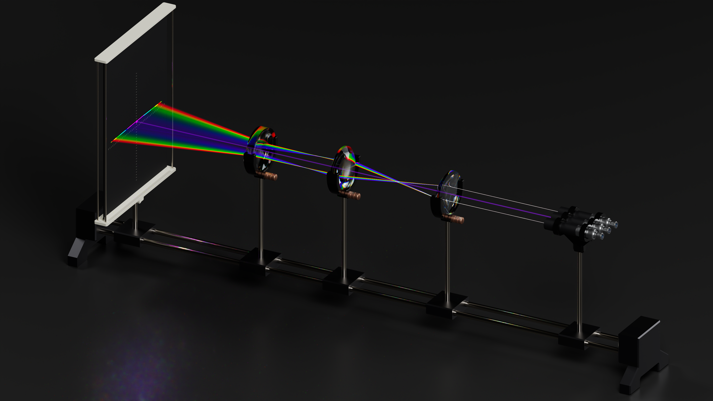

Use ForgeRender as a virtual optical bench. Choose from red, green, blue, UV violet (405 nm) and white laboratory laser sources, then inspect how the beam travels through transparent optical components.

- **Laser sources:** dedicated red, green, blue, UV violet and white laboratory presets.
- **Visible beam paths:** trace and display the beam through glass and liquids.
- **Refraction and partial reflections:** transparent interfaces can bend the beam and produce secondary reflected branches.
- **Spectral dispersion:** with white light and dispersive transparent materials, wavelength-dependent refraction can separate the visible spectrum.
- **Lens experiments:** explore the included converging and diverging lens demonstration scene.

The laser path is traced deterministically from the source, rather than relying on camera path tracing to randomly discover a narrow beam. This produces a clean, stable beam visualization.

### 4. Dry-ice fog — fluid simulation and volumetric rendering

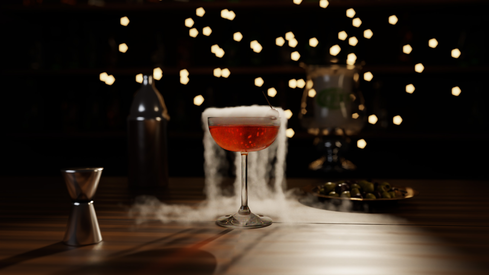

ForgeRender creates dry-ice-style fog with a deterministic, seeded fluid simulation. It is not a static smoke texture: a 3D fluid solver models the downward flow of cold, heavy gas, its accumulation and lateral spread along surfaces, and the turbulent wisps that rise as the cloud evolves.

- **3D MAC fluid grid:** the solver evolves velocity and pressure while transporting the fog fields through the simulation volume.
- **Gravity and rise:** the cold cloud falls from its emitter, settles and spreads sideways; the *Rise* parameter controls the upward motion of older wisps.
- **Turbulence:** seeded curl-noise forces and vorticity confinement create rolling eddies and filaments. Limited MacCormack advection helps preserve transported detail.
- **Scene collisions:** scene geometry is voxelised as solid obstacles, so fog flows around objects, pools inside containers, spills over their edges and spreads across nearby surfaces.
- **Volumetric rendering:** the simulation is baked into a higher-resolution density volume. The path tracer traverses it with delta tracking and Henyey–Greenstein phase scattering, allowing lights to illuminate the fog and cast volumetric shadows.
- **Reproducible controls:** simulated time, emission rate, source radius, turbulence, rise, dissipation, density, detail scale and simulation quality can be adjusted. A seed makes the same settings reproducible.
- **Fast and ready before you render:** each step works only where the fog is (within a few cells of it), not on the whole grid, and the pressure solve reads a compact neighbour table: on the cocktail demo the Ultra quality simulation went from about 3 minutes to about 37 seconds (4.9×), Very high from 61 s to 14.5 s (4.2×), High from 11.4 s to 3.7 s. The fog is computed in the background shortly after the last change, so it is usually ready when you press Render, and the status bar shows its progress (obstacles, simulation, detail) next to the samples.

This is a physically motivated fluid approximation for dry-ice-style effects, not a thermodynamic CFD model of CO2 sublimation or heat transfer.

[Open the cocktail with dry-ice demo scene](samples/scene/cocktail-ghiaccio-secco/cocktail-ghiaccio-secco.frproject) · [Demo instructions and controls](samples/scene/cocktail-ghiaccio-secco/LEGGIMI.md).

### 5. Ambient haze — five kinds of procedural fog

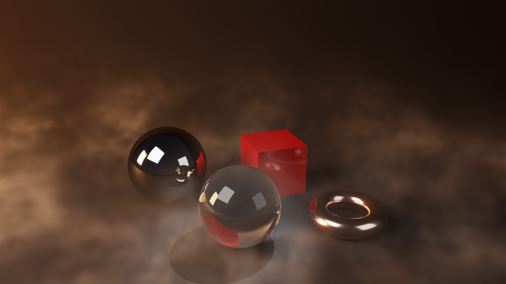

A participating medium that fills the scene (or only a layer of it) and that every light crosses: spots, sun and lamps draw rays with the shadows of the objects inside it, and light is scattered several times, on CPU and GPU. It is not a texture or a uniform grey block: the density comes from a domain-warped fractal noise computed on a 3D grid, so it has banks, curls and gaps.

- **Five kinds:** *Low fog* lying on the ground and thinning out going up; *Gas clouds*, almost clear air with dense clumps here and there; *Toxic smoke on the floor*, a layer a few centimetres thick that hovers over the floor gathered into filaments; *Floating layers*, horizontal veils at different heights, wavy and full of holes; *Vapour curls*, swirls inside swirls with high contrast.
- **Fractal controls:** swirl strength (from round blobs to clearly visible spirals), fractal detail (1–10 octaves), roughness (soft or ragged edges), swirl size, amount, colour and forward scattering (how bright the rays are against the light).
- **Light rays only (default):** the haze adds only the light of spots, sun and lamps scattered in the air, so the rays show without veiling or darkening the objects; switched off, it becomes a physical medium that also scatters the environment light and veils the scene.
- **Shape controls:** clumping (large denser areas and thinner ones), a start height and a maximum height above the floor (together they make a suspended band, for example under the ceiling) (the floor is found with rays) with a few random puffs rising above it, and a density scale that tells how far you can see through it.
- **Quality slider:** the grid follows both the swirl size and the size of the scene, from a 2-million-cell draft to 24 million cells (48 MB) for fine detail and sharp edges. The haze is computed ahead of time, one effect at a time, with the progress bar at the bottom.
- **Never inside the objects:** rays travelling inside glass or liquid skip it (lenses and glasses stay clear) and the solid inside of the parts is cleared, while the air of a closed room stays hazy.

### 6. Volumetric smoke — clouds, plumes and incense in a box

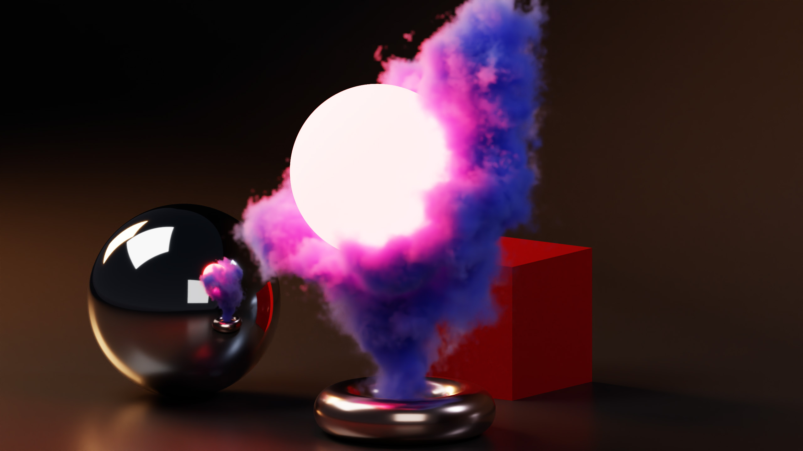

Real volumetric smoke clouds for product shots: incense smoke next to a perfume bottle, steam rising from a cup, a plume from a pipe or chimney, dense dark industrial smoke. Each cloud lives in a box that you select in the viewport and move or resize with the gizmo: the rendered smoke follows the box exactly, with nothing left behind where it was.

- **Four shapes and six presets:** *Cloud* (a rounded mass in mid-air), *Plume* (narrow at the bottom of the box, widening and fading as it rises), *Incense thread* (smooth at the bottom, then breaking into curls) and *Bank* (fills the whole box with frayed edges). Presets: suspended cloud, incense, steam from a cup, plume from a pipe, dense industrial smoke and smoke bank. Each preset adds a new cloud on top of the selection, it never replaces one.
- **Multi-scale structure:** the outline of the shape is twisted by domain-warped noise, the edge gets cauliflower puffs (a fractal of |noise|) and thin filaments (noise ridges), and the inside has slow density variations. Plumes and incense start laminar and become turbulent as they rise.
- **Controls:** density with an "opaque beyond ~X" scale, colour (white steam, grey smoke, dark soot), backlight, curl size, swirl strength (up to 8), fractal detail (up to 10 octaves), roughness, puffs, filaments, edge softness, inner variation; for plumes and incense also widening, meandering and fading; start height and maximum height inside the box; quality from 3 to 24 million cells; variant (seed).
- **Physical:** the smoke scatters and absorbs light with multiple scattering, casts volumetric shadows and receives them, on CPU and GPU (the same delta tracking as the dry-ice fog). It never fills the solid inside of the objects that cross the box. The same parameters and seed always give the same cloud.
- **Computed ahead of time** with the other effects, one at a time on the progress bar, and saved with the project.

- **Simulated mode:** instead of a chosen shape, the smoke can come from a physical simulation inside the box (a Eulerian fluid with temperature and buoyancy, as in Fedkiw, Stam and Jensen 2001): a source emits smoke and heat, hot smoke rises, heavy gas sinks and spreads, vorticity confinement keeps the curls, curl-noise turbulence breaks the column into puffs, wind pushes it and the objects in the box deflect it. The simulation is frozen at the chosen instant and the procedural detail (puffs, filaments) is added on its edge. Controls: source position and radius, amount, heat, buoyancy, weight, exit speed, cooling, fading, swirls, turbulence and its size, wind, instant and simulation quality (48 to 136 cells per side). Presets: simulated hot smoke, simulated heavy gas and steam from a cup (thin wisps that curl and fade away, from a source as wide as the cup).
- **Placing the simulated smoke:** the source is a light blue sphere in the viewport, as large as the real source: click it (or "Select the source") and the gizmo moves it, while Scale changes its radius. The **viewport preview** runs the same simulation on a coarse grid in about a second and shows it as a cloud of points that moves from 0 to the chosen instant, in a loop or paused at any time: you find the place, the source and the behaviour without rendering, then refine with the render. The simulation cells follow the source: in a large box they get finer (within the computing limit of the quality), so the smoke no longer comes out in a few lumps or vanishes into the floor, and the panel warns when the source is still smaller than a cell.
- **Soft edges:** the simulated smoke does not fill the box and end with a cut: in a band near the walls and the ceiling (not the bottom) it dissolves as if it left the box, and the edge frays in a fractal way, with tongues, holes and wisps, like real smoke thinning out in the air. The width of the band is adjustable (0 = full up to the edge).
- **Contrast:** raises the difference between the clumps and the thin parts: with a low density and a high contrast the smoke is transparent but keeps its relief, the clumps stay dense and shade themselves.
- **Computed once:** the simulation works only in the zone where the smoke and the heat are (like the dry-ice fog), and the result is reused by the render as long as smoke, box and objects stay the same.
- **Preview only:** turn off "Full computation for the render" and the simulated smoke stays as the quick point preview in the viewport (also when it is not selected), with its collisions with the objects, while the render skips the full simulation. Place it, check how it flows around the objects, then turn the computation back on for the real render.
- **Box with its source:** the gizmo follows the box: Move moves box and source, Rotate turns them around the vertical (also with the "Rotation" field), Scale enlarges box, source position and source radius together. Height and scale grow upwards only, from the bottom of the box, so the smoke never goes below the floor. The viewport preview shows the time being played and is kept when you click elsewhere, so it is not recomputed while you turn the camera.

Fire (combustion, emission, flames lighting the scene) is a separate, later step: see the [smoke and fire study](docs/studio-fumo-fuoco.md).

### 7. Floating dust — specks that shine only in a beam

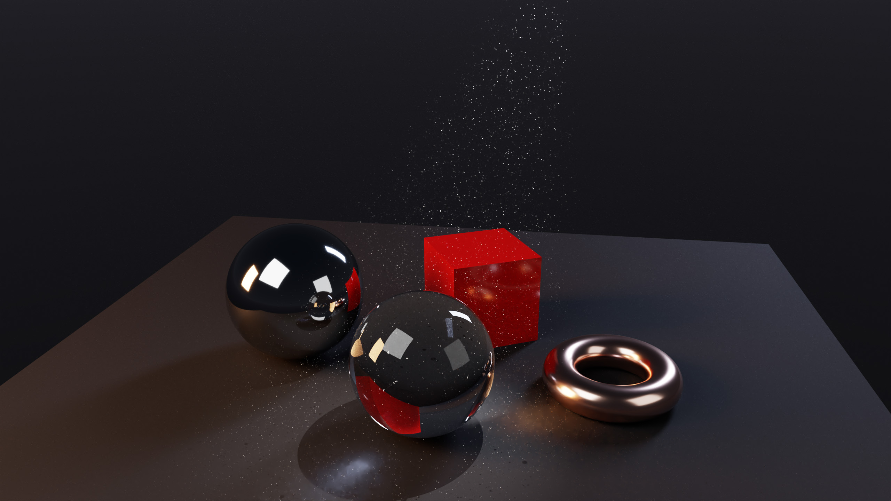

Real specks (a few millimetres, up to 150,000) scattered in the air, as their own effect. They are invisible except inside the beams of spots and sun: there they sparkle, like the dust in the rays coming through an attic window, while bulbs, panels, environment and bounce light do not light them. They are marked in the denoiser guides, so the denoiser keeps them instead of removing them as noise. The specks live in a box that you select in the viewport and move or resize with the gizmo; by default it covers the objects up to the spots, so the specks fill the whole beam down to the lit surface. Amount (down to a few isolated specks), size (up to 18 mm), brightness and colour are adjustable, and the specks can cast shadows: small dark shapes in the beams and on the lit surface.

- **Size variation:** how much the size of each speck differs at random from the set size, from all the same to tiny-to-triple.
- **Two colours and opacity:** a second colour with the share of specks that take it (for example gold and white), and an opacity that makes them semi-transparent: they scatter less light and, if they cast shadows, block only part of it.
- **Grains or flakes (fairy dust):** *Grains* are round and scatter the light evenly. *Flakes* are flat and face random directions: they reflect like tiny mirrors, so only those turned the right way between the light and the camera sparkle while the others stay dark, like glitter or fairy dust. **Sparkle** sets how much light the flakes reflect like a mirror, **reflection roughness** how small and intense (low) or wide and soft (high) the sparkles are. The same on CPU and GPU.

### 8. Decals — labels and logos on any surface

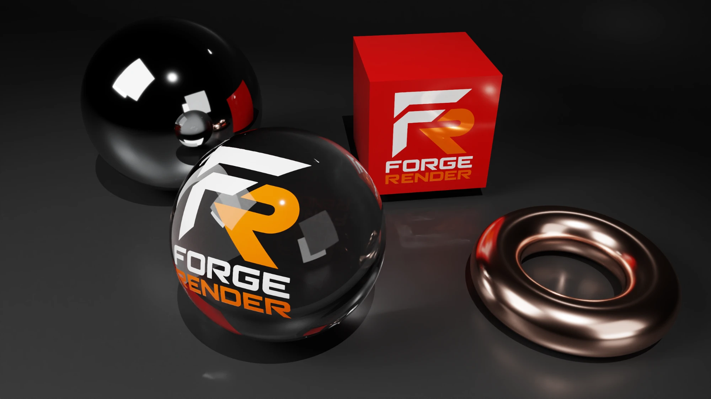

Apply an image (a logo, a label, a PNG with transparency) to the selected object where the camera is looking. The decal is cut from the object's own triangles inside a projection box, so it wraps curved surfaces such as bottles and cups, and it moves with the object. The transparent parts of the PNG let the object show through. Width (the height follows the image proportions), rotation, position on the surface, projection depth, roughness and metalness are adjustable, and the image travels with the project and inside `.frpack` packages.

### 9. PBR materials and textures for CAD models

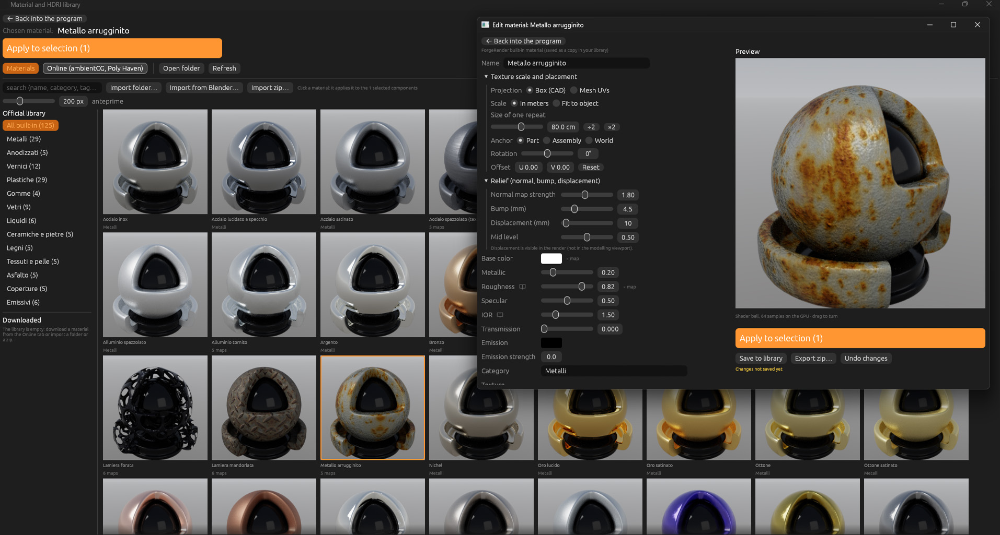

Diffuse materials, GGX metals and plastics, Fresnel glass, frosted glass and emissive surfaces. PBR maps include base colour, roughness, metallic, normal, bump, true displacement, ambient occlusion and opacity. For CAD models without UVs, metric Box projection is available, with Piece, Assembly or World anchoring.

- **Built-in library:** 125 ready materials in 13 categories: metals, anodised aluminium, paints, plastics, rubbers, glass, liquids, ceramics and stone, woods, fabrics and leather, asphalt, roofing and emissive. Every plain material (metals, paints, plastics, glass, liquids, LEDs) is included, plus five textured materials per category, chosen to be different from each other: brushed steel, turned aluminium, diamond plate, perforated sheet and rusty metal; oak, walnut, herringbone parquet, plywood and bark; denim, leather, bouclé wool, jute and satin. Transparent materials carry the right dispersion (Abbe number: crown glass 58, lead crystal 32, optical glass 64, diamond 55, polycarbonate 30, water 56…), visible in the spectral render, and water and drinks behave as liquids inside their glass. Maps are 1024 px to keep the program light.
- **Additional pack:** 109 more textured materials with 2K maps (woods and barks, stones and plasters, fabrics, rusty and worn metals, asphalt, roofs), about 1.6 GB, downloaded separately and copied as `materiali-aggiuntivi` next to `forgerender.exe`: at the next start they appear in the same library.
- **Free to redistribute:** the textured materials come from Poly Haven and ambientCG (CC0); each material's source is listed in `assets/materiali/LEGGIMI.md`.
- **Sharp previews:** every material preview is rendered once with the path tracer at 512 px and scaled down for each card size, so it stays sharp both large and small.
- **Replace material:** in the Materials panel choose "Replace [material] with «selected»" (or right-click a scene material): every component with that material, including those that inherit it and the scene default, switches to the selected one, without selecting a hundred objects. "Undo replacement" brings the previous assignments back.
- **Colour picker:** clicking the swatch of a material colour (base colour, volume colour, emission) opens one panel with three tabs: **RGB** (colour wheel, R, G, B and hex code), **CMYK** (cyan, magenta, yellow and black in percent, with a simple mathematical conversion, not a print profile) and **Palette** (colours with code and name). The colour changes live; **Apply** keeps it, **Cancel** (or Esc) restores the previous one. The palette tab includes the RAL Classic codes with Italian and English names and **indicative** RGB values (an average of public sources, not the official RAL values, which RAL sells as a digital library); you can also import the official RAL CLASSIC `.ase` library or your own `.json`/`.csv` palette into the Colours folder of the library. A colour picked from a palette shows its code (for example **RAL 7016**) next to the swatch, saved with the project; changing the colour by hand turns it back into a plain RGB colour.

### 10. Product studio and lighting

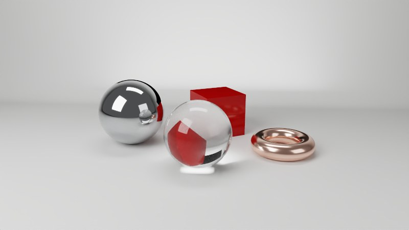

Prepare a product scene with a backdrop and studio lights, then choose a light, dark or dramatic background. Lights remain individually adjustable, and the studio can be fitted to the product dimensions without taking control away from the user.

### 11. Volumetric lighting and visible beams

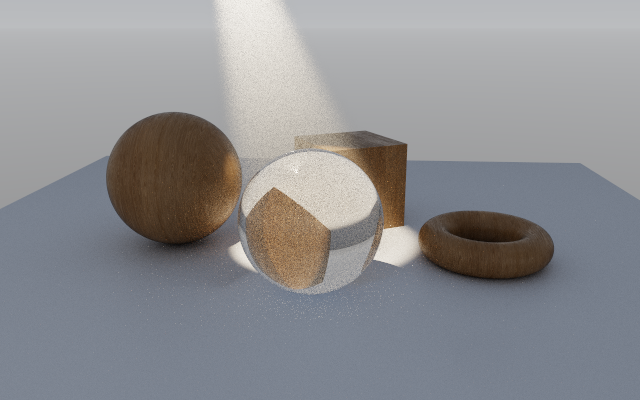

Spotlights can create visible beams with adjustable density and length. Volumetric fog is a participating medium with scattering and shadows: light interacts with the volume and becomes visible in space, not only on surfaces.

For fog that fills the whole scene see [Ambient haze](#5-ambient-haze--five-kinds-of-procedural-fog), and for specks that sparkle in the beams see [Floating dust](#7-floating-dust--specks-that-shine-only-in-a-beam).

### 12. Camera, multiple views and product presentation

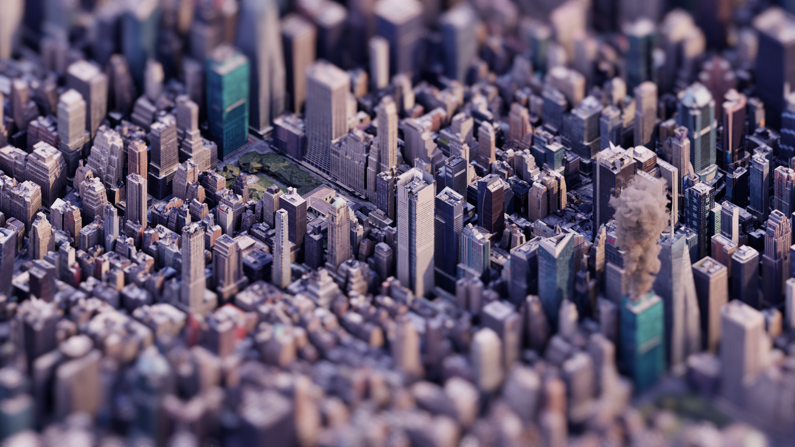

Render cameras provide focal length, aperture, depth of field and lens shift. Automatic front, rear, side, top and three-quarter views help present a product from multiple angles; turntable videos can be exported as MP4.

- **Cameras as components:** the render cameras are listed in the left panel, just above the lights. Selecting one shows a line to its target (a diamond) in the viewport: the gizmo moves the camera and its target together, orbits the camera around the target (Rotate), or, after clicking the diamond, moves only the target. The target can follow an object, like a spot light, so the object stays centred even when you move it.
- **Tilt-shift:** a sharp band on the final image (position, width and angle, horizontal, vertical or tilted) with the blur growing on both sides, each side with its own transition, from a hard edge to a very wide fade. It is separate from the depth of field: aperture, focal length and focus do not change, and with both on the band adds to the lens blur. The blur is depth-aware (a near sharp object does not bleed into the blurred background) and smooth even with a strong blur (it is gathered from progressively reduced copies of the image, so bright reflections become a soft blur instead of repeated copies), it works the same on CPU and GPU, and moving the band shows immediately without re-rendering.

### 13. Render passes and post-production

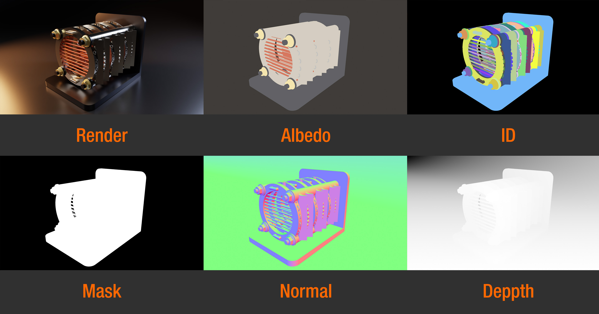

ForgeRender can export separate **Albedo, Normals, Depth, Product Mask and Component ID** passes for compositing, masking and further image editing. These are technical output buffers, not additional beauty renders.

### 14. Render styles — cartoon, technical illustration and ink outlines

At the top of the Render tab you choose how the image is drawn; hovering over each choice shows a small example.

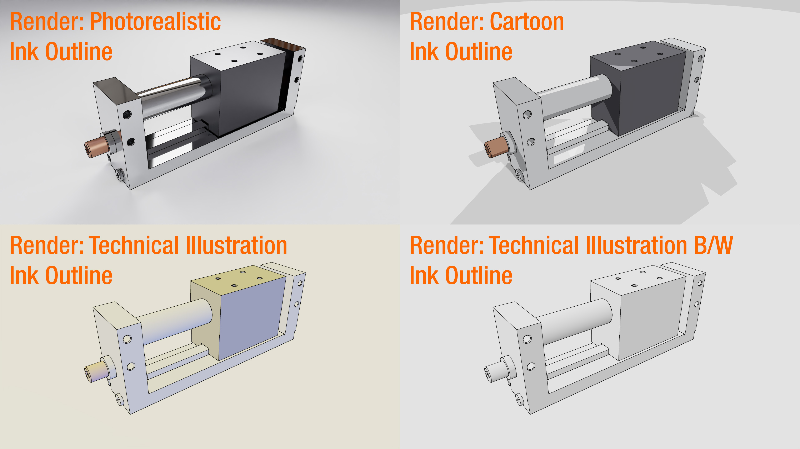

- **Photorealistic:** physically based path tracing, as always.
- **Cartoon (cel shading):** flat material colours in three sharp bands (light, half shadow, shadow) from the scene lights, with their hard shadows and a crisp highlight on shiny materials, only where a light is really reflected (the shape of a softbox for area lights) and as strong as the material reflects (faint on dark plastics, full on metals).
- **Technical illustration (Gooch):** soft shading from warm in the light to cool in the shadow, with no black shadows, so shapes and volumes read clearly.
- **Black and white:** the cartoon with the same bands in greys, the technical illustration like a pencil drawing; the whole image is grey, also what is seen through coloured glass and liquids or in mirrors. Off, they stay in colour.
- **Solid background:** where the camera sees nothing, a colour (white, light grey, black or any) instead of the environment, which still lights the scene.
- **Ink outlines:** dark lines on silhouettes, borders between objects, depth jumps and (optionally) sharp edges, traced with 3×3 rays per pixel and drawn over the final image, also after the denoiser. They work with any style; thickness, colour, edge angle and depth-jump sensitivity are adjustable. Rays that slip through the seam between two triangles no longer leave stray dots, a cleanup slider removes line pieces that are too short, and the floor edge against the background can be left without a line.

The styles are applied at the first surface seen by the camera, so glass and mirrors still reflect and refract; they work on CPU and GPU, also in the Spectral render.

### 15. STEP models: converted once, then reopened instantly

A STEP file is converted to meshes once. The result is kept in a conversion cache and saved next to the project (`modelli-convertiti/`) and inside `.frpack` packages, so reopening a project does not convert the STEP again. On the optical bench demo, opening went from 27 s to 0.2 s. When the STEP changes (or the parts of a multi-file assembly change, or the quality changes), it is converted again. Packages now also include the part files that a multi-file STEP assembly refers to.


## What it does today

- **Simple / Advanced interface** (switch at the top, Simple by default): "Product photo in
  5 steps" with large buttons (import, place on the base, frame, look, materials, 16:9 / 1:1 /
  4:5 / 9:16 format, Draft / Balanced / High quality, render and save). Advanced has every
  control; both modes edit the same values.
- **Photo studio**: start-up scene with a tilted cloth backdrop and four studio lights; light
  color (warm 3200 K, neutral 5500 K, cool 7500 K or per light). Other looks: Light background,
  Dark background, Dramatic studio. **Prepare product scene** and **Fit the scene to the
  product** resize backdrop and lights to the product; **Undo preset** restores the scene.
  New lights and objects appear next to the product.
- **Languages**: Italian and English, the whole interface switches immediately (at the top or in
  Settings → Language). Translations are separate `lang/Lan_*.json` files: copy `Lan_eng.json`
  to add more.
- **AI control (MCP)**: control ForgeRender in natural language through Claude Code or Claude Desktop, with the `forgerender-mcp.exe` bridge and the "AI MCP" switch in the top bar (ON/OFF, with the gear for the AI integration settings). See the [MCP setup guide](docs/MCP.en.md) for installation, examples, available tools and safety.
- **Welcome screen** at start-up with an image (`assets/splash.png`), version and commit; it
  closes with "Close" and reopens from File.
- **Path tracing** on the CPU (all cores) and on the GPU (wgpu compute shaders, Vulkan/DX12)
  with real progressive accumulation (16…1024 samples, custom or unlimited, changeable while
  rendering). Next Event Estimation + Multiple Importance Sampling, Russian roulette, SAH BVH.
- **Denoiser**: Intel Open Image Denoise loaded at runtime, CPU or CUDA device, albedo/normal
  guide buffers, final-only or progressive preview mode.
- **Materials**: diffuse, GGX metals and plastics with multiple-scattering compensation, glass
  with exact Fresnel, frosted glass, emissive surfaces sampled as lights.
  Full PBR maps: base colour, roughness/gloss, metallic, normal (OpenGL/DirectX), height (bump),
  **true displacement**, ambient occlusion, opacity cutout; UV mapping or world-space box
  projection in metres for CAD models without UVs, with repeat size, rotation and offset.
- **Library**: 125 built-in materials in 13 categories (an additional pack adds 109 textured ones), plus materials and HDRIs downloaded from ambientCG and
  Poly Haven or imported from folders/ZIP files, kept in a local `Library` folder with 512 px previews.
- **Colour picker**: RGB, CMYK and palettes (RAL Classic with indicative values, or imported
  `.ase`/`.json`/`.csv` palettes) for every material colour, with the palette code next to
  the swatch.
- **Spectral render, caustics and lasers**: RGB or spectral light transport with dispersion,
  photon-mapped caustics with every light, red, green, blue, violet and white lab lasers with
  visible beams, prisms and lenses.
- **Lights and environment**: area, point, spot and directional lights, studio presets;
  uniform, gradient or HDRI environment (.hdr/.exr) with importance sampling. Point and spot
  lights have a **range** with edge falloff, independent of the intensity, drawn as a bubble in
  the viewport (CPU and GPU).
- **Volumetric fog**: procedural dry-ice fog (seeded, deterministic) that falls from a point
  emitter, settles, spreads sideways and flows around objects; rendered as a real participating
  medium (delta tracking, Henyey–Greenstein phase, shadows through fog) on CPU and GPU.
- **Ambient haze and dust**: five kinds of procedural haze (low fog, gas clouds, toxic floor
  smoke, floating layers, vapour curls) from a start to a maximum height; dust specks in their
  own box that sparkle only in the beams of spots and sun, in two colours, with opacity and size
  variation, as round grains or as flat flakes that glitter like fairy dust.
- **Volumetric smoke**: procedural clouds, plumes, incense threads and smoke banks, or a physical
  simulation (heat, buoyancy, swirls, wind, objects that deflect it) with a movable source, a
  particle preview in the viewport (also as a preview only, without the full simulation at the
  render), soft fractal edges and a box that moves, turns and scales with its source.
- **Render styles**: photorealistic, cartoon (cel shading) and technical illustration, in colour
  or black and white, solid background, ink outlines on silhouettes and edges.
- **Decals**: images and logos (PNG with transparency) projected on curved surfaces, moving
  with the object.
- **Cameras**: orbit viewport camera plus render cameras with a professional lens: focal length
  in mm, f-stop, depth of field (focus plane and near/far limits drawn in the viewport),
  aperture blades, lens shift. **Orthographic and isometric view** in the viewport (icons next
  to the navigator, numpad 5) and in the render camera. Render cameras are components with a
  target, moved and orbited with the gizmo. **Tilt-shift**: a sharp band (position, width,
  angle) with a depth-aware blur on both sides, separate from the depth of field, shown at once
  without re-rendering.
- **Import**: glTF/GLB (recommended export from SolidWorks), OBJ (with .mtl), STL, Blender
  `.blend` (through an installed Blender); STEP via Open CASCADE and SolidWorks SLDPRT/SLDASM
  are experimental. The STEP converter (`forgerender-step.exe`) is built by `Build-ForgeRender.ps1`;
  it needs CMake (`winget install Kitware.CMake`).
- **Editing**: move/rotate/scale gizmo with snapping (also for lights, spot cone handles and fog
  emitters), per-object contact snap, undo/redo, hide (H), duplicate,
  exact drop to floor, Blender-style axis navigator, component tree, persistent material
  assignment by stable id.
- Start / pause / resume / stop / automatic restart when the scene changes, PNG export.
- `.frproject` projects (versioned JSON, atomic save, relative paths).
- CLI for headless rendering, benchmarks and library import.

## Download the Windows build

The GitHub Actions build does **not** start on push: start it manually from *Actions → CI → Run
workflow* (or build locally with `Build-ForgeRender.ps1`). The run's *Artifacts* section has two
packages:

| Package | Contents |
|---|---|
| `ForgeRender-portable-x64` | zip: extract and run `forgerender.exe`, no installation |
| `ForgeRender-setup-x64` | installer (Start menu, uninstaller, `.frproject` association) |

Both are self-contained: static CRT, only Windows system DLLs plus the bundled Open Image
Denoise libraries.

## Build locally

Requirements: stable Rust (`rustup`); on Windows the *Visual Studio Build Tools* (C++).

```
cargo test --workspace --release
cargo run --release -p forge_app            # graphical interface
cargo run --release -p forge_cli -- bench   # benchmark
```

Windows packages locally: `powershell -ExecutionPolicy Bypass -File packaging\windows\package.ps1`
(the installer needs [Inno Setup 6](https://jrsoftware.org/isdl.php)).

## Benchmarks: commands to run

Every measurement you can run, and what it is for. Results and raw data go in
[`reports/`](reports/README.md), one folder per experiment. Results already measured are in
[docs/BENCHMARK.md](docs/BENCHMARK.md). Rule: report only measured numbers.

### Setup (once)

These are PowerShell commands. The `ForgeRender-portable-x64` zip is all you need:
- extract it and open PowerShell **in the extracted folder**;
- the benchmark projects are already inside, in `samples\scene\cocktail-ghiaccio-secco\`;
- you need neither Python nor the repository.

Alternatively, use the repository folder with the `forgerender-cli.exe` built by
`Build-ForgeRender.ps1`.

```powershell
cd C:\path\to\ForgeRender-portable-x64          # extracted zip folder
$cli = ".\forgerender-cli.exe"                    # in the repository: ".\target\release\forgerender-cli.exe"
```

The benchmark projects are derived from the cocktail demo, all with a fixed camera and depth of
field off. If the demo changes, regenerate them with `reports/strumenti/crea_progetti_bench.py`;
CI checks that they are in sync.

Python (`py -m pip install numpy pillow`) is only needed for the image comparison scripts in
`reports/strumenti/`. Without it, put the images in `reports/YYYY-MM-DD_.../` and let the agent
analyse them.

| Project | View | Seed |
|---|---|---|
| `bench_intera` | the whole demo | 12345 |
| `bench_vicina` | close-up on the fog | 12345 |
| `bench_ad` | the whole demo | set with `--seed` |

Output lines to read:
- `rendering N s | M ms/passata | X Mcampioni/s` (render time, ms per pass, Msamples/s)
- `geometria compilata … in N ms` (geometry and BVH build time)
- `nebbia «…»: simulazione … in N ms` (fog simulation time)

### 1. Detected hardware

```powershell
& $cli info
```

**Purpose**: check the CPU, thread count and RAM the program sees. Write this into every
report.

### 2. Standard benchmark (CPU, GPU, denoiser)

```powershell
& $cli bench --json bench.json
& $cli bench --spp 64 --width 1920 --height 1080 --threads 1,4,8,12,24 --json bench-1080p.json
```

**Purpose**: measures raw path tracer speed on a small test scene (11 022 triangles):
- CPU scaling across thread counts;
- GPU Msamples/s and its speedup over one thread;
- OIDN denoiser time on CPU and CUDA, in ms per image.

**Compare with**: the 9900X table in `docs/BENCHMARK.md`.

### 3. Real heavy scene, CPU vs GPU (fog, glass, textures)

```powershell
$p = "samples\scene\cocktail-ghiaccio-secco"
& $cli render --project $p\bench_intera.frproject --backend cpu --width 320 --height 400 --spp 32 --quiet --out intera_cpu.png
& $cli render --project $p\bench_intera.frproject --backend gpu --width 320 --height 400 --spp 32 --quiet --out intera_gpu.png
& $cli render --project $p\bench_vicina.frproject --backend cpu --width 320 --height 400 --spp 32 --quiet --out vicina_cpu.png
& $cli render --project $p\bench_vicina.frproject --backend gpu --width 320 --height 400 --spp 32 --quiet --out vicina_gpu.png
```

**Purpose**:
- Measure the GPU on a real scene instead of the test scene.
- Measure the 3D fog majorant on the RTX 5070. It could not be measured in the dev container.

**What to read**: `ms/passata`. The fog simulation runs before the render and is not counted.

**Compare with**: the [majorant report](reports/2026-10-29_majorant-3d-nebbia/REPORT.md).
Add `--threads 3` to the CPU line to compare with the container numbers.

### 4. Adaptive sampling (does it pay off on this scene?)

```powershell
$b = "samples\scene\cocktail-ghiaccio-secco\bench_ad.frproject"
& $cli render --project $b --backend gpu --width 320 --height 400 --spp 1024 --seed 99  --quiet --out ref.png
& $cli render --project $b --backend gpu --width 320 --height 400 --spp 1024 --seed 100 --quiet --out ref2.png
& $cli render --project $b --backend gpu --width 320 --height 400 --spp 32  --quiet --out uni32.png
& $cli render --project $b --backend gpu --width 320 --height 400 --spp 128 --quiet --out uni128.png
& $cli render --project $b --backend gpu --width 320 --height 400 --spp 1024 --noise-threshold 0.08 --quiet --out ad08.png
& $cli render --project $b --backend gpu --width 320 --height 400 --spp 1024 --noise-threshold 0.04 --quiet --out ad04.png
py reports\strumenti\confronta_immagini.py ref.png ref2.png -- uni32.png uni128.png ad08.png ad04.png
```

**Purpose**: check whether stopping clean pixels early saves time at equal quality.

**What to read**:
- Note the time of each render.
- Compute **time × MSE**: lower is better. Compare adaptive against uniform.

Repeat with `--backend cpu` to compare the two backends.

**Diagnostics (where the samples go)**: add `--adaptive-map map04.png` to an adaptive render. It
writes a 16-bit PNG with the exact sample count of each pixel and prints the share of samples in
the "B" half used by the error estimate (should be about 0.5). Then:

```powershell
py reports\strumenti\analisi_adattivo.py --rif ref.png ref2.png --mappa map04.png --img ad04.png --img uni128.png --csv tiles.csv
```

It prints, for dark / mid / bright areas of the reference: share of pixels, share of samples,
error of each image and mean difference with its standard error.

**Compare with**: the [adaptive sampling report](reports/2026-10-29_campionamento-adattivo/REPORT.md).

### 5. Import and BVH of a large mesh

```powershell
& $cli render --mesh C:\path\big_model.stl --unit mm --spp 16 --width 640 --height 360 --quiet --out mesh.png
```

**Purpose**: measure loading time for heavy CAD scenes. It also works with `.step`, `.glb` and
`.obj`.

**What to read**: `geometria compilata: N triangoli, BVH M nodi, in T ms`.

### 6. Fog simulation profile

```powershell
$env:FORGE_FOG_PROFILE = "1"
& $cli render --project samples\scene\cocktail-ghiaccio-secco\bench_intera.frproject --spp 1 --width 160 --height 200 --quiet --out fog.png
Remove-Item Env:FORGE_FOG_PROFILE
```

**Purpose**: show the time of each fluid-simulation phase (forces, advection, pressure…), to
decide where to optimize.

To time the fog alone at every quality (obstacles, simulation, detail; 3 runs, median) and compare
the result with a previous run (`FOG_BENCH_REF`, difference and mass), from the repository:

```powershell
cargo run --release -p forge_project --example fog_bench -- fog_bench 3
```

### 7. Final image with the project settings

```powershell
& $cli render --project samples\scene\cocktail-ghiaccio-secco\cocktail-ghiaccio-secco.frproject --backend gpu --quiet --out final_gpu.png
& $cli render --project samples\scene\cocktail-ghiaccio-secco\cocktail-ghiaccio-secco.frproject --backend gpu --denoise finale --cuda --quiet --out final_gpu_dn.png
```

**Purpose**: real time for a finished image, with and without the denoiser.

### 8. Correctness tests (before trusting any timing)

```powershell
cargo test --release --workspace --exclude forge_step
cargo test --release -p forge_render_gpu -- --nocapture
cargo test --release -p forge_render_cpu --test portal -- --nocapture
cargo test --release -p forge_render_cpu --test adaptive -- --nocapture
```

**Purpose**:
- The full test suite checks rendering correctness: white furnace, lights vs analytic results,
  fog, glass, portals and adaptive sampling.
- On the RTX 5070, the GPU tests compare GPU and CPU output.
- `--nocapture` prints the measured errors.

### Where to write results

Create `reports/YYYY-MM-DD_topic/` containing:
- a `REPORT.md` (machine, commit, commands, table);
- the output logs and the images.

Then add a row to the index in `reports/README.md`.

## Documentation

- [Documentation home](docs/README.md) — English reference and Italian language index.

- [CHANGELOG.md](CHANGELOG.md) — what changed in each version (Italian)
- [reports/](reports/README.md) — measurement reports with raw data, images and the commands to reproduce them (Italian)
- [docs/MCP.md](docs/MCP.md) — controlling ForgeRender from Claude Code (MCP): setup, tools,
  safety (Italian)
- [docs/ROADMAP.md](docs/ROADMAP.md) — status, next steps with complexity, technical plans
  ([italiano](docs/ROADMAP.it.md))
- [docs/ARCHITECTURE.md](docs/ARCHITECTURE.md) — architecture, technical choices and known limitations (English; [Italian](docs/ARCHITECTURE.it.md))
- [docs/BENCHMARK.md](docs/BENCHMARK.md) — measured performance results (Italian version currently available at [docs/BENCHMARK.md](docs/BENCHMARK.it.md))
- [docs/STATO_LAVORI.md](docs/STATO_LAVORI.md) — development log (Italian)

## License and contributions

ForgeRender is licensed under the **Apache License 2.0**. You may use, modify,
redistribute, and commercially distribute the project under its terms. Modified
files must be identified as changed, and applicable copyright, license, and
attribution notices must be preserved. The license does **not** grant rights to
the ForgeRender name or logo beyond the limited customary use described in the
license.

- [Apache License 2.0](LICENSE)
- [Project attribution notices](NOTICE)
- [How to contribute](CONTRIBUTING.md)

Third-party libraries, materials, sample assets, and other bundled content may
have separate license terms; see their accompanying notices and
`packaging/licenses/`.
