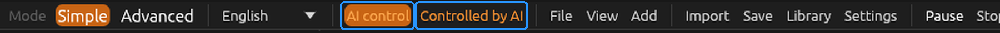

# ForgeRender

🇮🇹 [Leggi in italiano](README.it.md)


**A photorealistic CAD & 3D rendering engine for Windows 11 · 64-bit.**  
Written in Rust, with progressive CPU/GPU path tracing for CAD models, mechanical assemblies and general 3D scenes.

## Download ForgeRender 0.23.0

<sub><strong>STABLE RELEASE</strong> · Windows 11 · x64 · Portable ZIP</sub>

[⬇️ **DOWNLOAD FORGERENDER 0.23.0 — PORTABLE ZIP**](https://github.com/tarabaz/ForgeRender/releases/download/v0.23.0/ForgeRender-0.23.0-portable-x64.zip)

No installation required: extract the ZIP and run `forgerender.exe`.  
The package is distributed through GitHub Releases.

### What's new in 0.23.0

- **Cleaner default renders:** the denoiser now runs at 100% and the noise threshold starts at 0.03.

<details>
<summary><strong>Previous versions — complete release history</strong></summary>

- **0.22.0 — Multiple views, turntable and render passes:** automatic front, rear, side, top and three-quarter views; rotating product video exported as MP4 (H.264) with adjustable rotation and duration; albedo, normals, depth, product mask and component ID passes.
- **0.21.0 — Material editor and ZIP export:** edit library materials, adjust maps and values, rotate the live preview, apply changes, save materials and export portable material ZIPs. Also fixes draft sample defaults and repeated backdrop scaling.
- **0.20.0 — Adaptive material scale:** scale Box-projected textures to each object or assembly; keep bump and displacement at the same scale, consistently on CPU and GPU.
- **0.19.0 — Volumetric spotlights:** visible light beams with adjustable density and length, cone-shaped shadows, and matching CPU/GPU results.
- **0.18.0 — One-click AI integration:** configure and manage the ForgeRender MCP bridge for Claude Desktop, Claude Code and Codex, with connection status and safer configuration updates.
- **0.17.1 — Viewport and camera fixes:** automatic render restart only in Render view; improved camera framing and viewport navigation.
- **0.17.0 — Box texture anchoring and placement:** choose Piece, Assembly or World anchoring; improved multi-object placement with undo and collision-aware stacking.
- **0.16.0 — Material and texture correctness:** smoother Box displacement, consistent CPU/GPU results, improved Blender displacement and bump-node import.
- **0.15.0 — Box projection and material previews:** object-aligned triplanar textures, smoother projections on curved surfaces, scalable previews and contact placement.
- **0.14.0 — Object-axis dimensions and GPU-first rendering:** dimensions and scaling follow local object axes; GPU previews and improved interface.
- **0.13.0 — Blender material importer:** inspect and import materials, maps and supported shader values from `.blend` files without requiring Blender for the reading step.
- **0.12.0 — Shader-ball previews:** render material thumbnails and previews on a real shader-ball scene; show only materials used by the current scene in the Material panel.
- **0.11.0 — Unified material library:** combine built-in and downloaded materials; add BlenderKit-derived metal and wood presets (subject to their stated license restrictions).
- **0.10.0 — Mapped material presets:** first mapped presets for oak, black leather and polished white marble.
- **0.9.0 — AI component inspection:** MCP tool to generate numbered component previews and identify repeated parts in CAD assemblies.
- **0.8.3 — Rendering and placement fixes:** fix orthographic self-shadow artefacts and improve accurate placement on the base.
- **0.8.2 — Corrections:** stability and rendering fixes.
- **0.8.1 — Corrections:** additional fixes to the application.
- **0.8.0 — Documentation and build improvements:** internal manual, compilation workflow and corrections.
- **0.7.0 — Interface redesign:** separate menu bar and toolbar, new functions, corrections and first manual phase.
- **0.6.0 — Simple mode and onboarding:** simplified product-photo workflow, statistics, welcome screen, AI control and guides.
- **0.5.0 — Standalone AI control:** separate the AI control bridge from the main application.
- **0.4.0 — Claude control via MCP:** initial natural-language control integration and related improvements.
- **0.3.0 — Product photography workflow:** product-photo tools, viewport/camera, lighting and interface improvements.
- **0.2.0 — First workflow and library improvements:** Simple mode, material library, rendering improvements, portable samples and build tools.
- **0.1.0 — First release:** CPU/GPU path tracer, CAD/3D import, material library, OIDN denoiser, professional camera, lights, volumetric fog, projects, portable package and installer.

For the full technical notes, see [CHANGELOG.en.md](CHANGELOG.en.md) (Italian, authoritative release log).

</details>

> **Control ForgeRender with AI — MCP**
>
> Open ForgeRender, turn on **AI control** and ask Claude to prepare a scene, import a CAD model, position studio lights, assign materials, set the camera and render. 26 tools, live changes and render previews sent back to the assistant. You decide when the AI may take control: when it disconnects, ForgeRender stays open with your work.
>
> 
>
> **[Set up Claude Code or Claude Desktop →](docs/MCP.en.md)** · [Italian guide](docs/MCP.md)

> See [docs/ROADMAP.md](docs/ROADMAP.md) for what really works today, what comes next and
> how complex each next step is.

## What it does today

- **Simple / Advanced interface** (switch at the top, Simple by default): "Product photo in
  5 steps" with large buttons (import, place on the base, frame, look, materials, 16:9 / 1:1 /
  4:5 / 9:16 format, Draft / Balanced / High quality, render and save). Advanced has every
  control; both modes edit the same values.
- **Photo studio**: start-up scene with a tilted cloth backdrop and four studio lights; light
  color (warm 3200 K, neutral 5500 K, cool 7500 K or per light). Other looks: Light background,
  Dark background, Dramatic studio. **Prepare product scene** and **Fit the scene to the
  product** resize backdrop and lights to the product; **Undo preset** restores the scene.
  New lights and objects appear next to the product.
- **Languages**: Italian and English, the whole interface switches immediately (at the top or in
  Settings → Language). Translations are separate `lang/Lan_*.json` files: copy `Lan_eng.json`
  to add more.
- **AI control (MCP)**: control ForgeRender in natural language through Claude Code or Claude Desktop, with the `forgerender-mcp.exe` bridge and the "AI control" switch in the top bar. See the [MCP setup guide](docs/MCP.en.md) for installation, examples, available tools and safety.
- **Welcome screen** at start-up with an image (`assets/splash.png`), version and commit; it
  closes with "Close" and reopens from File.
- **Path tracing** on the CPU (all cores) and on the GPU (wgpu compute shaders, Vulkan/DX12)
  with real progressive accumulation (16…1024 samples, custom or unlimited, changeable while
  rendering). Next Event Estimation + Multiple Importance Sampling, Russian roulette, SAH BVH.
- **Denoiser**: Intel Open Image Denoise loaded at runtime, CPU or CUDA device, albedo/normal
  guide buffers, final-only or progressive preview mode.
- **Materials**: diffuse, GGX metals and plastics with multiple-scattering compensation, glass
  with exact Fresnel, frosted glass, emissive surfaces sampled as lights.
  Full PBR maps: base colour, roughness/gloss, metallic, normal (OpenGL/DirectX), height (bump),
  **true displacement**, ambient occlusion, opacity cutout; UV mapping or world-space box
  projection in metres for CAD models without UVs, with repeat size, rotation and offset.
- **Library**: built-in materials, plus materials and HDRIs downloaded from ambientCG and
  Poly Haven or imported from folders/ZIP files, kept in a local `Library` folder with previews.
- **Lights and environment**: area, point, spot and directional lights, studio presets;
  uniform, gradient or HDRI environment (.hdr/.exr) with importance sampling. Point and spot
  lights have a **range** with edge falloff, independent of the intensity, drawn as a bubble in
  the viewport (CPU and GPU).
- **Volumetric fog**: procedural dry-ice fog (seeded, deterministic) that falls from a point
  emitter, settles, spreads sideways and flows around objects; rendered as a real participating
  medium (delta tracking, Henyey–Greenstein phase, shadows through fog) on CPU and GPU.
- **Cameras**: orbit viewport camera plus render cameras with a professional lens: focal length
  in mm, f-stop, depth of field (focus plane and near/far limits drawn in the viewport),
  aperture blades, lens shift. **Orthographic and isometric view** in the viewport (icons next
  to the navigator, numpad 5) and in the render camera.
- **Import**: glTF/GLB (recommended export from SolidWorks), OBJ (with .mtl), STL, Blender
  `.blend` (through an installed Blender); STEP via Open CASCADE and SolidWorks SLDPRT/SLDASM
  are experimental. The STEP converter (`forgerender-step.exe`) is built by `Build-ForgeRender.ps1`;
  it needs CMake (`winget install Kitware.CMake`).
- **Editing**: move/rotate/scale gizmo with snapping (also for lights, spot cone handles and fog
  emitters), per-object contact snap, undo/redo, hide (H), duplicate,
  exact drop to floor, Blender-style axis navigator, component tree, persistent material
  assignment by stable id.
- Start / pause / resume / stop / automatic restart when the scene changes, PNG export.
- `.frproject` projects (versioned JSON, atomic save, relative paths).
- CLI for headless rendering, benchmarks and library import.

## Download the Windows build

The GitHub Actions build does **not** start on push: start it manually from *Actions → CI → Run
workflow* (or build locally with `Build-ForgeRender.ps1`). The run's *Artifacts* section has two
packages:

| Package | Contents |
|---|---|
| `ForgeRender-portable-x64` | zip: extract and run `forgerender.exe`, no installation |
| `ForgeRender-setup-x64` | installer (Start menu, uninstaller, `.frproject` association) |

Both are self-contained: static CRT, only Windows system DLLs plus the bundled Open Image
Denoise libraries.

## Build locally

Requirements: stable Rust (`rustup`); on Windows the *Visual Studio Build Tools* (C++).

```
cargo test --workspace --release
cargo run --release -p forge_app            # graphical interface
cargo run --release -p forge_cli -- bench   # benchmark
```

Windows packages locally: `powershell -ExecutionPolicy Bypass -File packaging\windows\package.ps1`
(the installer needs [Inno Setup 6](https://jrsoftware.org/isdl.php)).

## Benchmarks: commands to run

Every measurement you can run, and what it is for. Results and raw data go in
[`reports/`](reports/README.md), one folder per experiment. Results already measured are in
[docs/BENCHMARK.md](docs/BENCHMARK.md). Rule: report only measured numbers.

### Setup (once)

These are PowerShell commands. The `ForgeRender-portable-x64` zip is all you need:
- extract it and open PowerShell **in the extracted folder**;
- the benchmark projects are already inside, in `samples\scene\cocktail-ghiaccio-secco\`;
- you need neither Python nor the repository.

Alternatively, use the repository folder with the `forgerender-cli.exe` built by
`Build-ForgeRender.ps1`.

```powershell
cd C:\path\to\ForgeRender-portable-x64          # extracted zip folder
$cli = ".\forgerender-cli.exe"                    # in the repository: ".\target\release\forgerender-cli.exe"
```

The benchmark projects are derived from the cocktail demo, all with a fixed camera and depth of
field off. If the demo changes, regenerate them with `reports/strumenti/crea_progetti_bench.py`;
CI checks that they are in sync.

Python (`py -m pip install numpy pillow`) is only needed for the image comparison scripts in
`reports/strumenti/`. Without it, put the images in `reports/YYYY-MM-DD_.../` and let the agent
analyse them.

| Project | View | Seed |
|---|---|---|
| `bench_intera` | the whole demo | 12345 |
| `bench_vicina` | close-up on the fog | 12345 |
| `bench_ad` | the whole demo | set with `--seed` |

Output lines to read:
- `rendering N s | M ms/passata | X Mcampioni/s` (render time, ms per pass, Msamples/s)
- `geometria compilata … in N ms` (geometry and BVH build time)
- `nebbia «…»: simulazione … in N ms` (fog simulation time)

### 1. Detected hardware

```powershell
& $cli info
```

**Purpose**: check the CPU, thread count and RAM the program sees. Write this into every
report.

### 2. Standard benchmark (CPU, GPU, denoiser)

```powershell
& $cli bench --json bench.json
& $cli bench --spp 64 --width 1920 --height 1080 --threads 1,4,8,12,24 --json bench-1080p.json
```

**Purpose**: measures raw path tracer speed on a small test scene (11 022 triangles):
- CPU scaling across thread counts;
- GPU Msamples/s and its speedup over one thread;
- OIDN denoiser time on CPU and CUDA, in ms per image.

**Compare with**: the 9900X table in `docs/BENCHMARK.md`.

### 3. Real heavy scene, CPU vs GPU (fog, glass, textures)

```powershell
$p = "samples\scene\cocktail-ghiaccio-secco"
& $cli render --project $p\bench_intera.frproject --backend cpu --width 320 --height 400 --spp 32 --quiet --out intera_cpu.png
& $cli render --project $p\bench_intera.frproject --backend gpu --width 320 --height 400 --spp 32 --quiet --out intera_gpu.png
& $cli render --project $p\bench_vicina.frproject --backend cpu --width 320 --height 400 --spp 32 --quiet --out vicina_cpu.png
& $cli render --project $p\bench_vicina.frproject --backend gpu --width 320 --height 400 --spp 32 --quiet --out vicina_gpu.png
```

**Purpose**:
- Measure the GPU on a real scene instead of the test scene.
- Measure the 3D fog majorant on the RTX 5070. It could not be measured in the dev container.

**What to read**: `ms/passata`. The fog simulation runs before the render and is not counted.

**Compare with**: the [majorant report](reports/2026-10-29_majorant-3d-nebbia/REPORT.md).
Add `--threads 3` to the CPU line to compare with the container numbers.

### 4. Adaptive sampling (does it pay off on this scene?)

```powershell
$b = "samples\scene\cocktail-ghiaccio-secco\bench_ad.frproject"
& $cli render --project $b --backend gpu --width 320 --height 400 --spp 1024 --seed 99  --quiet --out ref.png
& $cli render --project $b --backend gpu --width 320 --height 400 --spp 1024 --seed 100 --quiet --out ref2.png
& $cli render --project $b --backend gpu --width 320 --height 400 --spp 32  --quiet --out uni32.png
& $cli render --project $b --backend gpu --width 320 --height 400 --spp 128 --quiet --out uni128.png
& $cli render --project $b --backend gpu --width 320 --height 400 --spp 1024 --noise-threshold 0.08 --quiet --out ad08.png
& $cli render --project $b --backend gpu --width 320 --height 400 --spp 1024 --noise-threshold 0.04 --quiet --out ad04.png
py reports\strumenti\confronta_immagini.py ref.png ref2.png -- uni32.png uni128.png ad08.png ad04.png
```

**Purpose**: check whether stopping clean pixels early saves time at equal quality.

**What to read**:
- Note the time of each render.
- Compute **time × MSE**: lower is better. Compare adaptive against uniform.

Repeat with `--backend cpu` to compare the two backends.

**Diagnostics (where the samples go)**: add `--adaptive-map map04.png` to an adaptive render. It
writes a 16-bit PNG with the exact sample count of each pixel and prints the share of samples in
the "B" half used by the error estimate (should be about 0.5). Then:

```powershell
py reports\strumenti\analisi_adattivo.py --rif ref.png ref2.png --mappa map04.png --img ad04.png --img uni128.png --csv tiles.csv
```

It prints, for dark / mid / bright areas of the reference: share of pixels, share of samples,
error of each image and mean difference with its standard error.

**Compare with**: the [adaptive sampling report](reports/2026-10-29_campionamento-adattivo/REPORT.md).

### 5. Import and BVH of a large mesh

```powershell
& $cli render --mesh C:\path\big_model.stl --unit mm --spp 16 --width 640 --height 360 --quiet --out mesh.png
```

**Purpose**: measure loading time for heavy CAD scenes. It also works with `.step`, `.glb` and
`.obj`.

**What to read**: `geometria compilata: N triangoli, BVH M nodi, in T ms`.

### 6. Fog simulation profile

```powershell
$env:FORGE_FOG_PROFILE = "1"
& $cli render --project samples\scene\cocktail-ghiaccio-secco\bench_intera.frproject --spp 1 --width 160 --height 200 --quiet --out fog.png
Remove-Item Env:FORGE_FOG_PROFILE
```

**Purpose**: show the time of each fluid-simulation phase (forces, advection, pressure…), to
decide where to optimize.

### 7. Final image with the project settings

```powershell
& $cli render --project samples\scene\cocktail-ghiaccio-secco\cocktail-ghiaccio-secco.frproject --backend gpu --quiet --out final_gpu.png
& $cli render --project samples\scene\cocktail-ghiaccio-secco\cocktail-ghiaccio-secco.frproject --backend gpu --denoise finale --cuda --quiet --out final_gpu_dn.png
```

**Purpose**: real time for a finished image, with and without the denoiser.

### 8. Correctness tests (before trusting any timing)

```powershell
cargo test --release --workspace --exclude forge_step
cargo test --release -p forge_render_gpu -- --nocapture
cargo test --release -p forge_render_cpu --test portal -- --nocapture
cargo test --release -p forge_render_cpu --test adaptive -- --nocapture
```

**Purpose**:
- The full test suite checks rendering correctness: white furnace, lights vs analytic results,
  fog, glass, portals and adaptive sampling.
- On the RTX 5070, the GPU tests compare GPU and CPU output.
- `--nocapture` prints the measured errors.

### Where to write results

Create `reports/YYYY-MM-DD_topic/` containing:
- a `REPORT.md` (machine, commit, commands, table);
- the output logs and the images.

Then add a row to the index in `reports/README.md`.

## Documentation

- [Documentation home](docs/README.md) — English reference and Italian language index.

- [CHANGELOG.md](CHANGELOG.md) — what changed in each version (Italian)
- [reports/](reports/README.md) — measurement reports with raw data, images and the commands to reproduce them (Italian)
- [docs/MCP.md](docs/MCP.md) — controlling ForgeRender from Claude Code (MCP): setup, tools,
  safety (Italian)
- [docs/ROADMAP.md](docs/ROADMAP.md) — status, next steps with complexity, technical plans
  ([italiano](docs/ROADMAP.it.md))
- [docs/ARCHITECTURE.md](docs/ARCHITECTURE.md) — architecture, technical choices and known limitations (English; [Italian](docs/ARCHITECTURE.it.md))
- [docs/BENCHMARK.md](docs/BENCHMARK.md) — measured performance results (Italian version currently available at [docs/BENCHMARK.it.md](docs/BENCHMARK.it.md))
- [docs/STATO_LAVORI.md](docs/STATO_LAVORI.md) — development log (Italian)

## License and contributions

ForgeRender is licensed under the **Apache License 2.0**. You may use, modify,
redistribute, and commercially distribute the project under its terms. Modified
files must be identified as changed, and applicable copyright, license, and
attribution notices must be preserved. The license does **not** grant rights to
the ForgeRender name or logo beyond the limited customary use described in the
license.

- [Apache License 2.0](LICENSE)
- [Project attribution notices](NOTICE)
- [How to contribute](CONTRIBUTING.md)

Third-party libraries, materials, sample assets, and other bundled content may
have separate license terms; see their accompanying notices and
`packaging/licenses/`.
