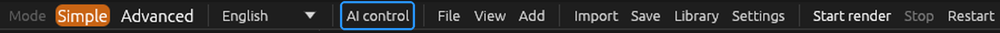
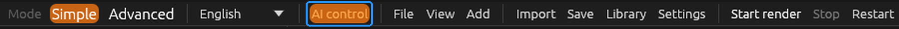
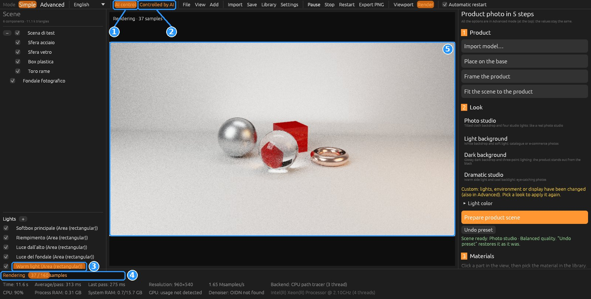
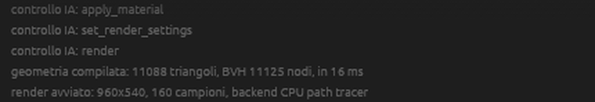

# Control ForgeRender with Claude (MCP)

An AI assistant can set up the scene and render for you: tell it "add a studio backdrop, a warm
light on the right, make the part satin metal and render a square image", and it uses
ForgeRender's tools. You see every change live in the ForgeRender window, and the assistant
receives the render preview so it can iterate.

The connection uses the **Model Context Protocol** (MCP), the standard Claude Code and Claude
Desktop use to talk to external programs. No internet connection or API key is needed:
everything stays on your computer.

🇮🇹 [Versione italiana](MCP.md) · [Back to README](../README.md)

## How it works (from version 0.5.0)

- **You open ForgeRender** as usual; it stays open until you close it.
- **You decide when the AI may control it**: the **"AI control"** button in the top bar. While it
  is off (always off at start-up) no assistant can touch the scene.
- Claude starts a small separate program, **`forgerender-mcp.exe`** (the "bridge"), which sits in
  the same folder as `forgerender.exe` and forwards commands to the open window.
- While Claude is connected, **"Controlled by AI"** appears next to the button; it disappears when
  Claude disconnects. The window and your work stay: continue by hand or reconnect Claude later
  on the same scene.
- If ForgeRender is closed or AI control is off, Claude is told to ask you to open ForgeRender and
  turn on AI control.

The three states of the top bar:

| State | Bar |
|---|---|
| **Off**: no assistant can control ForgeRender (this is how it starts) |  |
| **On**: Claude can connect |  |
| **Controlled by AI**: Claude is connected right now |  |

When Claude disconnects, "Controlled by AI" disappears and the bar goes back to the "On" state.

## 1. Requirements

- ForgeRender **0.5.0 or later**: the program folder contains `forgerender.exe` and
  `forgerender-mcp.exe` (portable package, installer, or `target\release` of a local build made
  with `Build-ForgeRender.ps1`).
- **Claude Code** (terminal or desktop app, "This computer" session) or **Claude Desktop**,
  installed on the computer that runs ForgeRender. The claude.ai web app cannot reach programs on
  your computer.

You need the full path of `forgerender-mcp.exe`: in File Explorer hold Shift, right-click the
file → **"Copy as path"** (the copied path already has quotes: in the commands below paste it
in place of the example path, quotes included). Prefer the path in a portable folder or in the
installation over `target\release`: a new build cannot replace the bridge while Claude is using
it. On an external drive the drive letter can change between computers;
update it in the configuration (or give the drive a fixed letter in Disk Management).

## 2. Connect it to Claude (once)

### Claude Code: user-level registration (recommended)

A single PowerShell command, with your own path instead of the example. It works for the
terminal and the desktop app, in any folder:

```powershell
claude mcp add --scope user forgerender -- "C:\REAL\PATH\TO\forgerender-mcp.exe"
```

Check: this command must list `forgerender` with your path.

```powershell
claude mcp list
```

Then open a **new** Claude Code session (sessions already open do not see a newly added
server). The connection stays up for the whole session: Claude carries out one request after
another. Only the "AI control" button decides whether commands reach ForgeRender.

**New version in another folder** (for example a portable `ForgeRender-0.9.0-…`): the
registered path still points to the old one. Remove it and register the new one:

```powershell
claude mcp remove --scope user forgerender
```

```powershell
claude mcp add --scope user forgerender -- "C:\NEW\PATH\forgerender-mcp.exe"
```

### Claude Code: a `.mcp.json` file in a folder (not recommended in the desktop app)

A `.mcp.json` file in a working folder registers the bridge for that folder only:

```json
{ "mcpServers": { "forgerender": { "command": "C:\\REAL\\PATH\\TO\\forgerender-mcp.exe", "args": [] } } }
```

Tested on 30/10/2026 with the Claude Code desktop app on Windows: only the **first** reply
works. At the end of the reply Claude Code closes the bridge ("Closing MCP server stdin" in its
logs) and does not start it again for the next request; user-level servers stay connected.
If you use the user-level registration, do not also keep a `.mcp.json` with a `forgerender`
server in the session folder: rename it (for example `.mcp.json.old`).

### Claude Desktop

Settings → Developer → Edit config; in `claude_desktop_config.json` (double backslashes):

```json
{
  "mcpServers": {
    "forgerender": {
      "command": "C:\\REAL\\PATH\\TO\\forgerender-mcp.exe",
      "args": []
    }
  }
}
```

Then restart Claude Desktop.

## 3. Use

1. Open ForgeRender (double-click, as usual).
2. Click **"AI control"** in the top bar: it turns orange.
3. Tell Claude what you want. At the first command **"Controlled by AI"** appears at the top.
4. When you are done, turn "AI control" off (or close Claude): ForgeRender stays open.

This is the window while Claude works (here it prepared the studio, added a warm light on the
right, made the sphere satin steel and started the render):



1. **AI control** on: you allowed it.
2. **Controlled by AI**: Claude is connected now.
3. The light Claude added appears in the list like the ones you create by hand (you can edit or
   delete it).
4. The render started by Claude, with the sample progress.
5. The image updating while the render runs; when it is finished Claude receives the preview.

The finished result, saved as PNG:


Example requests:

- "Import the model I point you to (it is in millimetres) and prepare a photo studio."
- "Use a dark studio backdrop, a warm light on the right and a cool rim light."
- "Make the part bronze satin metal and the base matte black plastic."
- "Three-quarter view with an 85 mm lens, 4:5 format for Instagram."
- "Make a quick test render and tell me what you would improve."
- "The right light is too strong: halve it and render again at 512 samples."
- "Save the project and the final render in the folder I give you."

Claude looks at every render preview and can correct things itself. You can edit by hand at any
time: it reads the scene again with `scene_info` before changing it.

**Long renders**: Claude waits at most about 45 seconds. If the render takes longer it is told
"in progress", ForgeRender finishes and saves it by itself, and Claude then calls
`render_status` to get the image.

## 4. Available tools

Measurements in **metres**, y up. "Right", "left", "front" are relative to the render framing.

| Tool | What it does |
|---|---|
| `scene_info` | Scene state: product (centre and size), components with material, lights, camera, environment, settings and render state |
| `new_scene` | New scene: studio demo or empty |
| `open_project` / `save_project` | Open or save a `.frproject` |
| `import_model` | Import glTF/GLB, OBJ, STL, STEP, Blender, SolidWorks (unit and up axis for STL/OBJ) |
| `prepare_studio` | Complete look: photo studio, light, dark, dramatic; quality |
| `fit_scene_to_product` | Rebuild backdrop and lights to the product size |
| `undo_preset` | Undo the last `prepare_studio` / `fit_scene_to_product` |
| `add_object` | Floor, backdrop, photo backdrop, wall, cube, sphere, cylinder, cup |
| `transform_objects` | Move, rotate, scale, drop to the floor (undo with Ctrl+Z) |
| `set_visibility` | Show or hide components |
| `add_light` | Area (softbox), point, spot, directional light; by side (right, left, top, front, back, rim…), Kelvin colour, relative strength, range |
| `edit_light` / `remove_light` | Edit or delete a light (by index or name) |
| `set_all_lights_color` | Colour temperature of all lights |
| `list_materials` | Search the ~120 ready-made materials and the downloaded library |
| `apply_material` | Apply an existing material to components or to the whole product |
| `create_material` | Create a material from parameters (colour, metallic, roughness, glass, emission) and apply it |
| `set_camera` | View (front, three-quarter, isometric…), angles, focal length, orthographic, zoom, depth of field |
| `set_environment` | Uniform, gradient, HDRI or black environment; visible or not |
| `set_render_settings` | Format (16:9, 1:1, 4:5, 9:16), resolution, samples, quality, CPU/GPU, denoiser, exposure |
| `render` | Start the render, wait up to ~45 s, save the PNG and send the preview to Claude |
| `render_status` | Render progress; when finished, saved file and preview |
| `stop_render` / `save_image` | Stop the render; save the last image (PNG, JPG, 16-bit TIFF or EXR by extension) |

Renders without a path go to a `render` folder next to the project, or to `renders` next to the
logs (portable: program folder; installed: `%LOCALAPPDATA%\ForgeRender\renders`).

## 5. Security

- Nobody can control ForgeRender until you turn "AI control" on; turning it off closes the
  connections immediately.
- The bridge ↔ window connection stays on the computer (`127.0.0.1`) and requires a secret key,
  new every time control is turned on, stored in a file in your user folder
  (`%LOCALAPPDATA%\ForgeRender\controllo-ia.json`, removed when control is turned off).
- Claude cannot run code inside the program: only the tools above, with validated arguments
  (bounded numbers, absolute paths).
- An existing file is **never overwritten** without `overwrite: true`, which Claude should only
  use when you ask. The open project can be saved again to its own file.
- Library materials are not modified: `create_material` creates a new project material
  (id `ia-…`).
- Transforms and presets can be undone like manual ones (Ctrl+Z, "Undo preset").

## 6. Troubleshooting

- **Claude says "ForgeRender is not connected"** (in Italian): open ForgeRender and turn on
  "AI control".
- **Only the first command works, then Claude says the connection was lost**: the bridge is
  registered through a folder `.mcp.json`. Register it at user level (section 2), rename the
  `.mcp.json` and open a new session. The bridge never closes by itself: it stays up until
  Claude closes it, even with "AI control" off or ForgeRender closed.
- **"ForgeRender does not respond: the window is minimised…"**: commands run like clicks, at each
  window update. Keep the window open (not minimised) and without dialogs in front.
- **Bridge test without Claude**: with ForgeRender open and "AI control" on, in PowerShell (with
  `$bridge` set as above):

  ```powershell
  '{"jsonrpc":"2.0","id":1,"method":"initialize","params":{}}', '{"jsonrpc":"2.0","id":2,"method":"tools/call","params":{"name":"scene_info","arguments":{}}}' | & $bridge
  ```

  It works if two JSON lines appear and the second describes the scene (accented letters may look
  garbled in PowerShell; Claude reads them correctly). With "AI control" off the second line asks
  to turn it on.
- **Slow renders**: for tests ask for few samples (32–64) and low resolution; for the final image
  use the GPU (`set_render_settings` with device gpu).
- Received commands are logged by ForgeRender ("controllo IA: …" lines, always in Italian),
  visible at the bottom of the window and in `forgerender.log`:

  

## 7. Developer notes

- `crates/forge_mcp`: MCP protocol (`rpc.rs`, JSON-RPC 2.0, protocol 2025-06-18, also accepts
  2025-03-26 and 2024-11-05), tool list (`tools.rs`), local bridge ↔ window link (`link.rs`:
  contact file with port and key, one JSON line per message).
- `crates/forge_mcp_bridge`: `forgerender-mcp`, the stdio MCP server. It answers `initialize` and
  `tools/list` itself (even with the window closed) and forwards `tools/call`. A delivered command
  is never sent twice.
- `crates/forge_app/src/mcp/`: window side. `mod.rs` listens on `127.0.0.1` only while "AI
  control" is on; each call is passed to the window through a channel and runs in
  `ForgeApp::tick` (no concurrent scene access). `tools.rs` runs the tools with the same functions
  as the buttons; `ops.rs` holds the window-free parts, with tests.
- `forgerender --controllo-ia` turns control on at start-up (automated tests); `FORGE_MCP_FILE`
  moves the contact file.
- To add a tool: definition in `forge_mcp::tools::list`, branch in `dispatch` of
  `forge_app::mcp::tools` (a test checks every name has a branch).
- The images in this guide are regenerated with `tools/guida-mcp/scatta.py` and `annota.py`
  (instructions at the top of the script) when the interface changes.
