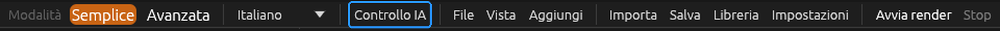
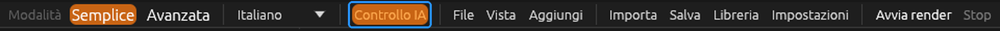
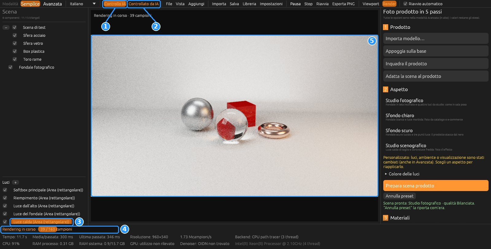
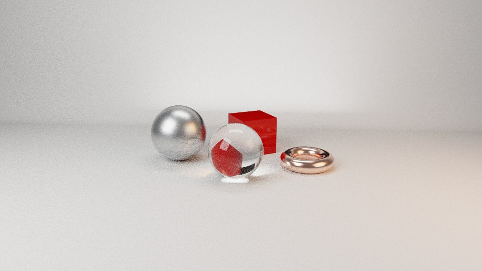
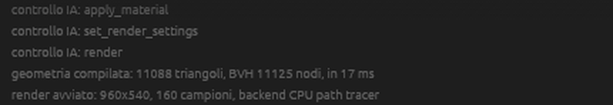

# Comandare ForgeRender con Claude (MCP)

Un assistente IA può impostare la scena e fare i render al posto tuo: gli scrivi in italiano
«metti uno sfondo da studio, aggiungi una luce calda a destra, fai il pezzo in metallo satinato
e fammi un render quadrato», e lui usa i comandi del programma. Vedi ogni modifica nella
finestra di ForgeRender mentre la fa, e lui vede il render che ottiene (così può correggere luci
e inquadratura da solo).

Il collegamento usa il **Model Context Protocol** (MCP), lo standard con cui Claude Code e
Claude Desktop parlano con i programmi esterni. Non serve internet né una chiave: tutto resta
sul tuo PC.

🇬🇧 [English version](MCP.en.md) · [Torna al README](../README.it.md)

## Come funziona (dalla versione 0.5.0)

- **ForgeRender lo apri tu**, come sempre, e resta aperto finché lo chiudi tu.
- **Decidi tu quando l'IA può comandarlo**: pulsante **"Controllo IA"** nella barra in alto.
  Spento (all'avvio è sempre spento) nessun assistente può toccare la scena.
- Claude avvia un piccolo programma separato, **`forgerender-mcp.exe`** (il "ponte"), che sta
  nella stessa cartella di `forgerender.exe`. Il ponte inoltra i comandi alla finestra aperta.
- Mentre Claude è collegato, accanto al pulsante compare **"Controllato da IA"**; quando si
  scollega sparisce. La finestra e il tuo lavoro restano: puoi continuare a mano o ricollegare
  Claude più tardi sulla stessa scena.
- Se ForgeRender è chiuso o il controllo è spento, Claude riceve il messaggio "apri ForgeRender
  e accendi Controllo IA" e te lo chiede.

I tre stati della barra in alto:

| Stato | Barra |
|---|---|
| **Spento**: nessun assistente può comandare (così parte ForgeRender) |  |
| **Acceso**: Claude può collegarsi |  |
| **Controllato da IA**: Claude è collegato in questo momento |  |

Quando Claude si scollega la scritta "Controllato da IA" sparisce e la barra torna come nello
stato "Acceso".

## 1. Cosa serve

- ForgeRender **0.5.0 o successivo**: nella cartella del programma ci sono `forgerender.exe` e
  `forgerender-mcp.exe` (pacchetto portable, installazione, oppure `target\release` della build
  locale con `Build-ForgeRender.ps1`).
- **Claude Code** (terminale o app desktop, sessione "Questo computer") oppure **Claude
  Desktop**, installato sul PC dove gira ForgeRender. La versione web di claude.ai non può
  raggiungere i programmi del tuo PC.

Ti serve il percorso completo di `forgerender-mcp.exe`: in Esplora file tieni premuto Maiusc,
clic destro sul file → **"Copia come percorso"**. Se il programma è su un disco esterno, la
lettera del disco può cambiare da un PC all'altro: in quel caso va aggiornata nella
configurazione (oppure assegna al disco una lettera fissa da Gestione disco).

## 2. Collegarlo a Claude (una volta)

### Claude Code: cartella con il file `.mcp.json`

Il modo più semplice, che funziona sia con il terminale sia con l'app desktop: una cartella di
lavoro con dentro un file `.mcp.json`. Un comando alla volta in PowerShell (metti il tuo
percorso al posto di quello d'esempio):

```powershell
New-Item -ItemType Directory -Force "$HOME\ForgeRender-IA" | Out-Null
```

```powershell
$ponte = (Resolve-Path "C:\PERCORSO\REALE\forgerender-mcp.exe").Path
```

```powershell
@{ mcpServers = @{ forgerender = @{ command = $ponte; args = @() } } } | ConvertTo-Json -Depth 5 | Set-Content -Encoding ascii "$HOME\ForgeRender-IA\.mcp.json"
```

Controllo: questo comando deve mostrare il file con `forgerender` e il tuo percorso.

```powershell
Get-Content "$HOME\ForgeRender-IA\.mcp.json"
```

Poi apri Claude Code in quella cartella (nell'app desktop: "Scegli…" accanto a "Questo
computer"; nel terminale: `Set-Location "$HOME\ForgeRender-IA"` e `claude`). La prima volta
chiede se approvare il server `forgerender`: rispondi sì.

In alternativa, dal terminale: `claude mcp add forgerender -- "$ponte"` dentro la cartella.

### Claude Desktop

Impostazioni → Sviluppatore → Modifica configurazione; nel file `claude_desktop_config.json`
(doppie barre nel percorso):

```json
{
  "mcpServers": {
    "forgerender": {
      "command": "C:\\PERCORSO\\REALE\\forgerender-mcp.exe",
      "args": []
    }
  }
}
```

Poi riavvia Claude Desktop.

## 3. Come si usa

1. Apri ForgeRender (doppio clic, come sempre).
2. Clicca **"Controllo IA"** in alto: diventa arancione.
3. Scrivi a Claude cosa vuoi. Al primo comando in alto compare **"Controllato da IA"**.
4. Quando hai finito, spegni "Controllo IA" (o chiudi Claude): ForgeRender resta aperto.

Così si presenta la finestra mentre Claude lavora (qui ha preparato lo studio, aggiunto una luce
calda a destra, messo la sfera in acciaio satinato e lanciato il render):



1. **Controllo IA** acceso: sei tu ad averlo permesso.
2. **Controllato da IA**: Claude è collegato adesso.
3. La luce che Claude ha aggiunto compare nell'elenco come quelle create a mano (si può
   modificare o eliminare).
4. Il render avviato da Claude, con l'avanzamento dei campioni.
5. L'immagine che si aggiorna mentre il render procede; a fine render Claude riceve l'anteprima.

Il risultato finito, salvato come PNG:



Esempi di richieste:

- «Importa il modello che ti indico (è in millimetri) e prepara uno studio fotografico.»
- «Metti uno sfondo da studio scuro e una luce calda a destra, più un controluce freddo.»
- «Fai il pezzo in metallo satinato color bronzo, la base in plastica nera opaca.»
- «Inquadratura tre quarti con un 85 mm, formato 4:5 per Instagram.»
- «Fammi un render di prova veloce e dimmi cosa miglioreresti.»
- «La luce a destra è troppo forte: dimezzala e rifai il render a 512 campioni.»
- «Salva il progetto e il render finale nella cartella che ti indico.»

Claude guarda l'anteprima di ogni render e può correggere da solo. Puoi intervenire a mano in
qualsiasi momento: lui rilegge la scena con `scene_info` prima di modificare.

**Render lunghi**: Claude aspetta al massimo circa 45 secondi. Se il render dura di più, gli
risponde "in corso" e ForgeRender lo finisce e lo salva da solo; Claude poi chiede
`render_status` e riceve l'immagine.

## 4. I comandi disponibili

Misure in **metri**, y verso l'alto. "Destra", "sinistra", "davanti" sono rispetto
all'inquadratura del render.

| Strumento | Cosa fa |
|---|---|
| `scene_info` | Stato della scena: prodotto (centro e misure), componenti con materiale, luci, camera, ambiente, impostazioni e stato del render |
| `new_scene` | Scena nuova: studio dimostrativo o vuota |
| `open_project` / `save_project` | Apre o salva un `.frproject` |
| `import_model` | Importa glTF/GLB, OBJ, STL, STEP, Blender, SolidWorks (unità e asse per STL/OBJ) |
| `prepare_studio` | Aspetto completo: studio fotografico, sfondo chiaro, scuro, scenografico; qualità |
| `fit_scene_to_product` | Rifà fondale e luci sulle misure del prodotto |
| `undo_preset` | Annulla l'ultimo `prepare_studio` / `fit_scene_to_product` |
| `add_object` | Pavimento, fondale, fondale fotografico, parete, cubo, sfera, cilindro, tazza |
| `transform_objects` | Sposta, ruota, scala, appoggia a terra (annullabile con Ctrl+Z) |
| `set_visibility` | Mostra o nasconde componenti |
| `add_light` | Luce area (softbox), punto, spot, direzionale; per lato (destra, sinistra, alto, davanti, dietro, controluce…), colore in Kelvin, intensità relativa, raggio d'azione |
| `edit_light` / `remove_light` | Modifica o elimina una luce (per numero o nome) |
| `set_all_lights_color` | Temperatura colore di tutte le luci |
| `list_materials` | Cerca tra i ~120 materiali pronti e la libreria scaricata |
| `apply_material` | Applica un materiale esistente a componenti o a tutto il prodotto |
| `create_material` | Crea un materiale da parametri (colore, metallic, roughness, vetro, emissione) e lo applica |
| `set_camera` | Vista (frontale, tre quarti, isometrica…), angoli, focale, ortografica, zoom, profondità di campo |
| `set_environment` | Ambiente uniforme, gradiente, HDRI o nero; visibile o no |
| `set_render_settings` | Formato (16:9, 1:1, 4:5, 9:16), risoluzione, campioni, qualità, CPU/GPU, denoiser, esposizione |
| `render` | Avvia il render, aspetta fino a ~45 s, salva il PNG e restituisce l'anteprima a Claude |
| `render_status` | Avanzamento del render; a render finito file salvato e anteprima |
| `stop_render` / `save_image` | Ferma il render; salva l'ultima immagine |

Dove finiscono i render senza un percorso: nella cartella `render` accanto al progetto, oppure
in `renders` accanto ai log (portable: cartella del programma; installata:
`%LOCALAPPDATA%\ForgeRender\renders`).

## 5. Sicurezza

- Nessuno può comandare ForgeRender finché non accendi "Controllo IA"; spegnendolo, i
  collegamenti si chiudono subito.
- Il collegamento tra ponte e finestra resta dentro il PC (`127.0.0.1`) e richiede una chiave
  segreta nuova a ogni accensione, scritta in un file della tua cartella utente
  (`%LOCALAPPDATA%\ForgeRender\controllo-ia.json`, tolto allo spegnimento).
- Claude non può eseguire codice nel programma: solo i comandi della tabella, con gli argomenti
  controllati (numeri nei limiti, percorsi assoluti).
- Un file esistente **non viene sovrascritto** senza `overwrite: true`, che Claude deve usare
  solo se glielo chiedi. Il progetto aperto si può risalvare sul suo file.
- I materiali della libreria non vengono modificati: `create_material` crea un materiale nuovo
  del progetto (id `ia-…`).
- Trasformazioni e preset si annullano come quelli fatti a mano (Ctrl+Z, "Annulla preset").

## 6. Se qualcosa non va

- **Claude dice "ForgeRender non è collegato"**: apri ForgeRender e accendi "Controllo IA".
- **"ForgeRender non risponde: la finestra è ridotta a icona…"**: i comandi si eseguono come
  i clic, a ogni aggiornamento della finestra. Tienila aperta (non ridotta a icona) e senza
  finestre di dialogo davanti.
- **Prova del ponte senza Claude**: con ForgeRender aperto e "Controllo IA" acceso, in
  PowerShell (con `$ponte` impostato come sopra):

  ```powershell
  '{"jsonrpc":"2.0","id":1,"method":"initialize","params":{}}', '{"jsonrpc":"2.0","id":2,"method":"tools/call","params":{"name":"scene_info","arguments":{}}}' | & $ponte
  ```

  Funziona se compaiono due righe JSON: la seconda descrive la scena (gli accenti si vedono
  storti in PowerShell, Claude li legge giusti). Con "Controllo IA" spento la seconda riga dice
  di accenderlo.
- **Render lento**: per le prove chiedi pochi campioni (32–64) e risoluzione bassa; per il finale
  la GPU (`set_render_settings` con device gpu).
- Il registro dei comandi ricevuti è nel log di ForgeRender (righe "controllo IA: …"), visibile
  in basso nella finestra e in `forgerender.log`:

  

## 7. Per sviluppatori

- `crates/forge_mcp`: protocollo MCP (`rpc.rs`, JSON-RPC 2.0, protocollo 2025-06-18, accetta
  anche 2025-03-26 e 2024-11-05), elenco degli strumenti (`tools.rs`), collegamento locale
  ponte ↔ finestra (`link.rs`: file di contatto con porta e chiave, una riga JSON per messaggio).
- `crates/forge_mcp_bridge`: `forgerender-mcp`, il server MCP su stdin/stdout. Risponde da solo
  a `initialize` e `tools/list` (anche con la finestra chiusa) e inoltra `tools/call`. Non
  rimanda mai un comando già consegnato.
- `crates/forge_app/src/mcp/`: lato finestra. `mod.rs` ascolta su `127.0.0.1` solo con
  "Controllo IA" acceso; ogni chiamata passa alla finestra con un canale e si esegue in
  `ForgeApp::tick` (nessun accesso concorrente alla scena). `tools.rs` esegue gli strumenti con
  le stesse funzioni dei pulsanti; `ops.rs` contiene le parti senza finestra, con test.
- `forgerender --controllo-ia` accende il controllo all'avvio (prove automatiche);
  `FORGE_MCP_FILE` sposta il file di contatto (prove con più istanze).
- Per aggiungere uno strumento: definizione in `forge_mcp::tools::list`, ramo in `dispatch` di
  `forge_app::mcp::tools` (un test controlla che ogni nome abbia il suo ramo).
- Le immagini di questa guida si rifanno con `tools/guida-mcp/scatta.py` e `annota.py`
  (istruzioni in testa allo script) quando l'interfaccia cambia.
