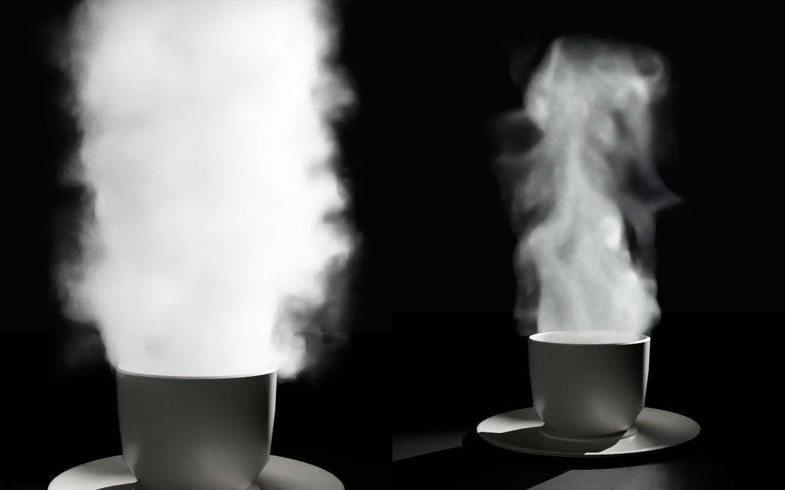
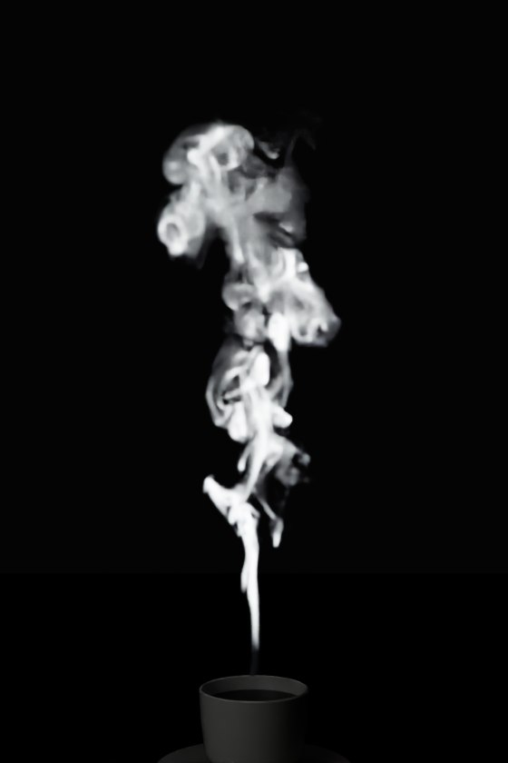
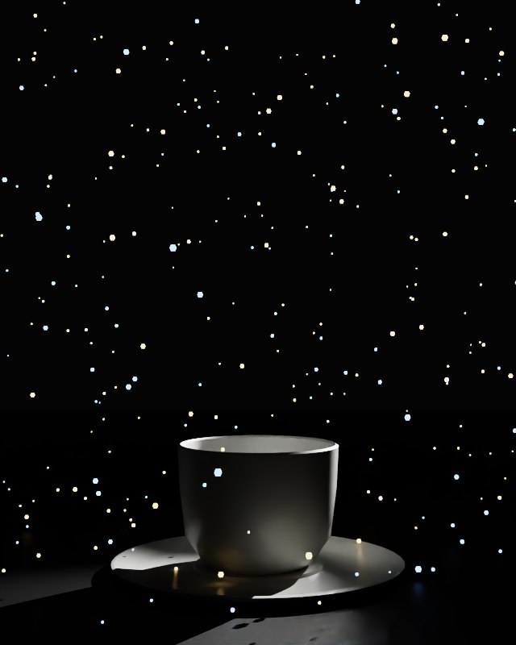
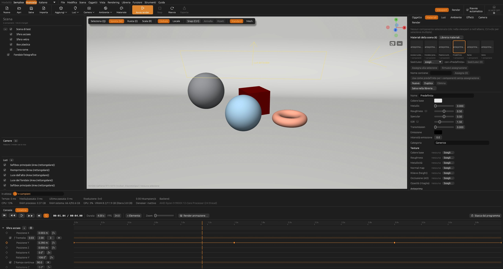
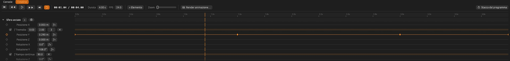
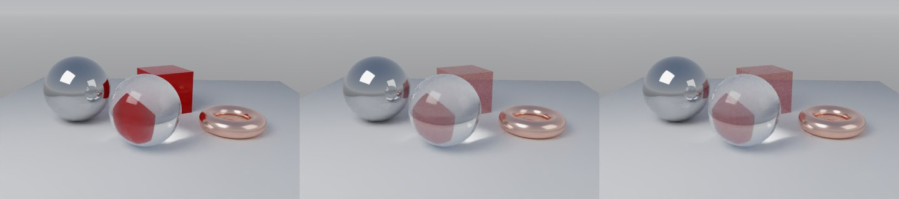
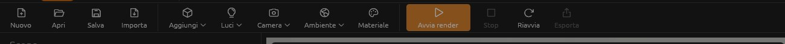
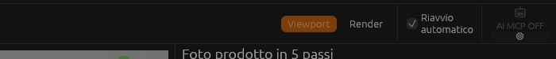

# ForgeRender 0.43.0 — report delle modifiche

Tutto su `sviluppo`. Le immagini di render sono fatte con `forgerender-cli`, quelle dell'interfaccia con
`forgerender --screenshot` (opzione `--timeline-demo` per avere un'animazione di prova già pronta).

## 1. Fumo a particelle: vapore da tazza e incenso

Prima il fumo viaggiava sulla griglia della simulazione. A ogni passo il trasporto lo sfumava un
po', così dopo qualche secondo ogni velo diventava una nuvola gonfia: la "ciminiera". Adesso la
griglia calcola solo il moto dell'aria. Il fumo viaggia su circa 2,4 milioni di particelle che non si
sfumano e alla fine si depositano su una griglia due o tre volte più fitta. Restano veli sottili che
si ripiegano e fili lunghi.

**Vapore da tazza**, prima (sinistra) e dopo (destra). La sorgente copre tutta la superficie del
caffè, ma "a chiazze": il vapore sale in nastri separati che si spostano piano. È poco caldo e poco
denso, quindi resta trasparente.

**Incenso o sigaretta** (preset nuovo). La sorgente è di 2 mm e il fumo esce caldo e veloce, quindi
il filo resta dritto e compatto, poi si rompe in riccioli e veli. Ha poca dissolvenza, così i
filamenti sono lunghi. Il contrasto 1,8 tiene pieno il filo e trasparenti i veli.

Nel pannello del fumo simulato ci sono le opzioni "Fumo a particelle (veli e filamenti sottili)" e
"Sorgente a chiazze".

Tempi con la qualità di simulazione 2:
- vapore: circa 20 s di simulazione;
- incenso: circa 40 s.

## 2. Polvere luminosa

Nel pannello Polvere c'è la sezione "Granelli luminosi" con il pulsante **+**. Ogni colore ha:
- l'intensità;
- la percentuale di granelli che si accendono di quel colore.

Questi granelli sono geometria che emette luce, quindi si vedono anche fuori dai fasci e
illuminano quello che hanno intorno (riflessi sul piattino). Nell'esempio sotto: 60 % arancio e
40 % azzurro, intensità 2.

Con intensità alte il colore satura al bianco, come una lampadina vista dritta: per questo il valore
di partenza è 3.

## 3. Timeline

**Come si accende:**
- dal menu nuovo **Funzioni → Timeline (animazione)**: di serie è spenta;
- da sola, quando aggiungi un effetto che si calcola nel tempo (fumo simulato, ghiaccio secco).

**Dove sta:**
- in basso, al posto della console, con le schede **Console | Timeline**;
- oppure in una finestra a parte con "Stacca dal programma", da spostare sull'altro monitor.

Nell'esempio, all'istante 1,04 s:
- la **Posizione Y** ha quattro chiavi, con le interpolazioni morbida, curva continua, morbida in
  uscita e lineare;
- la **Rotazione Y** ha il modificatore *Rampa continua* a 90°/s (all'istante 1,2 s vale 108°);
- la **Posizione X** ha un *Tremolio*.

### Elementi e chiavi

- **+ Elemento:** aggiunge gli oggetti selezionati, la camera, le luci, i fumi, il ghiaccio secco, la
  foschia, la polvere e l'ambiente.
- **Proprietà di base:** sempre in vista. Per un oggetto sono posizione, rotazione, scala e opacità.
- **+ sull'elemento:** aggiunge una alla volta le altre proprietà compatibili (scala per asse,
  visibile, colore, bersaglio, cono, campo visivo, diaframma, fuoco, densità, rotazione dell'HDRI,
  brillantezza).
- **Rombo:** mette o toglie la chiave nell'istante del cursore.
- **Registrazione dal gizmo:** se sposti un oggetto con il gizmo e la sua proprietà ha già delle
  chiavi, la chiave si registra da sola.
- **Chiavi sul righello:** si trascinano a scatti di fotogramma. Il clic destro sceglie
  l'interpolazione: a scatto, lineare, morbida in entrata, in uscita, in entrata e uscita, curva
  continua.

### Modificatori

**ƒ+** aggiunge i modificatori uno alla volta: tremolio, oscillazione, rampa continua, ripeti,
avanti e indietro, spostamento, moltiplica, limiti, a scatti. Ognuno si può spegnere.

### Riproduzione

- inizio, chiave prima, play/pausa, chiave dopo, fine, ripeti;
- durata e fps;
- zoom del tempo.

### Effetti nel tempo

Con la timeline accesa, fumo e ghiaccio secco seguono il cursore: l'istante simulato è il tempo del
cursore meno l'inizio dell'effetto. L'inizio si sceglie trascinando la barra arancione sulla riga
dell'effetto. La durata non è più "quanti secondi simulare" ma quella della timeline. Nel pannello
del fumo, "Istante" diventa "segue la timeline".

### Render dell'animazione

Salva un PNG per fotogramma nella cartella scelta, poi il video `animazione.mp4`. Usa campioni fissi
e il denoiser alla fine.

### Opacità degli oggetti

Per animarla è servita una novità nel render: l'opacità del materiale come numero. Un raggio
attraversa l'oggetto con probabilità 1 − opacità, quindi l'oggetto sfuma con la sua ombra. Il
risultato è uguale su CPU e GPU.

Sotto, da sinistra:
1. riferimento;
2. GPU con il cubo rosso a opacità 0,35;
3. CPU con lo stesso cubo.

## 4. Barra in alto

A sinistra i comandi non finiscono più sotto quelli di destra quando la finestra è stretta: quelli
che non entrano restano nascosti, ma sono anche nei menu.

A destra:
- **AI MCP** è in fondo dopo un divisore: sopra il pulsante grande con icona e ON/OFF, sotto
  l'ingranaggio piccolo, con la stessa larghezza;
- **Riavvio automatico** è su due righe.

## 5. Altre correzioni

- **Libreria ed editor dei materiali staccati:** se li riapri tornano davanti. Prima restavano dietro
  e bisognava sceglierli dalle finestre di Windows.
- **Selettore colore** (0.42.1): il quadrato dei colori ora si vede ed è lo stesso pannello per ogni
  colore.
- **Camera e simulazioni** (0.42.1): girare la camera non fa più ripartire la simulazione di ghiaccio
  secco o di fumo in corso.

## Cosa non è provato o va migliorato

- **Provato solo in parte:** render dell'animazione, finestra staccata della timeline e
  trascinamento delle chiavi non li ho provati a mano. Il pannello l'ho visto solo negli
  screenshot; la logica è coperta dai test.
- **Fumo nel render dell'animazione:** a ogni fotogramma la simulazione riparte da zero fino a
  quell'istante. È corretto ma lento. Il miglioramento è salvare i fotogrammi della simulazione.
- **Opacità granulosa:** a pochi campioni resta un po' granulosa, perché ogni raggio decide a caso
  se passare.
- **Viewport:** non mostra l'opacità, che si vede solo nel render.
- **Camera in riproduzione:** se la camera ha delle chiavi e la giri durante la riproduzione, la
  timeline registra le tue mosse come chiavi, come in After Effects.
