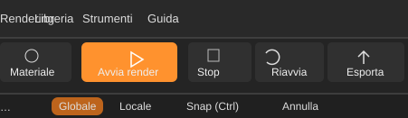
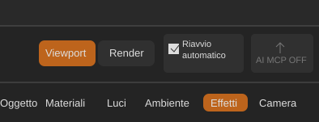

# ForgeRender — Modifiche ad animazione, simulazioni e salvataggio video

Data: 06/11/2026  
Tipo: richiesta tecnica di Valerio a Claude Code  
Stato: da analizzare e implementare  
Branch di riferimento: sviluppo

## Obiettivo

Raccogliere in questa nota le modifiche richieste da Valerio relative ad animazioni, simulazioni, Particle System, configurazione dell'esportazione video e uniformità della barra superiore. Le richieste future su questi ambiti potranno essere aggiunte qui.

## 1. Fumo: salvare anche la griglia fine

Il sistema esistente salva già dati temporanei del fumo e consente la ripresa dal primo fotogramma modificato. Estendere il precalcolo affinché salvi su disco anche la griglia fine utilizzata per il risultato.

- Calcolare e salvare tutti i dati necessari per ogni fotogramma, inclusa la griglia fine.
- Il render dell'animazione deve leggere e riutilizzare i dati precalcolati, senza ricostruire o ricampionare la griglia fine per ogni frame.
- Conservare riuso dei frame invariati e ripresa dal primo frame realmente modificato.
- Invalidare la cache quando cambiano parametri, sorgenti, geometrie, trasformazioni o altri input che influenzano la simulazione.
- Gestire versione del formato, integrità, cache incompleta/corrotta e pulizia dei temporanei.
- Esaminare e riutilizzare, dove sensato, l'infrastruttura esistente in `crates/forge_render_core/src/smoke_bake.rs`.

## 2. Particle System: interazione con oggetti animati

Problema osservato da Valerio: il Particle System si anima nella viewport, ma durante un'animazione con oggetti in movimento le particelle sembrano non interagire con essi. Non si osservano collisioni, spinte o deviazioni coerenti con il movimento degli oggetti. Il fumo nel rendering, invece, sembra reagire agli oggetti animati.

Prima di modificare:
- Riprodurre il problema con una scena minima e deterministica.
- Seguire il percorso della simulazione: aggiornamento temporale, trasformazioni degli oggetti, collisioni/interazioni, viewport e render.
- Individuare la causa effettiva; non presumere che sia un semplice problema di visualizzazione.
- Verificare se viewport e render utilizzano lo stesso stato simulato o percorsi distinti.

Comportamento richiesto:
- Le particelle devono interagire con gli oggetti animati usando la trasformazione effettiva degli oggetti a ogni istante della timeline.
- Gestire le interazioni già supportate dal sistema (collisione, spinta, deviazione o trascinamento dell'aria), senza introdurre proprietà superflue.
- Garantire coerenza tra anteprima viewport e rendering dell'animazione.
- Non limitarsi a riprodurre particelle in movimento indipendenti dalla scena.

## 3. Precalcolo e cache del Particle System

Valutare e implementare un precalcolo temporale persistente anche per il Particle System, se non esiste già.

- Salvare gli stati necessari a riprodurre le particelle nei vari frame, incluse le interazioni con gli oggetti animati.
- Fare in modo che viewport e render leggano gli stessi risultati precalcolati.
- Se cambia un oggetto che influenza la simulazione, invalidare dal primo frame interessato in avanti, preservando i precedenti quando possibile.
- Non invalidare inutilmente la simulazione per modifiche che non ne influenzano la fisica.
- Gestire riapertura del progetto, cache mancante/incompleta, versionamento e pulizia.
- Valutare il riuso dei meccanismi comuni di `smoke_bake.rs` (impronte, cache, ripresa, invalidazione), mantenendo distinti i dati e le logiche specifiche delle particelle.

## 4. Impostazioni complete di esportazione video

Attualmente l'esportazione dell'animazione produce un MP4 con impostazioni scelte automaticamente dal programma. Valerio vuole poter decidere formato e qualità del file, senza essere vincolato a una compressione aggressiva o a un unico MP4 predefinito.

Analizzare prima il percorso di esportazione attuale, le librerie/encoder disponibili e le dipendenze del progetto. Poi aggiungere un pannello o una finestra di impostazioni video accessibile prima di avviare il salvataggio dell'animazione.

### Impostazioni che l'utente deve poter controllare

- **Contenitore/formato:** almeno MP4 e AVI; valutare MOV e MKV se supportati in modo affidabile dall'encoder disponibile.
- **Codec:** mostrare soltanto codec realmente disponibili per il formato scelto. Non confondere contenitore e codec: AVI, per esempio, può contenere video non compresso oppure codec lossless.
- **Qualità/compressione:** preset chiari: dimensione ridotta/compressione alta, qualità alta, qualità molto alta/compressione leggera, lossless e non compresso quando supportati.
- **Bitrate:** possibilità di impostarlo per i codec che lo supportano, con indicazione o stima della dimensione finale.
- **Qualità del codec:** esporre CRF o equivalente quando pertinente, spiegandone il significato e senza mostrare controlli non applicabili.
- **Pixel format e profondità colore:** opzioni realmente supportate, ad esempio 8/10 bit quando disponibili; evitare conversioni non dichiarate.
- **Frame rate:** usare quello della timeline come valore iniziale, permettendo di controllarlo se la temporizzazione resta chiara.
- **Risoluzione:** mantenere quella del render come valore iniziale; consentire un'altra risoluzione solo con ridimensionamento corretto e documentato.
- **Percorso e nome file:** scelta esplicita della destinazione ed estensione coerente con il contenitore.
- **Preset salvabili:** preset predefiniti sensati e possibilità di ricordare l'ultima configurazione.

### Caso d'uso prioritario: AVI non compresso e compressione meno aggressiva

Valerio vuole poter esportare:
- AVI non compresso, se supportato;
- AVI lossless (valutare FFV1 o alternativa realmente disponibile);
- MP4 ad alta qualità e con compressione meno aggressiva del preset attuale;
- un formato intermedio di alta qualità per ulteriori lavorazioni in software di montaggio.

Verificare encoder e combinazioni contenitore/codec. Se AVI non compresso o FFV1 non sono disponibili nell'attuale backend, spiegarne il motivo e valutare l'integrazione minima necessaria, senza introdurre dipendenze pesanti o binari esterni senza motivazione.

### UX e protezione da errori

- Descrivere il compromesso qualità/dimensione di ogni preset.
- Avvisare quando un formato non supporta una particolare opzione.
- Non applicare silenziosamente un codec o una qualità diversi da quelli scelti.
- Gestire errori encoder, spazio disco insufficiente, interruzione e file parziali.
- Se possibile, mostrare una stima della dimensione, distinguendola da un valore garantito.
- La scelta del codec non deve modificare i frame renderizzati né il rendering della scena.

### Criteri di accettazione video

1. Prima dell'esportazione si possono scegliere formato/contenitore e codec compatibile.
2. È disponibile un MP4 ad alta qualità con compressione meno aggressiva del preset attuale.
3. È possibile esportare AVI non compresso, se supportato, oppure un'alternativa lossless chiaramente identificata.
4. Le impostazioni non applicabili sono disabilitate o nascoste, non ignorate.
5. Il file è riproducibile e l'estensione corrisponde al contenitore reale.
6. Sono riportati codec, pixel format, frame rate, risoluzione e parametri effettivi.
7. Un errore/interruzione non lascia un file incompleto presentato come riuscito.
8. Il percorso standard continua a funzionare con un preset predefinito ragionevole.

## 5. Uniformare i pulsanti della barra superiore

Valerio vuole che **tutti i pulsanti della barra superiore abbiano lo stesso linguaggio visivo, la stessa altezza e lo stesso ingombro verticale**.

Situazione mostrata nelle immagini:
- Nella parte sinistra, i pulsanti principali (per esempio Materiale, Avvia render, Stop, Riavvia, Esporta) sono più alti e hanno un aspetto da pulsante grande.
- Nella parte destra, i controlli (Viewport, Render, Riavvio automatico, AI MCP OFF) sono più bassi e compatti, ma già coerenti tra loro come famiglia di controlli.

### Risultato desiderato

- Uniformare la parte sinistra alla dimensione/altezza compatta già usata dalla parte destra.
- Tutti i controlli della barra superiore devono condividere altezza, allineamento verticale, padding e stile dei bordi/raggio, per quanto compatibile con la funzione.
- Il pulsante Avvia render non deve più essere visivamente molto più alto o dominante rispetto agli altri.
- Mantenere distinguibili gli stati e le azioni: per esempio Avvia render può conservare il colore d'accento, ma non dimensioni maggiori; Stop, Riavvia ed Esporta devono avere la stessa altezza e baseline.
- Non modificare le funzioni, le etichette, le icone, le scorciatoie o il comportamento dei comandi.
- Verificare spaziatura e allineamento anche con finestra stretta, DPI/scaling differenti e testi tradotti più lunghi.
- Preferire un componente/stile condiviso o token di dimensionamento comuni, evitando correzioni isolate con valori diversi per ciascun pulsante.

### Riferimenti visivi

Le immagini qui sotto sono ricostruzioni illustrative dei due ritagli forniti da Valerio, inserite come riferimenti visivi temporanei per questa richiesta.

**Parte sinistra — pulsanti attualmente troppo alti**

**Parte destra — altezza compatta da usare come riferimento**

### Criteri di accettazione UI

1. Tutti i pulsanti/controlli della barra superiore hanno la stessa altezza visiva.
2. La parte sinistra adotta la dimensione compatta della parte destra.
3. Icone e testi sono centrati e allineati sulla stessa baseline.
4. Il colore d'accento può differenziare l'azione primaria, ma non dimensioni e altezza.
5. Nessuna regressione di funzioni, scorciatoie, tooltip o stato dei controlli.
6. Verifica a dimensioni finestra diverse e con le lingue supportate.

## 6. Analisi architetturale richiesta

Prima dell'implementazione, descrivere brevemente:
- dove vengono eseguite oggi le simulazioni di fumo e particelle;
- come vengono valutate le trasformazioni degli oggetti a ogni frame;
- come sono gestite collisioni e interazioni;
- quali dati sono già salvati e quali ricostruiti;
- come viewport e render recuperano lo stato simulato;
- quale backend/encoder produce attualmente il video, quali contenitori e codec supporta e quali parametri espone;
- quali componenti e stili UI generano i pulsanti nelle due zone della barra superiore e quali dimensioni/padding usano.

Evitare sistemi di cache duplicati se è possibile condividere il meccanismo comune. Non compromettere la reattività dell'anteprima durante la normale modifica della scena e non cambiare il risultato del rendering per effetto delle sole impostazioni di codifica video.

## 7. Criteri di accettazione generali

1. Il precalcolo del fumo salva anche la griglia fine e il render la riutilizza senza ricostruirla per ogni frame.
2. Una modifica ai parametri del fumo invalida dal primo frame interessato, non prima.
3. Il Particle System reagisce visibilmente agli oggetti animati lungo la timeline.
4. Viewport e render mostrano la stessa evoluzione temporale delle particelle.
5. Una modifica alla traiettoria o geometria di un oggetto interagente ricalcola soltanto la parte dipendente dalla modifica.
6. I dati precalcolati restano riutilizzabili dopo la riapertura del progetto, se validi.
7. Dimensioni e pulizia della cache sono controllate.
8. Nessuna regressione alla simulazione normale del fumo o all'anteprima delle particelle.
9. L'esportazione video consente di scegliere consapevolmente formato e qualità, inclusi percorsi ad alta qualità/lossless quando supportati.
10. La barra superiore presenta pulsanti uniformi per altezza, allineamento e dimensionamento.

## 8. Test richiesti

Creare una scena riproducibile con emettitore, oggetto animato che attraversa la traiettoria delle particelle e prova di controllo con oggetto fermo. Includere anche una simulazione di fumo su più frame con griglia fine.

Verificare per le simulazioni: primo precalcolo; riproduzione da cache; modifica parametri e invalidazione; modifica della traiettoria e aggiornamento delle interazioni; confronto viewport/render; chiusura e riapertura progetto; cache parziale o non valida.

Per il video, esportare brevi sequenze di prova con MP4 standard, MP4 ad alta qualità, AVI non compresso se disponibile e AVI lossless con FFV1 o equivalente se disponibile. Verificare con uno strumento di ispezione i parametri effettivi del file (contenitore, codec, pixel format, frame rate, risoluzione e bitrate), oltre alla riproduzione. Confrontare dimensioni e qualità senza dichiarare equivalenti impostazioni diverse.

Per la UI, verificare visivamente la barra superiore in almeno una finestra larga e una stretta, con le lingue supportate. I test unitari non sostituiscono la verifica visiva.

## 9. Risposta richiesta a ChatGPT

Aggiungere al normale handoff una risposta datata con:
- causa effettiva del problema del Particle System;
- comportamento precedente e comportamento ottenuto;
- file modificati e motivazione;
- architettura e formato della cache per fumo e particelle;
- strategia di invalidazione e ripresa;
- backend video, contenitori, codec e opzioni effettivamente supportati;
- impostazioni predefinite e comportamento dei preset video;
- componenti/stili UI modificati per uniformare la barra;
- test e comandi realmente eseguiti e relativi risultati;
- verifica visiva svolta oppure esplicitamente non eseguita;
- dimensioni dei temporanei, dimensioni dei video e tempi di precalcolo/esportazione, se misurati;
- limiti residui e attività aperte.

Questa nota è una richiesta di analisi e implementazione, non una dichiarazione che le funzionalità siano già state realizzate o verificate. Distinguere fatti osservati, ipotesi, test eseguiti e attività ancora da fare.
