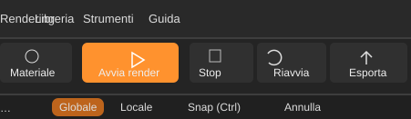
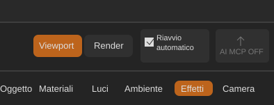

# ForgeRender — Modifiche
**Data: 06/11/2026**
**Documento unico per Claude Code — branch sviluppo**

Le richieste e decisioni del 6 novembre sono raccolte qui per essere lette insieme. Le funzionalità non sono da considerare implementate finché non risultano verificate nel codice e nei test.

## 1. Animazione, simulazioni, polvere, esportazione video e barra superiore

Data: 06/11/2026  
Tipo: richiesta tecnica di Valerio a Claude Code  
Stato: da analizzare e implementare  
Branch di riferimento: sviluppo

## Obiettivo

Raccogliere in questa nota le modifiche richieste da Valerio relative ad animazioni, simulazioni, Particle System, polvere sospesa, configurazione dell'esportazione video e uniformità della barra superiore. Le richieste future su questi ambiti potranno essere aggiunte qui.

## 1. Fumo: salvare anche la griglia fine

Il sistema esistente salva già dati temporanei del fumo e consente la ripresa dal primo fotogramma modificato. Estendere il precalcolo affinché salvi su disco anche la griglia fine utilizzata per il risultato.

- Calcolare e salvare tutti i dati necessari per ogni fotogramma, inclusa la griglia fine.
- Il render dell'animazione deve leggere e riutilizzare i dati precalcolati, senza ricostruire o ricampionare la griglia fine per ogni frame.
- Conservare riuso dei frame invariati e ripresa dal primo frame realmente modificato.
- Invalidare la cache quando cambiano parametri, sorgenti, geometrie, trasformazioni o altri input che influenzano la simulazione.
- Gestire versione del formato, integrità, cache incompleta/corrotta e pulizia dei temporanei.
- Esaminare e riutilizzare, dove sensato, l'infrastruttura esistente in `crates/forge_render_core/src/smoke_bake.rs`.

## 2. Particle System: interazione con oggetti animati

Problema osservato da Valerio: il Particle System si anima nella viewport, ma durante un'animazione con oggetti in movimento le particelle sembrano non interagire con essi. Non si osservano collisioni, spinte o deviazioni coerenti con il movimento degli oggetti. Il fumo nel rendering, invece, sembra reagire agli oggetti animati.

Prima di modificare:
- Riprodurre il problema con una scena minima e deterministica.
- Seguire il percorso della simulazione: aggiornamento temporale, trasformazioni degli oggetti, collisioni/interazioni, viewport e render.
- Individuare la causa effettiva; non presumere che sia un semplice problema di visualizzazione.
- Verificare se viewport e render utilizzano lo stesso stato simulato o percorsi distinti.

Comportamento richiesto:
- Le particelle devono interagire con gli oggetti animati usando la trasformazione effettiva degli oggetti a ogni istante della timeline.
- Gestire le interazioni già supportate dal sistema (collisione, spinta, deviazione o trascinamento dell'aria), senza introdurre proprietà superflue.
- Garantire coerenza tra anteprima viewport e rendering dell'animazione.
- Non limitarsi a riprodurre particelle in movimento indipendenti dalla scena.

## 3. Precalcolo e cache del Particle System

Valutare e implementare un precalcolo temporale persistente anche per il Particle System, se non esiste già.

- Salvare gli stati necessari a riprodurre le particelle nei vari frame, incluse le interazioni con gli oggetti animati.
- Fare in modo che viewport e render leggano gli stessi risultati precalcolati.
- Se cambia un oggetto che influenza la simulazione, invalidare dal primo frame interessato in avanti, preservando i precedenti quando possibile.
- Non invalidare inutilmente la simulazione per modifiche che non ne influenzano la fisica.
- Gestire riapertura del progetto, cache mancante/incompleta, versionamento e pulizia.
- Valutare il riuso dei meccanismi comuni di `smoke_bake.rs` (impronte, cache, ripresa, invalidazione), mantenendo distinti i dati e le logiche specifiche delle particelle.

## 4. Polvere sospesa: animazione naturale e interazione con scena e fumo

Valerio vuole che l'effetto **Polvere sospesa**, ora che ForgeRender dispone della timeline e delle animazioni, non resti un insieme di granelli statici o distribuiti in modo immobile. Deve comportarsi come vera polvere fine sospesa nell'aria: particelle che fluttuano, derivano lentamente e cambiano traiettoria con movimenti casuali ma continui e credibili.

### Comportamento visivo richiesto

- La polvere deve muoversi durante la timeline anche in una scena senza oggetti animati.
- Il moto deve essere lento, leggero, irregolare e tridimensionale: deriva, piccoli spostamenti verticali/orizzontali, oscillazioni e variazioni graduali di direzione e velocità.
- Usare un moto casuale **continuo e coerente nel tempo**, non una posizione casuale rigenerata a ogni frame: niente tremolio, teletrasporti o cambi di direzione bruschi.
- Usare seed deterministici per le particelle, così lo stesso progetto e la stessa timeline producono lo stesso risultato tra riproduzioni e render.
- Variare il comportamento tra granelli: dimensioni, inerzia, velocità di deriva e risposta alle correnti, senza dare a ogni particella una traiettoria identica.
- Evitare l'effetto sciame organizzato o bollicine: deve sembrare pulviscolo ambientale sospeso, non un emettitore di particelle evidente.
- Il comportamento deve essere valutabile sia in viewport sia nel rendering dell'animazione, con coerenza temporale tra i due.

### Fisica semplificata e parametri

Analizzare una simulazione leggera, adatta al rendering e non necessariamente una simulazione fluidodinamica completa. Valutare una combinazione di:
- inerzia e velocità propria della particella;
- resistenza/drag dell'aria, dominante per la polvere molto fine;
- gravità molto attenuata o compensata dalla sospensione e dai moti convettivi;
- deriva lenta e turbolenza a bassa frequenza, ottenute con rumore continuo nel tempo o un campo di velocità coerente;
- eventuale variazione di massa/dimensione, con risposta fisica plausibile ma controllata.

Non introdurre rumore indipendente per frame. Il rumore deve essere una funzione continua di posizione e tempo oppure uno stato simulato integrato con timestep stabile. Il risultato deve essere riproducibile anche quando si salta direttamente a un frame della timeline, non soltanto quando si preme Play dall'inizio.

### Interazione con oggetti animati

Valutare quanto la polvere debba essere influenzata dagli oggetti:
- Oggetti in movimento dovrebbero poter spostare l'aria e creare una perturbazione leggera del pulviscolo vicino, coerente con direzione e velocità del movimento.
- La polvere dovrebbe rispettare le superfici solide: evitare che attraversi palesemente gli oggetti quando la scena o la scala del granello rendono visibile la collisione.
- Non è necessario trattare ogni granello come un corpo rigido con collisioni costose: valutare collisioni semplificate, campionamento spaziale, volumi di influenza o interazione basata sul campo di velocità.
- Distinguere l'interazione con oggetti grandi e veloci da quella con dettagli geometrici minuti, che non giustificano costi elevati.
- Se l'oggetto è fermo, non deve generare continuamente turbolenza artificiale.

### Interazione con il fumo e con l'aria della scena

Valutare esplicitamente il rapporto tra polvere sospesa e fumo:
- Il fumo e le correnti associate dovrebbero poter trascinare o deviare la polvere nelle zone in cui i due effetti si sovrappongono.
- La polvere può essere trasportata dal campo di velocità del fumo, se disponibile, con intensità regolabile e attenuata in base alla risposta/inerzia delle particelle.
- Valutare se il movimento degli oggetti che già spinge l'aria nel sistema del fumo possa alimentare anche il moto della polvere, evitando due modelli di interazione incoerenti.
- Come comportamento iniziale, preferire un accoppiamento unidirezionale leggero: aria/fumo e oggetti influenzano la polvere, ma la polvere non deve modificare la simulazione del fumo. Un accoppiamento bidirezionale va considerato soltanto se esiste una motivazione visiva/fisica concreta e il costo è sostenibile.
- Se il campo di velocità del fumo non è disponibile o non è conveniente da campionare, proporre un'alternativa semplice e dichiararne i limiti. Non fingere un'interazione fisica che il modello non calcola.

### Prestazioni, cache e controlli

- Valutare il costo con un numero elevato di granelli e su sequenze lunghe.
- Evitare collisioni mesh-per-particella a ogni step se il costo è sproporzionato.
- Usare LOD o semplificazioni per viewport e render, senza cambiare arbitrariamente la distribuzione o il comportamento temporale.
- Il moto deve essere indipendente dal frame rate di riproduzione; timestep e integrazione non devono produrre risultati diversi a seconda della velocità di Play.
- Se è necessario uno stato simulato, prevedere precalcolo/cache e invalidazione coerenti con le altre simulazioni. Se è possibile ricavare il moto in modo deterministico direttamente da tempo e seed, valutare questa soluzione per evitare cache superflue.
- Esporre soltanto controlli utili, per esempio intensità del moto/deriva e influenza delle correnti, mantenendo preset naturale di default. Non riempire l'interfaccia con parametri fisici difficili da comprendere.

### Criteri di accettazione della polvere

1. La polvere sospesa si muove anche senza animazioni degli oggetti.
2. Il moto è lento, organico, tridimensionale e continuo, senza scatti o tremolii casuali tra frame.
3. La riproduzione è deterministica: Play, salto diretto a un frame e render dello stesso frame producono posizioni coerenti.
4. Gli oggetti animati influenzano in modo visibile ma non eccessivo il pulviscolo nelle loro vicinanze, se l'interazione viene implementata.
5. Il fumo/campo d'aria può trascinare la polvere in modo plausibile, senza introdurre un accoppiamento bidirezionale costoso non necessario.
6. Le particelle non attraversano palesemente superfici solide quando la collisione è visibile e rilevante.
7. Il costo resta ragionevole con molti granelli e sequenze lunghe.
8. La resa è coerente tra viewport e render e non degrada l'effetto di polvere già esistente nelle scene statiche.

## 5. Impostazioni complete di esportazione video

Attualmente l'esportazione dell'animazione produce un MP4 con impostazioni scelte automaticamente dal programma. Valerio vuole poter decidere formato e qualità del file, senza essere vincolato a una compressione aggressiva o a un unico MP4 predefinito.

Analizzare prima il percorso di esportazione attuale, le librerie/encoder disponibili e le dipendenze del progetto. Poi aggiungere un pannello o una finestra di impostazioni video accessibile prima di avviare il salvataggio dell'animazione.

### Impostazioni che l'utente deve poter controllare

- **Contenitore/formato:** almeno MP4 e AVI; valutare MOV e MKV se supportati in modo affidabile dall'encoder disponibile.
- **Codec:** mostrare soltanto codec realmente disponibili per il formato scelto. Non confondere contenitore e codec: AVI, per esempio, può contenere video non compresso oppure codec lossless.
- **Qualità/compressione:** preset chiari: dimensione ridotta/compressione alta, qualità alta, qualità molto alta/compressione leggera, lossless e non compresso quando supportati.
- **Bitrate:** possibilità di impostarlo per i codec che lo supportano, con indicazione o stima della dimensione finale.
- **Qualità del codec:** esporre CRF o equivalente quando pertinente, spiegandone il significato e senza mostrare controlli non applicabili.
- **Pixel format e profondità colore:** opzioni realmente supportate, ad esempio 8/10 bit quando disponibili; evitare conversioni non dichiarate.
- **Frame rate:** usare quello della timeline come valore iniziale, permettendo di controllarlo se la temporizzazione resta chiara.
- **Risoluzione:** mantenere quella del render come valore iniziale; consentire un'altra risoluzione solo con ridimensionamento corretto e documentato.
- **Percorso e nome file:** scelta esplicita della destinazione ed estensione coerente con il contenitore.
- **Preset salvabili:** preset predefiniti sensati e possibilità di ricordare l'ultima configurazione.

### Caso d'uso prioritario: AVI non compresso e compressione meno aggressiva

Valerio vuole poter esportare:
- AVI non compresso, se supportato;
- AVI lossless (valutare FFV1 o alternativa realmente disponibile);
- MP4 ad alta qualità e con compressione meno aggressiva del preset attuale;
- un formato intermedio di alta qualità per ulteriori lavorazioni in software di montaggio.

Verificare encoder e combinazioni contenitore/codec. Se AVI non compresso o FFV1 non sono disponibili nell'attuale backend, spiegarne il motivo e valutare l'integrazione minima necessaria, senza introdurre dipendenze pesanti o binari esterni senza motivazione.

### UX e protezione da errori

- Descrivere il compromesso qualità/dimensione di ogni preset.
- Avvisare quando un formato non supporta una particolare opzione.
- Non applicare silenziosamente un codec o una qualità diversi da quelli scelti.
- Gestire errori encoder, spazio disco insufficiente, interruzione e file parziali.
- Se possibile, mostrare una stima della dimensione, distinguendola da un valore garantito.
- La scelta del codec non deve modificare i frame renderizzati né il rendering della scena.

### Criteri di accettazione video

1. Prima dell'esportazione si possono scegliere formato/contenitore e codec compatibile.
2. È disponibile un MP4 ad alta qualità con compressione meno aggressiva del preset attuale.
3. È possibile esportare AVI non compresso, se supportato, oppure un'alternativa lossless chiaramente identificata.
4. Le impostazioni non applicabili sono disabilitate o nascoste, non ignorate.
5. Il file è riproducibile e l'estensione corrisponde al contenitore reale.
6. Sono riportati codec, pixel format, frame rate, risoluzione e parametri effettivi.
7. Un errore/interruzione non lascia un file incompleto presentato come riuscito.
8. Il percorso standard continua a funzionare con un preset predefinito ragionevole.

## 6. Uniformare i pulsanti della barra superiore

Valerio vuole che tutti i pulsanti della barra superiore abbiano lo stesso linguaggio visivo, la stessa altezza e lo stesso ingombro verticale.

Situazione mostrata nelle immagini:
- Nella parte sinistra, i pulsanti principali (per esempio Materiale, Avvia render, Stop, Riavvia, Esporta) sono più alti e hanno un aspetto da pulsante grande.
- Nella parte destra, i controlli (Viewport, Render, Riavvio automatico, AI MCP OFF) sono più bassi e compatti, ma già coerenti tra loro come famiglia di controlli.

Risultato desiderato:
- Uniformare la parte sinistra alla dimensione/altezza compatta già usata dalla parte destra.
- Tutti i controlli della barra superiore devono condividere altezza, allineamento verticale, padding e stile dei bordi/raggio, per quanto compatibile con la funzione.
- Il pulsante Avvia render non deve più essere visivamente molto più alto o dominante rispetto agli altri.
- Mantenere distinguibili gli stati e le azioni: per esempio Avvia render può conservare il colore d'accento, ma non dimensioni maggiori; Stop, Riavvia ed Esporta devono avere la stessa altezza e baseline.
- Non modificare funzioni, etichette, icone, scorciatoie o comportamento dei comandi.
- Verificare spaziatura e allineamento anche con finestra stretta, DPI/scaling differenti e testi tradotti più lunghi.
- Preferire un componente/stile condiviso o token di dimensionamento comuni, evitando correzioni isolate con valori diversi per ciascun pulsante.

### Riferimenti visivi

Le immagini qui sotto sono ricostruzioni illustrative dei due ritagli forniti da Valerio, inserite come riferimenti visivi temporanei per questa richiesta.

**Parte sinistra — pulsanti attualmente troppo alti**

**Parte destra — altezza compatta da usare come riferimento**

### Criteri di accettazione UI

1. Tutti i pulsanti/controlli della barra superiore hanno la stessa altezza visiva.
2. La parte sinistra adotta la dimensione compatta della parte destra.
3. Icone e testi sono centrati e allineati sulla stessa baseline.
4. Il colore d'accento può differenziare l'azione primaria, ma non dimensioni e altezza.
5. Nessuna regressione di funzioni, scorciatoie, tooltip o stato dei controlli.
6. Verifica a dimensioni finestra diverse e con le lingue supportate.

## 7. Analisi architetturale richiesta

Prima dell'implementazione, descrivere brevemente:
- dove vengono eseguite oggi le simulazioni di fumo e particelle;
- come vengono valutate le trasformazioni degli oggetti a ogni frame;
- come sono gestite collisioni e interazioni;
- quali dati sono già salvati e quali ricostruiti;
- come viewport e render recuperano lo stato simulato;
- quale backend/encoder produce attualmente il video, quali contenitori e codec supporta e quali parametri espone;
- quali componenti e stili UI generano i pulsanti nelle due zone della barra superiore e quali dimensioni/padding usano.

Evitare sistemi di cache duplicati se è possibile condividere il meccanismo comune. Non compromettere la reattività dell'anteprima durante la normale modifica della scena e non cambiare il risultato del rendering per effetto delle sole impostazioni di codifica video.

## 8. Criteri di accettazione generali

1. Il precalcolo del fumo salva anche la griglia fine e il render la riutilizza senza ricostruirla per ogni frame.
2. Una modifica ai parametri del fumo invalida dal primo frame interessato, non prima.
3. Il Particle System reagisce visibilmente agli oggetti animati lungo la timeline.
4. Viewport e render mostrano la stessa evoluzione temporale delle particelle.
5. Una modifica alla traiettoria o geometria di un oggetto interagente ricalcola soltanto la parte dipendente dalla modifica.
6. I dati precalcolati restano riutilizzabili dopo la riapertura del progetto, se validi.
7. Dimensioni e pulizia della cache sono controllate.
8. Nessuna regressione alla simulazione normale del fumo o all'anteprima delle particelle.
9. L'esportazione video consente di scegliere consapevolmente formato e qualità, inclusi percorsi ad alta qualità/lossless quando supportati.
10. La barra superiore presenta pulsanti uniformi per altezza, allineamento e dimensionamento.
11. La polvere sospesa ha un moto naturale, deterministico e coerente con gli oggetti e i campi d'aria/fumo, con costo controllato.

## 9. Test richiesti

Creare una scena riproducibile con emettitore, oggetto animato che attraversa la traiettoria delle particelle e prova di controllo con oggetto fermo. Includere anche una simulazione di fumo su più frame con griglia fine.

Verificare per le simulazioni: primo precalcolo; riproduzione da cache; modifica parametri e invalidazione; modifica della traiettoria e aggiornamento delle interazioni; confronto viewport/render; chiusura e riapertura progetto; cache parziale o non valida. Per la polvere verificare anche moto in assenza di oggetti animati, riproducibilità con salto diretto al frame, interazione con oggetti in movimento e fumo, e costo con molti granelli.

Per il video, esportare brevi sequenze di prova con MP4 standard, MP4 ad alta qualità, AVI non compresso se disponibile e AVI lossless con FFV1 o equivalente se disponibile. Verificare con uno strumento di ispezione i parametri effettivi del file (contenitore, codec, pixel format, frame rate, risoluzione e bitrate), oltre alla riproduzione. Confrontare dimensioni e qualità senza dichiarare equivalenti impostazioni diverse.

Per la UI, verificare visivamente la barra superiore in almeno una finestra larga e una stretta, con le lingue supportate. I test unitari non sostituiscono la verifica visiva.

## 10. Risposta richiesta a ChatGPT

Aggiungere al normale handoff una risposta datata con:
- causa effettiva del problema del Particle System;
- comportamento precedente e comportamento ottenuto;
- file modificati e motivazione;
- architettura e formato della cache per fumo e particelle;
- strategia di invalidazione e ripresa;
- approccio scelto per la polvere sospesa, interazioni implementate e motivazione delle semplificazioni fisiche;
- backend video, contenitori, codec e opzioni effettivamente supportati;
- impostazioni predefinite e comportamento dei preset video;
- componenti/stili UI modificati per uniformare la barra;
- test e comandi realmente eseguiti e relativi risultati;
- verifica visiva svolta oppure esplicitamente non eseguita;
- dimensioni dei temporanei, dimensioni dei video e tempi di precalcolo/esportazione, se misurati;
- limiti residui e attività aperte.

Questa nota è una richiesta di analisi e implementazione, non una dichiarazione che le funzionalità siano già state realizzate o verificate. Distinguere fatti osservati, ipotesi, test eseguiti e attività ancora da fare.

## 2. Decisione approvata — polvere sospesa

Data: 06/11/2026  
Progetto: ForgeRender  
Stato: **approvato da Valerio**

## Decisione

Per l'effetto **Polvere sospesa**, adottare come architettura iniziale un'interazione **unidirezionale**:

- gli oggetti in movimento possono influenzare il moto della polvere;
- le correnti d'aria e il campo di velocità del fumo, quando disponibili e convenienti da campionare, possono trascinare o deviare la polvere;
- la polvere **non modifica la simulazione del fumo** e non genera feedback sulle correnti.

## Motivazione

Questa soluzione riduce sensibilmente complessità e costo computazionale, evitando un accoppiamento bidirezionale che difficilmente darebbe un vantaggio visivo proporzionato. L'obiettivo è ottenere un effetto convincente: pulviscolo leggero che reagisce all'ambiente, senza trasformare la simulazione in un sistema fluidodinamico accoppiato.

## Indicazioni per l'implementazione

1. Riutilizzare, ove possibile, il campo di velocità o le informazioni di spinta dell'aria già calcolate per il fumo e per gli oggetti animati.
2. Applicare l'influenza alla polvere con intensità controllabile e attenuata in base a inerzia/risposta dei granelli.
3. Se il campo del fumo non è disponibile nel punto in cui viene aggiornata la polvere, non introdurre dipendenze invasive: proporre un'interazione semplificata e documentarne il limite.
4. Non implementare feedback dalla polvere al fumo.
5. Mantenere comportamento deterministico e coerente tra viewport, salto diretto nella timeline e render.
6. Misurare il costo con quantità rappresentative di particelle e verificare che l'interazione non comprometta le prestazioni.

## Ambito della decisione

Questa approvazione riguarda **la polvere sospesa** descritta nella sezione dedicata del documento:

`reports/chatgpt/2026-11-06_modifiche-animazione-simulazioni-export-video.md`

Non estendere automaticamente questa decisione al nuovo effetto **Lucciole / Bosco incantato**, che ha requisiti distinti di illuminazione reale e deve essere progettato separatamente.

Questa decisione prevale sulle formulazioni esplorative della sezione 1: oggetti animati e correnti/campo di velocità del fumo possono influenzare la polvere; la polvere non modifica il fumo. Non estendere automaticamente questa regola alle lucciole.

## 3. Nuovo effetto — Lucciole / Bosco incantato

Data: 06/11/2026
Tipo: nuova funzionalità richiesta da Valerio
Stato: da analizzare, progettare e implementare
Ambito: Particle System, illuminazione, animazione e rendering

## Obiettivo

Creare un nuovo effetto selezionabile, denominato **Lucciole** (preset estetico: **Bosco incantato**). Deve simulare uno stormo di lucciole che vola nello spazio tridimensionale con traiettorie irregolari, prevalentemente orizzontali, e si illumina in modo intermittente e asincrono.

Non deve essere un semplice sistema di particelle emissive con alone aggiunto in post-produzione. Le lucciole devono contribuire all'illuminazione della scena: quando si accendono, la loro luce deve influenzare realmente superfici e oggetti circostanti, nel percorso di illuminazione del renderer.

Il progetto possiede già particelle luminose/polvere luminosa e un sistema di alone/glow (Dust::glow, nodi effetto:polvere:luce:<n>, forge_render_core/src/glow.rs). Questi elementi vanno studiati e riutilizzati dove appropriato, ma il nuovo effetto deve risolvere esplicitamente la differenza tra emissione visibile/post-effetto e illuminazione reale della scena.

## 1. Comportamento delle lucciole

Ogni lucciola ha un ciclo indipendente:
1. vola nello spazio anche quando è spenta;
2. rimane invisibile durante la fase spenta;
3. inizia ad accendersi con una rampa graduale (glow-in);
4. raggiunge un'intensità luminosa variabile;
5. si spegne con una rampa graduale (glow-out);
6. continua a volare e attende un intervallo variabile prima di una nuova accensione.

Le accensioni devono essere asincrone: evitare che tutte le lucciole si accendano o spengano insieme. Il risultato deve ricordare un gruppo naturale in un bosco, con punti luminosi che appaiono e scompaiono in posizioni diverse.

### Parametri temporali

L'utente deve poter controllare:
- durata minima e massima della fase spenta;
- durata minima e massima dell'accensione (glow-in);
- durata minima e massima della fase accesa;
- durata minima e massima dello spegnimento (glow-out);
- eventuale pausa/intervallo tra cicli;
- intensità minima e massima della luce;
- variazione casuale dei tempi e dell'intensità;
- distribuzione casuale delle fasi iniziali, per evitare che tutte le lucciole partano nello stesso stato.

Usare unità comprensibili (secondi o frame, dichiarando quale) e validare i limiti. Le transizioni devono essere morbide e prive di flicker.

## 2. Movimento: stormo caotico ma naturale

Le lucciole devono muoversi continuamente anche quando sono spente.

Caratteristiche:
- movimento caotico e irregolare, ma non nervoso;
- componente **orizzontale predominante**;
- componente verticale presente ma sensibilmente inferiore e regolabile in percentuale;
- traiettorie curve, cambi di direzione graduali, derive e piccole oscillazioni;
- velocità variabile tra individui;
- movimento indipendente, evitando traiettorie identiche o sincronizzate;
- permanenza entro un volume/area di emissione configurabile, con rientro graduale quando una lucciola si allontana troppo, senza teletrasporti ai bordi.

Evitare moto balistico uniforme, traiettorie rettilinee troppo lunghe, rumore indipendente per frame, cambi di direzione istantanei e sciami troppo ordinati.

### Parametri di movimento

Esporre controlli chiari per:
- quantità/numero di lucciole;
- estensione del volume di movimento;
- velocità media e variazione casuale;
- intensità del movimento orizzontale;
- percentuale/intensità del movimento verticale rispetto a quello orizzontale;
- fluidità/inerzia dei cambi di direzione;
- dispersione/densità dello stormo;
- attrazione leggera verso una zona centrale o confini morbidi del volume.

Documentare gli assi rispetto al mondo o al volume dell'effetto e consentire di orientare/ruotare il volume.

## 3. Colori: palette probabilistica e variazioni controllate

Implementare una palette con più voci. Per ogni voce l'utente può scegliere:
- colore;
- percentuale di assegnazione sul totale.

La somma delle percentuali deve essere gestita chiaramente: validazione o normalizzazione automatica, con indicazione della distribuzione effettiva. Il colore assegnato a ciascuna lucciola deve restare stabile nel tempo.

Oltre ai colori statici, aggiungere una variazione casuale controllabile:
- percentuale di lucciole che ricevono una variazione;
- ampiezza della variazione cromatica;
- variazione limitata alla stessa famiglia/tonalità del colore assegnato, senza trasformare per esempio un giallo in un blu;
- seed deterministico.

Distinguere la palette multi-colore dalla variazione tonale. Il comportamento predefinito dovrebbe mantenere il colore stabile per individuo; se si offre una variazione durante i cicli di accensione, deve essere lieve e controllabile.

## 4. Illuminazione reale della scena — requisito fondamentale

Questa è la caratteristica che distingue il nuovo effetto dai granelli luminosi esistenti.

Quando sono accese, le lucciole devono essere sorgenti luminose effettive:
- la loro luce contribuisce all'illuminazione delle superfici vicine;
- produce variazioni di luce e colore su oggetti, terreno, foglie e tronchi;
- segue l'intensità del ciclo glow-in/accensione/glow-out;
- da spente, il contributo luminoso è nullo o trascurabile e il corpo è invisibile;
- il colore della luce corrisponde al colore assegnato.

Il glow visibile non deve sostituire l'illuminazione fisica.

### Analisi tecnica obbligatoria

Ispezionare i percorsi CPU e GPU e valutare:
- sorgenti puntiformi dinamiche o area lights;
- campionamento esplicito delle luci del sistema;
- integrazione con illuminazione diretta e MIS, se applicabile;
- contributi locali o sistema di illuminazione dedicato.

Non assegnare automaticamente una luce completa e costosa a ogni lucciola senza misurare il costo. Con centinaia o migliaia di sorgenti il rendering potrebbe diventare troppo lento.

Proporre una soluzione scalabile che mantenga il contributo luminoso reale, valutando clustering delle lucciole vicine, selezione delle sorgenti più influenti, rappresentazione gerarchica del campo luminoso o campionamento stocastico con pesi corretti.

Le approssimazioni sono ammesse se documentate e se producono illuminazione coerente. Non chiamare illuminazione reale un alone aggiunto in post-produzione o un colore disegnato direttamente sui pixel.

### Ombre e occlusione

Valutare se e a quale costo le lucciole devono produrre ombre:
- la luce deve essere occlusa dagli oggetti interposti, almeno nel percorso di illuminazione del renderer;
- se ombre complete per ogni lucciola sono troppo costose, progettare un compromesso controllabile e dichiararne i limiti;
- evitare che la luce attraversi pareti o oggetti opachi in modo palesemente scorretto.

## 5. Glow visibile e corpo della lucciola

Quando la lucciola è accesa, il corpo/punto luminoso diventa visibile e il glow aumenta/diminuisce in sincronia con la luce. Dimensione apparente e intensità del glow devono essere configurabili e il glow dovrebbe essere visibile anche in viewport, se supportato.

Quando è spenta, il corpo è invisibile e non resta alone residuo, ma la particella continua la traiettoria.

Distinguere emissione visibile e contributo luminoso alla scena, mantenendoli coerenti ma controllabili separatamente.

## 6. Determinismo, timeline e precalcolo

- Seed deterministico per ogni lucciola.
- Stato iniziale e fase del ciclo distribuiti deterministicamente.
- Il salto diretto a un frame deve produrre lo stesso risultato della riproduzione dall'inizio.
- Viewport, render singolo e render animazione devono usare lo stesso stato temporale.
- Il risultato non deve dipendere dalla velocità di riproduzione o dal frame rate effettivo della UI.

Preferire, se possibile, traiettorie e cicli ricavabili da tempo assoluto + seed, senza integrare tutta la simulazione dall'inizio. Se interazioni con oggetti o campi richiedono stato simulato, valutare precalcolo/cache e invalidazione dal primo frame interessato.

## 7. Interazione con oggetti e ambiente

Valutare:
- gli oggetti in movimento possono perturbare leggermente il moto delle lucciole vicine;
- le lucciole restano nel volume definito, con confini morbidi;
- evitare attraversamenti evidenti di superfici solide, se risolvibile con collisioni semplificate;
- non serve un modello biologico completo: l'obiettivo è un effetto credibile, controllabile e riproducibile.

Separare interazioni indispensabili da miglioramenti opzionali, così il costo non cresce senza controllo.

## 8. Interfaccia e controlli

Creare un pannello dedicato chiamato **Lucciole / Bosco incantato**, organizzato in gruppi:
1. Generale e quantità;
2. Volume e movimento;
3. Ciclo di accensione/spegnimento;
4. Palette colori e percentuali;
5. Variazione tonale;
6. Intensità luminosa e glow;
7. Qualità/prestazioni e interazione con la scena.

Usare controlli comprensibili, unità esplicite, tooltip e valori predefiniti gradevoli. Evitare di esporre decine di parametri tecnici se possono essere raggruppati in controlli intuitivi.

Fornire un preset **Bosco incantato**: molte lucciole, movimento lento e irregolare, accensioni asincrone, palette calda e luce morbida. Tutti i parametri restano modificabili.

## 9. Prestazioni e qualità

- Misurare il costo su CPU e GPU e non assumere che una pipeline rappresenti l'altra.
- Evitare una sorgente completa e costosa per ogni particella se non scala.
- Misurare il costo al crescere del numero di lucciole e delle sorgenti effettivamente campionate.
- Verificare rumore Monte Carlo, fireflies, convergenza e comportamento con campionamento adattivo.
- Evitare che l'effetto faccia esplodere il rumore o i tempi di render.
- Se si usa selezione/cluster, assicurarsi che la distribuzione non favorisca arbitrariamente alcuni colori o zone.
- Glow e illuminazione della scena devono poter essere regolati separatamente.

## 10. Criteri di accettazione

1. Esiste un nuovo effetto selezionabile chiamato Lucciole, con preset Bosco incantato.
2. Le lucciole si muovono continuamente anche quando sono spente.
3. Da spente sono invisibili; si rendono visibili gradualmente durante l'accensione e scompaiono gradualmente allo spegnimento.
4. Ogni individuo ha tempi e fasi asincroni, con intervalli configurabili.
5. Il moto è caotico ma fluido, prevalentemente orizzontale e con componente verticale inferiore regolabile.
6. È possibile configurare più colori con percentuali di assegnazione.
7. È possibile configurare la percentuale di particelle che ricevono variazioni tonali e l'ampiezza della variazione nella stessa tonalità.
8. Le lucciole accese illuminano realmente la scena nel renderer: superfici e oggetti ricevono colore e intensità della luce.
9. La luce rispetta l'occlusione degli oggetti, nei limiti della soluzione scelta e documentata.
10. Glow visibile e illuminazione reale seguono lo stesso ciclo, ma sono controllabili separatamente.
11. Play, salto diretto al frame, viewport, render singolo e render animazione producono stati coerenti e deterministici.
12. Il costo è misurato con quantità crescenti di lucciole e non compromette eccessivamente CPU/GPU.
13. Il normale sistema di polvere luminosa e gli altri effetti esistenti non subiscono regressioni.

## 11. Piano di lavoro e risposta richiesta

Prima di implementare, Claude deve:
1. Ispezionare il sistema esistente di particelle luminose, il glow in post-produzione e i percorsi di illuminazione CPU/GPU.
2. Spiegare quali parti possono essere riutilizzate e quali devono essere nuove.
3. Proporre una strategia concreta per l'illuminazione reale scalabile, con compromessi e rischi.
4. Indicare come garantire determinismo temporale e sincronizzazione tra viewport e render.
5. Implementare il nuovo effetto senza alterare il comportamento degli effetti esistenti.

Al termine, aggiungere al normale handoff una risposta datata con architettura scelta per movimento, ciclo luminoso, palette e illuminazione; file modificati; test CPU/GPU realmente eseguiti; verifica visiva con scena dimostrativa; tempi di render e misure al variare del numero di lucciole; limiti/approssimazioni di illuminazione e ombre; aspetti non verificati e prossimi interventi.

Non dichiarare completato l'effetto se le particelle sono soltanto visibili con glow in post-produzione: il requisito centrale è che le lucciole illuminate contribuiscano all'illuminazione della scena.

## 4. Finestra dedicata per importazione STEP

**Richiesta di Valerio — 06/11/2026**

## Riferimento visivo

Screenshot di riferimento fornito in questa conversazione: **“demo impostazione step.jpg”** (CAD Converter Pro, schermata STEP File Import / Mesh Conversion / 3D Preview).

> Nota operativa: il file immagine originale è presente come allegato nella conversazione ChatGPT, ma non è stato possibile inserirne il binario nel repository GitHub con gli strumenti disponibili in questa sessione. Non considerare quindi questo documento come prova che l'immagine sia già stata caricata nel repository. La schermata va allegata/cop iata nella cartella di scambio quando si trasferisce il task a Claude Code.

## Obiettivo

Valerio vuole che l'importazione dei file **STEP** in ForgeRender avvenga tramite una finestra/pannello dedicato, ispirato al layout dello screenshot, invece di affidarsi a una conversione poco configurabile o a impostazioni nascoste.

La finestra deve permettere di controllare i parametri di tessellazione e conversione prima di creare la mesh finale, mostrando contemporaneamente una preview del risultato.

## Struttura UX desiderata

Prendere come riferimento la suddivisione in tre colonne dello screenshot:

1. **Geometria sorgente**
   - Nome del file STEP selezionato e dimensione.
   - Anteprima della geometria CAD/B-rep originale, se disponibile.
   - Informazioni utili sul modello: unità, dimensioni/bounding box, numero di solidi/componenti e stato dei controlli geometrici, se ricavabili.
   - Impostazioni di importazione: unità (mm, cm, m, pollici) e asse verticale/up-axis, quando pertinenti.
2. **Tessellazione e conversione**
   - Parametri di qualità della conversione B-rep → mesh.
   - Tolleranza di deviazione (scostamento massimo dalla superficie CAD).
   - Tolleranza angolare/superficiale, se supportata dalla libreria STEP.
   - Lunghezza massima degli spigoli, se implementabile in modo corretto.
   - Opzione per preservare gli spigoli vivi, se supportata.
   - Pulsanti per annullare, ripristinare i valori predefiniti e avviare la conversione.
   - Durante la conversione: indicatore di avanzamento e stato leggibile; evitare percentuali inventate se il backend non espone progressi reali.
3. **Anteprima 3D**
   - Preview interattiva della mesh tessellata, preferibilmente con modalità shaded e wireframe.
   - Controlli di illuminazione, zoom e rotazione.
   - Riepilogo della mesh convertita: triangoli, vertici e, se disponibili, warning/errori.

## Comportamento richiesto

- La conversione non deve partire definitivamente prima che l'utente abbia confermato i parametri.
- L'utente deve poter modificare i parametri e rigenerare la preview senza dover reimportare manualmente il file.
- I valori devono avere unità esplicite e tooltip che spieghino l'effetto pratico dei parametri.
- Prevedere preset di qualità (ad esempio Bozza, Bilanciata, Alta qualità) solo se mappabili su parametri tecnici reali e documentati.
- Gestire file non validi, geometrie vuote, superfici problematiche e conversioni fallite con messaggi comprensibili.
- Per modelli STEP grandi, valutare conversione asincrona e possibilità di annullamento senza bloccare l'interfaccia.
- Conservare il flusso attuale per gli altri formati: questa richiesta riguarda specificamente STEP.
- Verificare come i parametri disponibili nel convertitore STEP attuale corrispondono ai controlli UI: non mostrare controlli che il backend ignora.

## Indicazioni per Claude Code

Prima di implementare:
1. Ispezionare il flusso STEP esistente, il processo/helper `forgerender-step.exe`, i parametri OCCT realmente esposti e il modo in cui la mesh viene importata nell'app.
2. Elencare i parametri realmente configurabili e distinguere quelli supportati da quelli che richiederebbero modifiche al convertitore.
3. Proporre una struttura UI coerente con egui e con lo stile attuale di ForgeRender, mantenendo la finestra utilizzabile anche con risoluzioni ridotte.
4. Non replicare alla lettera il branding o gli elementi grafici di CAD Converter Pro: usare lo screenshot solo come riferimento per layout, gerarchia e flusso.
5. Implementare preview e progress reporting solo nei limiti dei dati effettivamente forniti dal backend.
6. Aggiungere test per mapping dei parametri, conversione e gestione degli errori; riportare i comandi eseguiti e ciò che non è stato testato.

**Risultato atteso:** una finestra professionale di importazione STEP, con impostazioni di tessellazione accessibili e preview 3D del risultato prima dell'importazione definitiva.

### Riferimento immagine STEP

Usare lo screenshot allegato da Valerio, **demo impostazione step.jpg**, come riferimento visivo per la finestra a tre colonne: geometria sorgente, tessellazione/conversione e anteprima 3D. Non copiare il branding di CAD Converter Pro; riprendere solo organizzazione, gerarchia e flusso. L'immagine deve essere presente nella cartella di scambio insieme a questo documento quando Claude lo apre.

## 5. Istruzioni comuni

- Leggere il documento completo prima di intervenire.
- Verificare il codice attuale e i parametri realmente supportati.
- Distinguere fatti, ipotesi, decisioni approvate e aspetti da verificare.
- Evitare regressioni e mantenere la compatibilità dei progetti esistenti.
- Nel normale handoff riportare commit, file modificati, test e comandi effettivamente eseguiti, verifiche visive, misure e attività residue.
- Aggiungere eventuali aggiornamenti a questo documento, senza creare altri file separati per le richieste del 06/11, a meno che Valerio lo chieda esplicitamente.

## 6. Manipolazione del bersaglio delle luci Spot e Direzionali dal viewport

**Richiesta di Valerio — 06/11/2026**

Per le luci di tipo **Spot** e **Direzionale**, il bersaglio (*target*) deve poter essere spostato direttamente nel viewport con un manipolatore/cursore 3D, senza dover modificare manualmente le coordinate numeriche nei pannelli.

### Comportamento desiderato

- Quando si seleziona una luce Spot o Direzionale, rendere visibile nel viewport anche il punto/indicatore del suo bersaglio.
- Consentire di selezionare e trascinare il bersaglio con il normale gizmo di traslazione 3D, sugli assi e nei piani, con feedback visivo immediato.
- Il gizmo della posizione della luce e quello del bersaglio devono essere distinguibili e selezionabili separatamente: spostare il target non deve spostare accidentalmente la sorgente luminosa.
- Durante il trascinamento aggiornare in tempo reale direzione e orientamento del fascio/cono, così che la luce punti sempre al target corrente.
- Lasciare disponibili i campi numerici esistenti come modalità alternativa e per regolazioni precise; viewport e valori numerici devono restare sincronizzati.
- La modifica deve essere registrata correttamente nell'Undo/Redo e, se la luce è animata, rispettare il sistema di keyframe e la semantica di modifica della timeline già adottata dall'applicazione.
- Mostrare il manipolatore del target solo quando è pertinente e la luce è selezionata, evitando di appesantire o affollare il viewport.

### Verifiche richieste

1. Selezionare una Spot e spostarne il target in viewport: verificare che la sorgente resti ferma e il cono ruoti verso il nuovo punto.
2. Ripetere con una luce Direzionale e verificare l'aggiornamento della direzione.
3. Verificare trascinamento sugli assi e sui piani, sincronizzazione con i campi numerici e Undo/Redo.
4. Verificare il comportamento con luci animate e keyframe, senza introdurre modifiche involontarie ai frame non interessati.
5. Verificare che le altre tipologie di luce e gli strumenti di manipolazione esistenti non subiscano regressioni.

**Risultato atteso:** poter puntare e orientare Spot e Direzionali trascinando il loro bersaglio direttamente nella scena, con un'interazione chiara e coerente con gli altri gizmo di ForgeRender.

## 7. Aggiornamento immagini e README — 06/11/2026

**Richiesta di Valerio:** integrare nel README le due immagini appena aggiunte al repository.

- `docs/img/features/dopo_fascio_solo_camera.jpg`: sostituire nei README il vecchio collegamento a `reports/fascio-volumetrico/dopo_fascio_solo_camera.png` con il nuovo file JPG.
- `docs/img/features/timeline-animation.jpg`: inserirla nella sezione 16 dedicata alla Timeline, subito dopo il paragrafo introduttivo.
- Applicare entrambe le modifiche a `README.md` (inglese) e `README.it.md` (italiano), mantenendo le descrizioni coerenti.
- Non modificare o rimuovere i file immagine originali.

**Verifica richiesta:** controllare che entrambi i percorsi immagine esistano nel branch e che i README non contengano più il vecchio collegamento PNG.

## 8. Contatori di stato configurabili, FPS viewport e stima del completamento video — 06/11/2026

**Richiesta di Valerio:** riorganizzare la zona dei contatori in tempo reale e renderla configurabile dalle Opzioni/Impostazioni del programma. Quando si crea un video, mostrare anche una stima del tempo totale e il tempo rimanente.

### A. Stima dei tempi durante la creazione di un video

- Durante il render dell'animazione/video, mostrare sotto **Tempo** una voce **Tempo rimanente** e una stima del completamento.
- La stima deve basarsi sui fotogrammi effettivamente completati e sul tempo trascorso, aggiornandosi mentre il lavoro procede. Se possibile, distinguere la fase di rendering dei fotogrammi dalla successiva codifica MP4, oppure fornire una stima complessiva che includa entrambe.
- Non mostrare una falsa precisione all'inizio: finché non ci sono abbastanza dati, mostrare "Calcolo stima…" o un'indicazione equivalente. Gestire correttamente pausa, annullamento, cambio di fase e completamento.
- Anche durante la codifica MP4, se tecnicamente possibile, esporre progresso/fotogrammi elaborati e aggiornare il tempo rimanente: oggi `video::encode_mp4` riceve l'intero elenco dei frame e restituisce soltanto il nome dell'encoder, quindi Claude deve verificare come introdurre un canale di progresso senza bloccare la UI.
- Visualizzare il tempo rimanente sotto il tempo trascorso, non sostituirlo.

### B. Contatori selezionabili nelle Opzioni del programma

Aggiungere una sezione dedicata nelle **Impostazioni/Opzioni** (preferibilmente Rendering o una nuova sezione "Barra di stato") con caselle di spunta per scegliere quali contatori mostrare in tempo reale.

- Massimo **11 indicatori visibili complessivi**.
- Gli ultimi due sono **fissi, non disattivabili e sempre all'estrema destra**, nell'ordine e con le diciture tecniche già usate dall'app:
  1. `Backend: GPU - …` (o la dicitura backend effettiva già presente).
  2. `INTEL(R) C++ Compiler …` / indicatore del compilatore Intel già presente sotto il backend.
- Di conseguenza, massimo **9 indicatori configurabili** oltre ai due fissi.
- I contatori selezionati devono partire da sinistra e disporsi in modo fluido: inizialmente due righe come nell'attuale barra; aggiungendo altri indicatori, la barra può espandersi a tre righe o più, senza sovrapposizioni, troncamenti illeggibili o spostamento dei due indicatori fissi dalla posizione all'estrema destra.
- La selezione va salvata in `impostazioni.json` e mantenuta tra riavvii. Nuovi campi retrocompatibili con impostazioni già esistenti (`serde(default)`).
- Se il numero massimo è raggiunto, impedire di selezionare altri indicatori e spiegare che il limite è 9 configurabili + 2 fissi.
- Prevedere un comando rapido per ripristinare i contatori predefiniti.

### C. Contatori da valutare e rendere selezionabili

Il codice attuale in `crates/forge_app/src/ui/status.rs` mostra già tempo trascorso, campioni/s, CPU, utilizzo GPU/VRAM, media e ultima passata, risoluzione, backend, RAM processo/sistema e denoiser. Prima di aggiungere duplicati, riutilizzare le misure già disponibili e verificare quali dati sono realmente aggiornati.

Proposta di elenco (selezionare fino a 9):
- **Tempo trascorso** (render corrente).
- **Tempo rimanente** (render/video, solo quando stimabile).
- **FPS viewport** (frame al secondo effettivi, misurati su una finestra mobile; non confonderli con gli FPS impostati per il video).
- **FPS video** (frequenza di fotogrammi impostata per l'esportazione, se utile).
- **Fotogrammi** (completati / totali, durante animazione e codifica).
- **Velocità render** (Mcampioni/s).
- **CPU** (utilizzo percentuale).
- **GPU** (utilizzo percentuale).
- **VRAM** (usata / totale, con disponibilità solo quando il driver fornisce il dato).
- **RAM processo** (memoria usata da ForgeRender).
- **RAM sistema** (usata / totale).
- **Temperatura GPU** e **potenza GPU**, solo se già esposte in modo affidabile dal provider telemetry e senza dipendenze obbligatorie da NVML per hardware non NVIDIA.
- **Denoiser** e **risoluzione** come indicatori opzionali secondari, se restano utili nello spazio disponibile.

Non è necessario implementare ogni voce proposta se il dato non esiste o richiede una dipendenza fragile. Preferire indicatori affidabili e spiegare in tooltip unità, frequenza di aggiornamento e disponibilità hardware.

### D. FPS viewport: misurazione corretta

- Misurare gli FPS reali della viewport tramite delta temporale tra frame consecutivi, con media mobile o EMA per evitare oscillazioni eccessive.
- Non usare gli FPS del monitor né il frame rate configurato per il video come sostituti.
- Evitare di includere il tempo di finestre modali/minimizzate o schermate non attive, se il dato può essere distinto.
- Aggiornare il contatore senza introdurre repaint continui costosi o rallentare la viewport stessa.

### E. Verifiche richieste

1. Verificare la barra con 1, 2, 9 indicatori selezionabili e con tutti e 9 attivi: wrapping ordinato, massimo 11 totali, due indicatori fissi sempre a destra.
2. Chiudere e riaprire ForgeRender: le selezioni devono essere conservate.
3. Verificare il limite massimo e il ripristino dei valori predefiniti.
4. Durante un render video, verificare fotogrammi completati, tempo trascorso, stima e tempo rimanente; confrontare la stima finale con il tempo reale.
5. Verificare separatamente la fase di codifica MP4, se viene mostrata una stima dedicata.
6. Misurare FPS viewport in una scena semplice e in una scena pesante; verificare che il contatore non causi cali apprezzabili.
7. Verificare traduzioni IT/EN e tooltip, nonché il comportamento con CPU, GPU NVIDIA e dati telemetry non disponibili.

### F. File di partenza già individuati (da verificare nel codice completo)

- `crates/forge_app/src/ui/status.rs`: barra attuale, contatori e griglia dettagliata.
- `crates/forge_app/src/prefs.rs`: preferenze persistenti.
- `crates/forge_app/src/ui/settings.rs`: finestra Impostazioni e sezioni.
- `crates/forge_app/src/video.rs`: encoder MP4; oggi la funzione pubblica restituisce il nome dell'encoder, non un progresso per frame.
- Individuare inoltre il punto in cui vengono renderizzati i frame della viewport e l'indicatore `INTEL(R) C++ Compiler`, per mantenerli correttamente nella barra.

**Indicazione a Claude:** prima mappare i dati già disponibili e il punto in cui il video viene esportato; proporre una struttura dati unica per gli indicatori e il wrapping responsive, senza duplicare monitoraggi. Implementare in modo incrementale, con test per persistenza, limite 9+2, layout e calcolo ETA. Non dichiarare verificata la stima video finché non è stata confrontata con un'esportazione reale.
